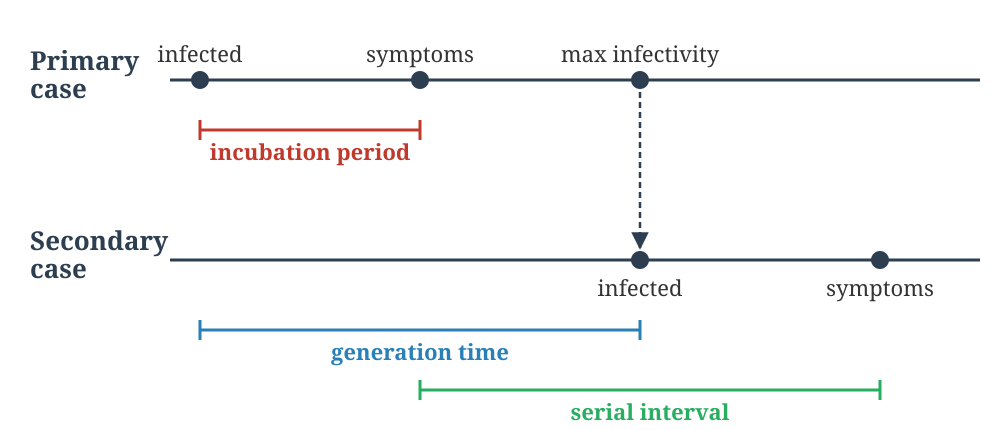
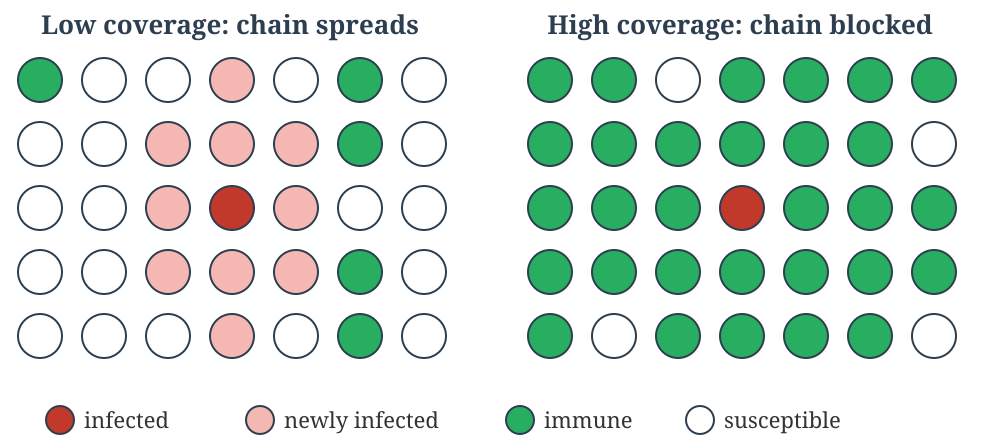
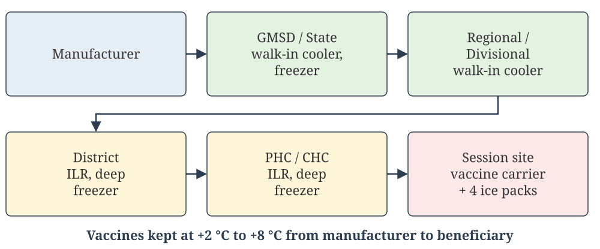
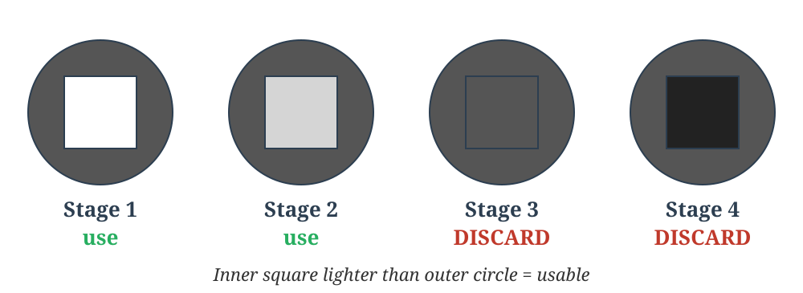
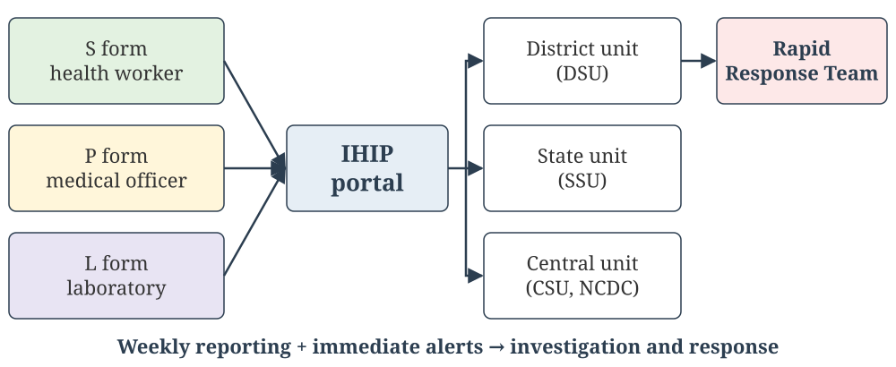

## Welcome {#home}

### Epidemiology of Communicable Diseases

**Learning Objectives (CM7 Lectures 10–13):**

- Describe the dynamics of disease transmission: chain of infection, reservoirs, carriers, modes of transmission, incubation period, SAR, R₀
- Classify immunity; describe immunizing agents, the cold chain and AEFI
- Outline the measures for control of communicable disease and the types and agents of disinfection
- Describe the steps of an epidemic investigation, the types of surveillance, and IDSP/IHIP

**NMC Community Medicine Code:** CM7.2, CM7.7 (also CM8, CM20)

🟢 **MUST KNOW** · 🟡 **SHOULD KNOW** · 🟣 **MAY KNOW** · 🧡 **QUESTION**

::: {.notes}
This chapter applies Chapter 2's levels of prevention and Chapters 3–4's
epidemiological methods to infectious disease, and opens the Diseases
section of the curriculum.
:::

---

## Lecture 10: Infectious Disease Dynamics and Transmission {background-color="#E6EEF5"}

📚 **Lecture 10 of 15** · **CM7.L10**

*Infectious disease epidemiology - dynamics and modes of
transmission*

---

## Recap from Chapter 2: Triad, Causation, Natural History {background-color="#E8E4F3"}

🟣 **RECAP**

| Concept | One-line reminder | Chapter 2 slide |
|---|---|---|
| **Epidemiological triad** | Agent, host and environment interact to produce disease | [The Epidemiological Triad](../foundations/concept-health-disease.qmd#the-epidemiological-triad) |
| **Web of causation** | Many interlinked factors, especially for chronic disease | [Multifactorial Causation](../foundations/concept-health-disease.qmd#multifactorial-causation) |
| **Natural history** | Prepathogenesis → pathogenesis → recovery, disability or death | [Natural History of Disease](../foundations/concept-health-disease.qmd#natural-history-of-disease) |
| **Iceberg phenomenon** | Clinical cases are only the visible tip | [The Iceberg Phenomenon](../foundations/concept-health-disease.qmd#the-iceberg-phenomenon) |

---

## The Chain of Infection {background-color="#E3F2E1"}

🟢 **MUST KNOW**

Communicable disease transmission depends on six linked elements — break
any one link, and transmission stops:

1. **Infectious agent** — the causative organism
2. **Reservoir** — where the agent lives and multiplies (human, animal,
   or environment)
3. **Portal of exit** — how the agent leaves the reservoir (respiratory
   tract, gut, skin, blood)
4. **Mode of transmission** — how it travels to a new host
5. **Portal of entry** — how it enters the new host
6. **Susceptible host** — an individual capable of being infected

---

## Chain of Infection: Visual Summary {background-color="#E3F2E1"}

🟢 **MUST KNOW**

```{=html}
<svg viewBox="0 0 720 460" width="100%" height="auto" role="img" aria-labelledby="chain-title chain-desc" style="max-width:640px;display:block;margin:0 auto;font-family:Georgia,serif;">
<title id="chain-title">The Chain of Infection</title>
<desc id="chain-desc">Six linked stages of disease transmission arranged in a ring: infectious agent, reservoir, portal of exit, mode of transmission, portal of entry, and susceptible host, with arrows showing the cycle and back to the agent.</desc>
<defs>
<marker id="chainArrow" viewBox="0 0 10 10" refX="8" refY="5" markerWidth="7" markerHeight="7" orient="auto-start-reverse">
<path d="M0,0 L10,5 L0,10 z" fill="#555"/>
</marker>
</defs>
<line x1="407.6" y1="87.5" x2="459.4" y2="117.5" stroke="#555" stroke-width="2" marker-end="url(#chainArrow)"/>
<line x1="507" y1="190" x2="507" y2="270" stroke="#555" stroke-width="2" marker-end="url(#chainArrow)"/>
<line x1="459.4" y1="342.5" x2="407.6" y2="372.5" stroke="#555" stroke-width="2" marker-end="url(#chainArrow)"/>
<line x1="312.4" y1="372.5" x2="260.6" y2="342.5" stroke="#555" stroke-width="2" marker-end="url(#chainArrow)"/>
<line x1="213" y1="270" x2="213" y2="190" stroke="#555" stroke-width="2" marker-end="url(#chainArrow)"/>
<line x1="260.6" y1="117.5" x2="312.4" y2="87.5" stroke="#555" stroke-width="2" marker-end="url(#chainArrow)"/>
<g>
<rect x="275" y="25" width="170" height="70" rx="12" fill="#E3F2E1" stroke="#2f7d4f" stroke-width="2"/>
<text x="360" y="52" text-anchor="middle" font-size="15" fill="#1c4a30">1. Infectious</text>
<text x="360" y="72" text-anchor="middle" font-size="15" fill="#1c4a30">Agent</text>
</g>
<g>
<rect x="422" y="110" width="170" height="70" rx="12" fill="#E3F2E1" stroke="#2f7d4f" stroke-width="2"/>
<text x="507" y="150" text-anchor="middle" font-size="15" fill="#1c4a30">2. Reservoir</text>
</g>
<g>
<rect x="422" y="280" width="170" height="70" rx="12" fill="#E3F2E1" stroke="#2f7d4f" stroke-width="2"/>
<text x="507" y="307" text-anchor="middle" font-size="15" fill="#1c4a30">3. Portal of</text>
<text x="507" y="327" text-anchor="middle" font-size="15" fill="#1c4a30">Exit</text>
</g>
<g>
<rect x="275" y="365" width="170" height="70" rx="12" fill="#E3F2E1" stroke="#2f7d4f" stroke-width="2"/>
<text x="360" y="392" text-anchor="middle" font-size="15" fill="#1c4a30">4. Mode of</text>
<text x="360" y="412" text-anchor="middle" font-size="15" fill="#1c4a30">Transmission</text>
</g>
<g>
<rect x="128" y="280" width="170" height="70" rx="12" fill="#E3F2E1" stroke="#2f7d4f" stroke-width="2"/>
<text x="213" y="307" text-anchor="middle" font-size="15" fill="#1c4a30">5. Portal of</text>
<text x="213" y="327" text-anchor="middle" font-size="15" fill="#1c4a30">Entry</text>
</g>
<g>
<rect x="128" y="110" width="170" height="70" rx="12" fill="#E3F2E1" stroke="#2f7d4f" stroke-width="2"/>
<text x="213" y="140" text-anchor="middle" font-size="15" fill="#1c4a30">6. Susceptible</text>
<text x="213" y="160" text-anchor="middle" font-size="15" fill="#1c4a30">Host</text>
</g>
</svg>
```

**Breaking any single link** — e.g. safe water interrupting the portal
of exit/entry, or vaccination removing the susceptible host — stops
transmission around the entire ring, regardless of which link is
targeted.

---

## The Agent in Disease Causation {background-color="#FFF6DA"}

🟡 **SHOULD KNOW**

**Agent**: a substance, living or non-living, whose presence (or absence) is essential for a disease to occur. It is one corner of the **epidemiological triad** of agent, host and environment (Chapter 2).

| Type of agent | Examples |
|---|---|
| **Biological** | Viruses, bacteria, fungi, protozoa, helminths |
| **Nutrient** (excess or deficiency) | Protein-energy malnutrition, obesity, vitamin deficiencies |
| **Physical** | Heat, cold, radiation, noise |
| **Chemical**: endogenous / exogenous | Urea (uraemia), bilirubin / lead, pesticides, allergens |
| **Mechanical** | Injuries, chronic friction |
| **Absence or insufficiency** | Lack of a hormone (insulin), chromosomal factors |
| **Social** | Poverty, smoking, alcohol, stress |

---

## Agent Properties: Infectivity, Pathogenicity, Virulence {background-color="#E3F2E1"}

🟢 **MUST KNOW**

| Property | Meaning | Measured by |
|---|---|---|
| **Infectivity** | Ability to enter, survive and multiply in a host | Secondary attack rate, infection rate |
| **Pathogenicity** | Ability to produce **clinical disease** in those infected | Clinical cases ÷ all infections |
| **Virulence** | **Severity** of the disease produced | **Case fatality rate** |

- **Measles**: high infectivity and pathogenicity, low virulence (except in the malnourished)
- **Polio**: high infectivity, **low pathogenicity** (over 90% of infections are inapparent)
- **Rabies**: virulence close to 100%
- **Infective dose**: the number of organisms needed to cause infection, low for *Shigella* (10–100) and high for *V. cholerae*

---

## Host and Environment in Transmission {background-color="#FFF6DA"}

🟡 **SHOULD KNOW**

**Host factors** decide whether exposure becomes infection and then disease:

- **Portal of entry** and intact barriers (skin, mucosa, gastric acid)
- **Immune status**: past infection, immunization, immunodeficiency
- **Age, sex, nutrition, pregnancy, genetic factors**
- **Behaviour**: hygiene, sexual behaviour, occupation, travel

**Environmental factors:**

- *Physical*: climate, water, housing, crowding
- *Biological*: vectors, animal reservoirs
- *Social*: poverty, sanitation, health services

Agent, host and environment together form the **epidemiological triad**.

---

## Reservoirs of Infection {background-color="#E3F2E1"}

🟢 **MUST KNOW**

**Source** = the person, animal or object from which the agent passes to the host. **Reservoir** = where the agent normally lives and multiplies.

- **Human reservoir**: a **case** (clinical, subclinical or latent) or a **carrier** (infected and shedding but without overt disease)
- **Animal reservoir**: diseases transmitted from vertebrate animals to humans are **zoonoses** (rabies, plague, leptospirosis)
- **Non-living reservoir**: soil and inanimate matter (tetanus spores in soil, *Legionella* in water systems)

---

## Carrier States {background-color="#FFF6DA"}

🟡 **SHOULD KNOW**

A **carrier** is an infected person who sheds the agent without showing overt disease, before or after it. Carriers matter because clinical surveillance often *misses* them.

- **By type:**
  - *incubatory*: sheds during the incubation period (measles, polio)
  - *convalescent*: continues shedding after clinical recovery (typhoid, cholera)
  - *healthy*: sheds without ever having overt disease (polio, meningococcus)
- **By duration:** *temporary* (short-lived shedding) vs *chronic* (indefinite shedding, e.g. typhoid and hepatitis B). Chronic carriers are the greater public-health threat.
- **By portal of exit:** urinary, intestinal, respiratory, nasal

A diagnosed case is usually isolated. An unrecognized chronic carrier keeps transmitting silently.

---

## Epidemic, Endemic, and Pandemic {background-color="#E3F2E1"}

🟢 **MUST KNOW**

| Term | Meaning |
|---|---|
| **Endemic** | Constant, expected presence of a disease in a given area or population, without importation |
| **Sporadic** | Cases occur irregularly and infrequently, with no consistent pattern |
| **Epidemic** | Cases clearly **in excess** of normal expectancy for that place, population and season |
| **Pandemic** | An epidemic spanning several countries or continents, usually affecting large numbers of people |
| **Exotic** | A disease imported into an area where it does not otherwise occur |

**Zoonoses** are classified by direction:

- **anthropozoonoses**: animal → human (rabies, anthrax)
- **zooanthroponoses**: human → animal (human TB in cattle)
- **amphixenoses**: either direction

---

## Modes of Transmission {background-color="#E3F2E1"}

🟢 **MUST KNOW**

:::: {.columns}
::: {.column width="50%"}
**Direct transmission**

- Direct contact (skin, mucosa, sexual): STIs, leprosy, scabies
- Droplet infection (< 1 m): influenza, diphtheria, pertussis
- Contact with soil: hookworm, tetanus
- Inoculation into skin or mucosa: rabies (bite), hepatitis B
- Transplacental (vertical): rubella, syphilis, HIV, toxoplasmosis
:::

::: {.column width="50%"}
**Indirect transmission**

- **Vehicle-borne**: water, food, milk, blood (cholera, typhoid, hepatitis A)
- **Vector-borne**: *mechanical* (flies, typhoid) or *biological*, which is propagative (plague), cyclo-propagative (malaria) or cyclo-developmental (filaria)
- **Airborne**: droplet nuclei (TB, measles), dust
- **Fomite-borne**: towels, utensils (diphtheria, trachoma)
- **Unclean hands and fingers**: faecal-oral spread
:::
::::

---

## Incubation Period and Related Intervals {background-color="#FFF6DA"}

🟡 **SHOULD KNOW**

**Incubation period** is the time from entry of the infectious agent to the first sign or symptom of disease. It depends on the infective dose, portal of entry, host susceptibility and the agent's generation time.

**Uses:** tracing the source of infection, setting the period of **quarantine and surveillance of contacts** (= the longest incubation period), timing immunization and prophylaxis, and identifying point-source vs propagated epidemics.

- **Generation time**: from receipt of infection to the host's maximal infectivity
- **Serial interval**: from onset in the primary case to onset in the secondary case
- **Communicable period**: the time during which an infected person can transmit the agent

---

## Incubation, Generation Time, Serial Interval {background-color="#FFF6DA"}

🟡 **SHOULD KNOW**

{.slide-img .nostretch width="920px"}

---

## Secondary Attack Rate {background-color="#E3F2E1"}

🟢 **MUST KNOW**

**Secondary Attack Rate (SAR)** measures how contagious a disease is within a close-contact group after exposure to a primary case:

`SAR = (New cases among contacts within one incubation period / Total susceptible contacts) × 100`

- **Exclude** the primary case and contacts who are immune (by immunization or past attack) from the denominator
- **Worked example:** a household of 6 has 1 primary measles case and 1 immune member, leaving 4 susceptibles. 2 develop measles within one incubation period, so SAR = 2/4 = **50%**.


---

## Case Scenario: Measles in a Household {background-color="#FDE8E8"}

🧡 **CASE SCENARIO**

A child with measles lives in a household of **7**. The father had measles in childhood. A younger sibling has had **2 doses of MR vaccine**. Of the other 4 members, **one falls ill 2 days later** and **two more fall ill 10–12 days later**.

1. Who are the susceptible contacts?
2. How do you treat the person who fell ill after 2 days?
3. Calculate the secondary attack rate.

---

## Case Scenario: Measles in a Household, Discussion {background-color="#FDE8E8"}

🧡 **CASE SCENARIO: DISCUSSION**

- Exclude the primary case, the immune father and the vaccinated sibling, leaving **4 susceptible contacts**
- Onset after 2 days is **shorter than the minimum incubation period**, so this is a **co-primary case** infected from the same source. Exclude them from both numerator and denominator, leaving **3** susceptibles.
- **SAR** = 2 ÷ 3 × 100 ≈ **67%**

---

## Basic Reproduction Number (R₀) {background-color="#E3F2E1"}

🟢 **MUST KNOW**

**R₀** is the average number of secondary infections produced by one infected person in a **completely susceptible** population.

- **R₀ > 1**: each case generates more than one new case, giving epidemic potential
- **R₀ < 1**: the outbreak is expected to die out
- **R₀ = 1**: the disease remains endemic at a steady rate

R₀ depends on the contact rate, the probability of transmission per contact, and the duration of infectiousness. Measles has an R₀ of about 12–18, and influenza about 1.5–2.

---

## Practice Questions: Descriptive (Lecture 10) {background-color="#FFF6DA"}

**For written practice — work through these on paper; no auto-check for this slide.**

**Short Essay / Short Answer**

1. Write the various modes of disease transmission with examples and control measures for each.
2. Describe the chain of infection (dynamics of disease transmission).

**Short Notes**

3. Secondary attack rate and its calculation.
4. Carriers.
5. Incubation period and its uses.
6. Basic reproduction number (R₀).

---

## Practice Questions: Descriptive (Lecture 10, contd.) {background-color="#FFF6DA"}

**University Examination Questions**

7. Epidemiological triad.
8. Define “agent” in disease causation. Explain the different types of agents.

**Short Notes (additional)**

9. Infectivity, pathogenicity and virulence.
10. Host factors in disease transmission.

---

## Self-Check: Question 1 {background-color="#FDE8E8"}

🧡 **QUESTION**

::: {.quiz-question}
### Question 1

Which of the following is NOT one of the six links in the chain of infection?

- Reservoir
- Portal of exit
- [Herd immunity]{.correct data-explanation="Herd immunity is a population-level protective effect. The six links are agent, reservoir, portal of exit, mode of transmission, portal of entry, and susceptible host."}
- Susceptible host
:::

---

## Self-Check: Question 2 {background-color="#FDE8E8"}

🧡 **QUESTION**

::: {.quiz-question}
### Question 2

Malaria, transmitted from an infected person to a new host via a mosquito, is an example of which mode of transmission?

- Direct contact
- Droplet spread
- [Vector-borne transmission]{.correct data-explanation="Vector-borne transmission occurs when a living arthropod carries the agent between hosts. In malaria it is biological (cyclo-developmental) transmission in the Anopheles mosquito."}
- Fomite transmission
:::

---

## Self-Check: Question 3 {background-color="#FDE8E8"}

🧡 **QUESTION**

::: {.quiz-question}
### Question 3

A typhoid patient continues to excrete S. Typhi in stools for several weeks after clinical recovery. This person is a:

- Incubatory carrier
- [Convalescent carrier]{.correct data-explanation="A convalescent carrier sheds the agent after clinical recovery. If shedding lasts more than a year, the person is a chronic carrier, which is typical of typhoid (gall bladder)."}
- Healthy carrier
- Contact
:::

---

## Self-Check: Question 4 {background-color="#FDE8E8"}

🧡 **QUESTION**

::: {.quiz-question}
### Question 4

In a household of 6, one person develops measles (the primary case). One other member is already immune. Within one incubation period, 2 more members develop measles. The secondary attack rate is:

- 33%
- 40%
- [50%]{.correct data-explanation="SAR = new cases among susceptible contacts ÷ susceptible contacts × 100. The denominator excludes the primary case and the immune member: 6 − 1 − 1 = 4 susceptible contacts. SAR = 2/4 = 50%. Using all 5 contacts (40%) is the classic error."}
- 60%
:::

---

## Self-Check: Question 5 {background-color="#FDE8E8"}

🧡 **QUESTION**

::: {.quiz-question}
### Question 5

The time interval between receipt of infection by a host and maximal infectivity of that host is called the:

- Incubation period
- Serial interval
- [Generation time]{.correct data-explanation="Generation time runs from infection to maximal infectivity. The serial interval is the gap between onsets of primary and secondary cases. The incubation period runs from infection to the first symptom."}
- Communicable period
:::

---

## Self-Check: Question 6 {background-color="#FDE8E8"}

🧡 **QUESTION**

::: {.quiz-question}
### Question 6

If a disease has a basic reproduction number (R₀) of less than 1 in a population, the disease will:

- Spread as an epidemic
- Remain endemic at a stable level
- [Gradually die out]{.correct data-explanation="Each case produces fewer than one new case on average, so transmission chains shorten and the outbreak dies out. R₀ = 1 gives stable endemicity, and R₀ &gt; 1 gives epidemic potential."}
- Become pandemic
:::

---

## Self-Check: Question 7 {background-color="#FDE8E8"}

🧡 **QUESTION**

::: {.quiz-question}
### Question 7

The case fatality rate of a disease is a measure of the agent’s:

- Infectivity
- Pathogenicity
- [Virulence]{.correct data-explanation="Virulence is the severity of disease, measured by the CFR. Infectivity is measured by attack rates, and pathogenicity by clinical cases ÷ infections."}
- Infective dose
:::

---

## Self-Check: Question 8 {background-color="#FDE8E8"}

🧡 **QUESTION**

::: {.quiz-question}
### Question 8

Poliovirus produces paralysis in less than 1% of those it infects. This reflects the virus’s low:

- Infectivity
- [Pathogenicity]{.correct data-explanation="Polio spreads easily (high infectivity), but most infections are inapparent. The ability to cause clinical disease, pathogenicity, is low."}
- Communicability
- Herd immunity
:::

---

## Lecture 11: Immunity and Immunising Agents {background-color="#E6EEF5"}

📚 **Lecture 11 of 15** · **CM7.L11**

*Immunity and immunising agents*

---

## Types of Immunity {background-color="#E3F2E1"}

🟢 **MUST KNOW**

{.slide-img .nostretch width="920px"}

---

## Active vs Passive Immunity {background-color="#E3F2E1"}

🟢 **MUST KNOW**

| | Active immunity | Passive immunity |
|---|---|---|
| **Produced by** | The host's own immune system | Ready-made antibodies from another source |
| **Induced by** | Infection or vaccination | Maternal transfer; immunoglobulins, antisera |
| **Onset** | Slow (lag phase of 1–2 weeks or more) | Immediate |
| **Duration** | Long-lasting (years) | Short (weeks to months) |
| **Memory and boosters** | Immunological memory; boosters effective | No memory |
| **Use** | Prophylaxis | Immediate protection, treatment, immunodeficiency |

**Combined active–passive:** rabies post-exposure (RIG + vaccine) and tetanus-prone wounds (TIG + TT/Td) give immediate *and* lasting protection.

---

## Herd Immunity {background-color="#E3F2E1"}

🟢 **MUST KNOW**

**Herd immunity** is the level of resistance of a community to an infection. When a high proportion is immune, chains of transmission break and even non-immune individuals are protected.

**Herd immunity threshold (HIT):**

`HIT = 1 − (1 / R₀)`

**Example:** a disease with R₀ = 3 needs about 67% of the population immune, and measles (R₀ about 15) needs more than 90%.

- It depends on clinical and subclinical infections, immunization coverage, and the herd structure (density, mixing)
- It does **not** protect against tetanus, which has no person-to-person spread

---

## Herd Immunity: How It Works {background-color="#E3F2E1"}

🟢 **MUST KNOW**

{.slide-img .nostretch width="920px"}

---

## Immunizing Agents {background-color="#FFF6DA"}

🟡 **SHOULD KNOW**

| Agent | What it is | Examples |
|---|---|---|
| **Vaccines** | Antigens that induce **active** immunity | See next slide |
| **Immunoglobulins: normal human** | Pooled human IgG | Hepatitis A, measles post-exposure |
| **Immunoglobulins: specific (hyperimmune) human** | IgG from donors with high specific titres | HBIG, RIG, TIG, VZIG |
| **Antisera / antitoxins** | Animal-derived (usually equine) antibody | Anti-snake venom, anti-diphtheritic serum, equine RIG |

Antisera carry a risk of **serum sickness and anaphylaxis**. Give a test dose and keep adrenaline ready. Human immunoglobulins are preferred where available.

---

## Types of Vaccines {background-color="#FFF6DA"}

🟡 **SHOULD KNOW**

| Type | How it works | Examples |
|---|---|---|
| **Live attenuated** | Weakened live organism; strong, long-lasting immunity from few doses | BCG, OPV, MR/MMR, rotavirus, yellow fever |
| **Killed / inactivated** | Whole organism inactivated; safer in the immunocompromised, but needs boosters | IPV, rabies (cell culture), whole-cell pertussis |
| **Toxoid** | Inactivated bacterial toxin, not the organism | Tetanus, diphtheria |
| **Subunit / recombinant / conjugate** | A specific antigenic component | Hepatitis B, Hib, PCV, HPV |
| **Newer platforms** | mRNA, viral vector | COVID-19 vaccines |

**Exam tip:** live vaccines are generally contraindicated in pregnancy and in immunocompromised people, because the attenuated organism can still replicate.

---

## Cold Chain and AEFI {background-color="#FFF6DA"}

🟡 **SHOULD KNOW**

**Cold chain** is the system of storing and transporting vaccines at recommended temperatures from manufacturer to beneficiary, at **+2 °C to +8 °C**.

- Equipment: walk-in coolers and freezers → ILR and deep freezer (PHC) → cold box → vaccine carrier with conditioned ice packs
- **Heat-sensitive**: OPV (most), measles/MR, BCG. **Freeze-sensitive (never freeze)**: Hep B, pentavalent, DPT, TT/Td, IPV, PCV. Freezing is checked with the **shake test**.
- **Vaccine Vial Monitor (VVM)**: a heat-exposure indicator. Discard the vial when the inner square matches or is darker than the outer circle.

**AEFI (adverse event following immunization):** any untoward medical occurrence after immunization, not necessarily caused by the vaccine.

- WHO causes: vaccine product-related, quality defect-related, **immunization error-related**, **immunization anxiety-related**, and **coincidental**
- Serious AEFIs (death, hospitalization, disability, clusters) must be reported and investigated

---

## The Cold Chain {background-color="#FFF6DA"}

🟡 **SHOULD KNOW**

{.slide-img .nostretch width="920px"}

---

## Vaccine Vial Monitor {background-color="#FFF6DA"}

🟡 **SHOULD KNOW**

{.slide-img .nostretch width="920px"}

Check the VVM before **every** use. The **shake test** detects freezing damage, which the VVM does not show.


---

## Case Scenario: Dog Bite and a Vaccine Carrier {background-color="#FDE8E8"}

🧡 **CASE SCENARIO**

A 25-year-old unimmunized man has **deep bites with bleeding on the hand** from a stray dog (category III). At the PHC, the nurse finds that the inner square of the anti-rabies vaccine VVM **matches the outer circle**.

1. What immunization does he need, and what kind of immunity does each component give?
2. Why give both?
3. Can the vial be used?

---

## Case Scenario: Dog Bite and a Vaccine Carrier, Discussion {background-color="#FDE8E8"}

🧡 **CASE SCENARIO: DISCUSSION**

- **Wound wash** with soap and running water for 15 minutes. **Rabies immunoglobulin** infiltrated into the wounds gives **artificial passive** immunity. **Anti-rabies vaccine** (e.g. IM on days 0, 3, 7, 14, 28, or the intradermal schedule) gives **artificial active** immunity. Add tetanus prophylaxis.
- RIG protects **immediately**, during the 1–2 weeks before vaccine-induced antibody appears. The vaccine gives **lasting** protection. This is **combined passive–active immunization**.
- **No.** A VVM at **stage 3** (square matches circle) means too much heat exposure: **discard** it and use a vial at stage 1 or 2.

---

## Open Vial Policy and the UIP Schedule {background-color="#FFF6DA"}

🟡 **SHOULD KNOW**

**Open Vial Policy (MoHFW, revised Sept 2015):** a partly used multi-dose vial of **DPT, TT/Td, Hepatitis B, OPV, pentavalent or IPV** can be used at later sessions for **up to 28 days** after opening, provided:

- it is within its **expiry date**
- the **VVM** is still usable (stage 1 or 2)
- it was stored at **+2 °C to +8 °C**, not submerged in water and not contaminated
- the **date and time of opening** are written on the vial

**Not covered:** reconstituted vaccines (**BCG, measles/MR, JE**). Discard these at the end of the session, or within 4 hours of reconstitution, whichever is earlier.

The national schedule (UIP, Mission Indradhanush, U-WIN) is in [Lecture 10 of Preventive Medicine](../programs/preventive-medicine.qmd#lecture-10-uip-mission-indradhanush-u-win-and-cold-chain).

*Policy details retrieved 28 Oct 2026. Check the latest MoHFW circular.*

---

## Practice Questions: Descriptive (Lecture 11) {background-color="#FFF6DA"}

**For written practice — work through these on paper; no auto-check for this slide.**

**Short Essay / Short Answer**

1. Classify immunity with examples. Differentiate active and passive immunity.
2. Describe the immunizing agents: vaccines, immunoglobulins and antisera.

**Short Notes**

3. Herd immunity.
4. Cold chain.
5. Adverse events following immunization (AEFI).
6. Live vs killed vaccines.

---

## Practice Questions: Descriptive (Lecture 11, contd.) {background-color="#FFF6DA"}

**Short Notes (additional)**

7. Open vial policy.

---

## Self-Check: Question 9 {background-color="#FDE8E8"}

🧡 **QUESTION**

::: {.quiz-question}
### Question 9

A disease has R₀ = 4. What proportion of the population must be immune to reach the herd immunity threshold?

- 25%
- 50%
- [75%]{.correct data-explanation="HIT = 1 − 1/R₀ = 1 − 1/4 = 0.75, or 75%."}
- 100%
:::

---

## Self-Check: Question 10 {background-color="#FDE8E8"}

🧡 **QUESTION**

::: {.quiz-question}
### Question 10

Immunity acquired by a newborn from maternal antibodies transferred across the placenta is:

- Natural active immunity
- [Natural passive immunity]{.correct data-explanation="Ready-made antibodies from another person give passive immunity, and placental or breast-milk transfer is natural. It is immediate but short-lived (about 6 months)."}
- Artificial active immunity
- Artificial passive immunity
:::

---

## Self-Check: Question 11 {background-color="#FDE8E8"}

🧡 **QUESTION**

::: {.quiz-question}
### Question 11

Administration of tetanus immunoglobulin to an unimmunized patient with a contaminated wound provides:

- Natural active immunity
- Natural passive immunity
- Artificial active immunity
- [Artificial passive immunity]{.correct data-explanation="Ready-made antibody given by injection gives artificial passive immunity: immediate but temporary. The tetanus toxoid given alongside induces artificial active immunity."}
:::

---

## Self-Check: Question 12 {background-color="#FDE8E8"}

🧡 **QUESTION**

::: {.quiz-question}
### Question 12

Which of the following is a live attenuated vaccine?

- Tetanus toxoid
- Hepatitis B vaccine
- [BCG]{.correct data-explanation="BCG, OPV, measles/MR/MMR, rotavirus and yellow fever are live attenuated. TT is a toxoid, Hep B a recombinant subunit, and IPV a killed vaccine."}
- Inactivated polio vaccine (IPV)
:::

---

## Self-Check: Question 13 {background-color="#FDE8E8"}

🧡 **QUESTION**

::: {.quiz-question}
### Question 13

Which of the following vaccines is the MOST heat-sensitive?

- BCG
- [Oral polio vaccine (OPV)]{.correct data-explanation="OPV is the most heat-sensitive vaccine. Freezing does not damage it, so it can be stored frozen at district level. TT, Hep B and pentavalent are freeze-sensitive and must never be frozen."}
- Tetanus toxoid
- Hepatitis B
:::

---

## Self-Check: Question 14 {background-color="#FDE8E8"}

🧡 **QUESTION**

::: {.quiz-question}
### Question 14

The Vaccine Vial Monitor (VVM) on a vial indicates:

- Whether the vaccine has been frozen
- [Cumulative heat exposure of the vial]{.correct data-explanation="The VVM is a heat-sensitive label. If the inner square matches or is darker than the outer circle, the vaccine has had too much heat and must be discarded. Freezing damage is checked with the shake test."}
- The expiry date of the vaccine
- Whether the vial has been opened
:::

---

## Self-Check: Question 15 {background-color="#FDE8E8"}

🧡 **QUESTION (select ALL that apply)**

::: {.quiz-question .quiz-multiple}
### Question 15

Which of the following are recognized causes in the WHO classification of adverse events following immunization (AEFI)?

- [Vaccine product-related reaction]{.correct data-explanation="WHO cause-specific categories: vaccine product-related, vaccine quality defect-related, immunization error-related, immunization anxiety-related, and coincidental events."}
- [Immunization error-related reaction]{.correct}
- [Immunization anxiety-related reaction]{.correct}
- [Coincidental event]{.correct}
:::

---

## Self-Check: Question 16 {background-color="#FDE8E8"}

🧡 **QUESTION**

::: {.quiz-question}
### Question 16

Under India’s Open Vial Policy, which opened vaccine vial must be discarded at the end of the session and cannot be used at a later session?

- Pentavalent
- Hepatitis B
- [Measles-Rubella (MR)]{.correct data-explanation="Reconstituted vaccines (BCG, MR, JE) are discarded at the end of the session or within 4 hours. DPT, TT/Td, Hep B, OPV, pentavalent and IPV can be reused for up to 28 days if the conditions are met."}
- OPV
:::

---

## Lecture 12: Disease Prevention, Control, and Disinfection {background-color="#E6EEF5"}

📚 **Lecture 12 of 15** · **CM7.L12**

*Disease prevention and control; disinfection*

---

## Control of Communicable Diseases {background-color="#E3F2E1"}

🟢 **MUST KNOW**

{.slide-img .nostretch width="920px"}

---

## Controlling the Reservoir {background-color="#E3F2E1"}

🟢 **MUST KNOW**

- **Early diagnosis**: treatment, epidemiological investigation, early control
- **Notification**: legal reporting of notifiable diseases to the health authority. Internationally notifiable events go through the IHR (2005).
- **Epidemiological investigation**: find the source and the contacts
- **Isolation**: separate infected *cases* for their period of communicability
- **Treatment**: cuts the period of communicability, as in TB, leprosy and STIs
- **Quarantine**: restrict healthy *contacts* for the **longest incubation period**
- **Disinfection**: concurrent and terminal (next slides)

---

## Isolation vs. Quarantine {background-color="#FFF6DA"}

🟡 **SHOULD KNOW**

- **Isolation**: separating a person **already known to be infected** from others until they are no longer infectious. Types include standard, strict, respiratory, enteric and contact isolation.
- **Quarantine**: restricting a **healthy person exposed** to a communicable disease, for a period equal to the **longest incubation period**, to see whether disease develops
  - *Absolute (complete) quarantine*: full restriction of movement
  - *Modified quarantine*: selective restriction (e.g. excluding children from school)
  - *Segregation*: separating a group for observation

Both are control measures on different links of the chain. Isolation removes an active source, and quarantine stops transmission from a possible future case.

---

## Levels of Prevention Applied to Communicable Disease {background-color="#E3F2E1"}

🟢 **MUST KNOW**

| Level | Communicable disease example |
|---|---|
| **Primordial** | Improving sanitation and housing before any outbreak risk exists |
| **Primary** | Immunization, chemoprophylaxis, vector control, safe water, health education |
| **Secondary** | Case detection, contact tracing, early treatment, screening (e.g. TB active case finding) |
| **Tertiary** | Disability limitation and rehabilitation from sequelae (e.g. post-polio, leprosy deformities) |

---

## Control, Elimination, Eradication: Recap {background-color="#E8E4F3"}

🟣 **RECAP**

| Term | Meaning | Example |
|---|---|---|
| **Control** | Reduce incidence, prevalence and mortality to a locally acceptable level | Malaria and TB control |
| **Elimination** | Interrupt transmission in a defined area; vigilance continues | Polio-free India (2014), yaws (2016), maternal and neonatal tetanus (2015) |
| **Eradication** | Worldwide termination of infection; the agent no longer exists in nature | **Smallpox** (1980) is the only human example |

Full treatment: [Concept of Control](../foundations/concept-health-disease.qmd#concept-of-control-control-elimination-and-eradication) and [Monitoring, Surveillance, and Evaluation of Control](../foundations/concept-health-disease.qmd#monitoring-surveillance-and-evaluation-of-control) in Chapter 2.

---

## Disinfection: Definitions and Types {background-color="#E3F2E1"}

🟢 **MUST KNOW**

- **Disinfection**: killing infectious agents outside the body by chemical or physical means. Spores may survive.
- **Sterilization**: destruction of **all** microorganisms, including spores
- **Antiseptic**: inhibits or kills organisms on living tissue. **Deodorant**: suppresses odours only.

| Type | When | Example |
|---|---|---|
| **Concurrent** | Immediately, throughout the illness, on infectious discharges and soiled articles | Disinfecting a cholera patient's stools and linen daily |
| **Terminal** | Once, after the patient has gone (recovery, transfer, death) | Cleaning the sickroom, bedding and furniture |
| **Precurrent (prophylactic)** | Before any case, as a preventive measure | Water chlorination, milk pasteurization, hand washing |

---

## Disinfection: Agents and Uses {background-color="#FFF6DA"}

🟡 **SHOULD KNOW**

| Group | Agents | Typical uses |
|---|---|---|
| **Natural** | Sunlight (UV), air | Bedding, mattresses |
| **Physical** | Burning, hot air (oven), **boiling** (15–30 min), **autoclave** (121 °C, 15 lb/in², 15–20 min), radiation | Dressings (burning), glassware (hot air), surgical items (autoclave) |
| **Chemical: halogens** | Bleaching powder (about 33% available chlorine), sodium hypochlorite, chlorine | Water, faeces, urine, floors |
| **Chemical: others** | Phenol and cresol (lysol), alcohols (70%), formaldehyde (fumigation), glutaraldehyde, quaternary ammonium compounds, iodophors | Excreta, skin, rooms, endoscopes |

**Choosing an agent:** consider the target organism, the material, organic load, contact time, toxicity and cost. Biomedical waste is managed under the BMW Management Rules, 2016.

---

## Case Scenario: A Cholera Case at Home {background-color="#FDE8E8"}

🧡 **CASE SCENARIO**

A confirmed cholera case is being treated at home in a village with a shared well. The family of 6 lives in two rooms.

1. What concurrent disinfection is needed?
2. What is done when the patient recovers?
3. How will you manage the contacts and the well?

---

## Case Scenario: A Cholera Case at Home, Discussion {background-color="#FDE8E8"}

🧡 **CASE SCENARIO: DISCUSSION**

- **Concurrent:** disinfect stools and vomit with bleaching powder or hypochlorite before disposal in a latrine. Soak soiled linen in hypochlorite solution or boil it. Wash hands with soap.
- **Terminal:** clean the room, floor and furniture with hypochlorite solution, and wash or sun-dry the bedding
- **Contacts:** surveillance for **5 days** (the maximum incubation), with **selective chemoprophylaxis** for household contacts (e.g. single-dose doxycycline for adults). Mass chemoprophylaxis is *not* recommended.
- **Well:** chlorinate it and test residual chlorine. **Notify** through IDSP, give ORS and health education.


---

## Practice Questions: Descriptive (Lecture 12) {background-color="#FFF6DA"}

**For written practice — work through these on paper; no auto-check for this slide.**

**Short Essay / Short Answer**

1. Describe the methods for the control of communicable diseases: controlling the reservoir, interrupting transmission, and protecting the susceptible host.
2. Define disinfection. Describe its types and the agents used, with their applications.

**Short Notes**

3. Isolation vs quarantine.
4. Concurrent and terminal disinfection.
5. Chemoprophylaxis.

---

## Self-Check: Question 17 {background-color="#FDE8E8"}

🧡 **QUESTION**

::: {.quiz-question}
### Question 17

A person who was exposed to a confirmed case, but has no symptoms and unknown infection status, is placed in separate accommodation for the incubation period of the disease. This is:

- Isolation
- [Quarantine]{.correct data-explanation="Quarantine applies to exposed but not-yet-confirmed individuals, for the longest incubation period of the disease. Isolation applies to known cases."}
- Ring vaccination
- Contact tracing
:::

---

## Self-Check: Question 18 {background-color="#FDE8E8"}

🧡 **QUESTION**

::: {.quiz-question}
### Question 18

Disinfection of the sickroom, its contents and bedding after the patient has been removed by recovery, death or transfer is called:

- Concurrent disinfection
- [Terminal disinfection]{.correct data-explanation="Terminal disinfection is done once, after the source has gone. Concurrent disinfection is applied immediately to infectious discharges during the illness. Precurrent (prophylactic) disinfection is done in advance, as with water chlorination."}
- Precurrent disinfection
- Sterilization
:::

---

## Self-Check: Question 19 {background-color="#FDE8E8"}

🧡 **QUESTION**

::: {.quiz-question}
### Question 19

Chlorination of a community water supply is an example of:

- Concurrent disinfection
- Terminal disinfection
- [Precurrent (prophylactic) disinfection]{.correct data-explanation="Precurrent disinfection is a preventive measure applied before any case occurs: water chlorination, pasteurization, hand washing."}
- Sterilization
:::

---

## Self-Check: Question 20 {background-color="#FDE8E8"}

🧡 **QUESTION**

::: {.quiz-question}
### Question 20

Giving rifampicin to the household contacts of a case of meningococcal meningitis is an example of:

- Controlling the reservoir
- Interrupting transmission
- [Chemoprophylaxis to protect the susceptible host]{.correct data-explanation="Chemoprophylaxis, giving a drug to prevent infection or disease, protects susceptible contacts. Isolation and treatment of the case act on the reservoir."}
- Active immunization
:::

---

## Self-Check: Question 21 {background-color="#FDE8E8"}

🧡 **QUESTION**

::: {.quiz-question}
### Question 21

Which measure acts on the RESERVOIR link of the chain of infection?

- [Early diagnosis and treatment of cases]{.correct data-explanation="Early diagnosis, notification, isolation, treatment and quarantine control the reservoir. Vector control and water treatment interrupt transmission. Immunization protects the susceptible host."}
- Vector control
- Water chlorination
- Immunization of contacts
:::

---

## Lecture 13: Epidemic Investigation and Surveillance {background-color="#E6EEF5"}

📚 **Lecture 13 of 15** · **CM7.L13**

*Investigation of an epidemic; surveillance (IDSR / IHIP)*

---

## Outbreak Investigation: The 10 Steps {background-color="#E3F2E1"}

🟢 **MUST KNOW**

The standard CDC-style sequence for investigating a suspected outbreak:

1. Prepare for field work
2. Establish the existence of an outbreak (compare with expected numbers)
3. Verify the diagnosis
4. Define and identify cases (case definition, active case search)
5. Describe data by time, place and person (epidemic curve, spot map)
6. Develop hypotheses
7. Evaluate hypotheses (case-control or cohort study)
8. Refine hypotheses and conduct additional studies (laboratory, environmental)
9. Implement control and prevention measures
10. Communicate findings (report)

In practice the steps overlap. Control measures often start before the investigation formally ends. Park and the textbook put **verification of the diagnosis** as the *very first* step (next slide).

---

## Investigation of an Epidemic: Park's Steps {background-color="#E3F2E1"}

🟢 **MUST KNOW**

1. **Verification of the diagnosis**: clinical examination of a sample of cases, plus laboratory confirmation
2. **Confirmation of the existence of an epidemic**: compare with the same period of the **previous 3 years**
3. **Defining the population at risk**: a map of the area, and the population denominator
4. **Rapid search for all cases**: a **line list** (nominal roll of reported cases), active house-to-house search, and the epidemiological case sheet
5. **Data analysis**: time (epidemic curve), place (spot map), person (age, sex, occupation)
6. **Formulation of a hypothesis**: source, mode of spread, population affected
7. **Testing the hypothesis**: compare attack rates in the exposed and unexposed (case-control or cohort)
8. **Evaluation of ecological factors**: sanitation, water, vectors, food handling
9. **Further investigation of the population at risk**: e.g. serological surveys
10. **Writing the report**: with control measures and recommendations


---

## Case Scenario: Typhoid in One Locality {background-color="#FDE8E8"}

🧡 **CASE SCENARIO**

A health officer sees that reported **typhoid** cases in a town have **doubled** this month compared with the same month last year. **Most cases cluster in one locality.**

1. What epidemiological phenomenon is suggested?
2. Which measure of frequency is being compared?
3. What is the first step of investigation?
4. Name two possible sources of infection.
5. How does epidemiology help plan control?

---

## Case Scenario: Typhoid in One Locality, Discussion {background-color="#FDE8E8"}

🧡 **CASE SCENARIO: DISCUSSION**

- An **epidemic (outbreak)**: cases clearly in excess of the expected level. The clustering suggests a **common source**.
- **Incidence** (new cases, i.e. an attack rate), compared with the same period in previous years (ideally 3)
- **Verify the diagnosis** (blood culture), then **confirm the existence of the epidemic**
- A **contaminated water supply** (a leaking pipe with sewage cross-connection), or **food from a common vendor or a carrier food handler**
- Time-place-person analysis (spot map, epidemic curve) pinpoints the source, which is then targeted: chlorination and pipe repair, food hygiene, treating cases and carriers, typhoid conjugate vaccine for high-risk groups, health education and continued surveillance.

---

## The Epidemiological Case Sheet {background-color="#FFF6DA"}

🟡 **SHOULD KNOW**

A standard case investigation form is filled for every case during an epidemic. It records:

- **Identification**: name, age, sex, address (for spot mapping), occupation
- **Clinical**: date of onset (for the epidemic curve), symptoms, signs, severity, outcome
- **Exposure history**: food, water, travel, gatherings, animal or vector contact within the incubation period
- **Contacts**: household and others, with their immunization or prophylaxis status
- **Laboratory**: specimens taken, results
- **Investigator**: name and date

Aggregating case sheets gives the time-place-person description from which hypotheses are formed.

---

## Surveillance: Definition and Types {background-color="#E3F2E1"}

🟢 **MUST KNOW**

**Surveillance** is the continuous, systematic collection, analysis and interpretation of health data, with timely dissemination to those who need to know, *for action*. In short: "information for action".

| Type | How it works | Example |
|---|---|---|
| **Passive** | Cases reported by health facilities on their own; cheap, under-reports | Routine IDSP reporting |
| **Active** | Health workers actively search for cases | House-to-house fever surveillance (malaria) |
| **Sentinel** | Selected sites report systematically; detects trends | HIV sentinel surveillance, AFP sites |
| **Syndromic** | Reporting by syndrome before lab confirmation | IDSP "S" form |
| **Laboratory-based / event-based** | Confirmed isolates; media and community alerts | IDSP "L" form, media scanning |

---

## Monitoring vs Surveillance {background-color="#E3F2E1"}

🟢 **MUST KNOW**

| | Monitoring | Surveillance |
|---|---|---|
| **Definition** | Ongoing measurement of an **activity or programme** to check that it runs as planned | Continuous scrutiny of **disease occurrence and its determinants**, *for action* |
| **Focus** | Inputs, process, outputs, coverage | Cases, deaths, risk factors, trends |
| **Example** | Monthly immunization coverage, drug stock, sessions held | AFP surveillance, IDSP weekly reports |
| **Leads to** | Correcting implementation | Outbreak response, control measures |

**Evaluation** is periodic: it judges whether the programme achieved its **objectives** (effectiveness, efficiency, impact).

---

## Notifiable Diseases, IHR, and Epidemic Thresholds {background-color="#FFF6DA"}

🟡 **SHOULD KNOW**

- **Notifiable diseases**: diseases that must legally be reported to health authorities.
  - Internationally under the **IHR**.
  - Nationally and by state: e.g. cholera, plague, TB (notifiable in India since 2012), AFP and polio, measles, diphtheria, dengue, Japanese encephalitis, and others as listed by each state.
- **International Health Regulations (2005)**: legally binding on WHO member states. Every country has a **National IHR Focal Point** (NCDC, India), which must notify WHO **within 24 hours** of any event that may be a **Public Health Emergency of International Concern (PHEIC)**, assessed with the IHR decision instrument.
  - Always notifiable: smallpox, wild polio, new human influenza subtype, SARS.
  - Core capacities are required at points of entry.
- **Epidemic threshold**: an alert level beyond which cases signal an outbreak, commonly the **mean + 2 SD** of the same weeks in previous years. IDSP flags clustering or rising trends for the Rapid Response Team.

---

## IDSP, IHIP, and IDSR {background-color="#E3F2E1"}

🟢 **MUST KNOW**

- **IDSP (Integrated Disease Surveillance Programme)**, launched in **2004**, is a decentralized, laboratory-supported surveillance of epidemic-prone diseases. It has Rapid Response Teams at district and state level, and weekly reporting (Monday to Sunday).
- Reporting formats:
  - **S** (syndromic: health workers, e.g. ASHA/MPW)
  - **P** (presumptive: medical officers)
  - **L** (laboratory-confirmed)
- **IHIP (Integrated Health Information Platform)** is a web and mobile platform with near-real-time, case-based, GIS-enabled reporting. It was piloted from 2018 and rolled out nationwide in **April 2021**, replacing paper IDSP formats.
- **IDSR (Integrated Disease Surveillance and Response)** is the WHO strategy (first adopted in the African Region) linking surveillance to **response** at every level. India's IDSP/IHIP follows the same "surveillance for response" principle.

*IHIP launch dates differ between sources: soft launch 2018, nationwide April 2021. Retrieved 28 Oct 2026.*

---

## IDSP Reporting Flow {background-color="#E3F2E1"}

🟢 **MUST KNOW**

{.slide-img .nostretch width="920px"}

---

## Health Surveys {background-color="#FFF6DA"}

🟡 **SHOULD KNOW**

| Type | Gives | Note |
|---|---|---|
| **Cross-sectional** | Prevalence | Quick one-time snapshot |
| **Longitudinal** | **Exact incidence**, natural history | Repeated observation of the same population |
| **Hybrid** | Both | A cross-sectional baseline plus follow-up |
| **Hospital-based** | Clinical patterns | Not representative of the community |

- **Universe** (reference population) → study population → **sample**. Findings are generalized to the universe.
- **Analysis of a community (descriptive) survey:** frequency distributions by age and sex, line diagrams of seasonal variation, and spot maps. Stratified analysis for confounding belongs to *analytical* studies.
- **Ethics:** **informed consent**, **confidentiality**, and a **health-care benefit** such as treatment or referral for conditions found. A cash benefit is *not* an ethical requirement.

---

## Computers and Digital Health in Epidemiology {background-color="#E8E4F3"}

🟣 **MAY KNOW**

- **Software:**
  - **Epi Info** (CDC, with WHO): free; questionnaires, outbreak analysis, maps
  - SPSS, STATA, R for statistics
  - Excel (spreadsheet) for budgets and line lists
  - Access, FoxPro, dBase for databases
- **PACS** (Picture Archiving and Communication System) transmits radiology images for quick remote diagnosis
- **India's digital health:**
  - **IHIP** (surveillance)
  - **CoWIN** (COVID-19 vaccination registration; now **U-WIN** for routine immunization)
  - **Aarogya Setu** (COVID-19 self-assessment and contact tracing)
  - **NDHM** (announced 15 Aug 2020), relaunched in Sept 2021 as the **Ayushman Bharat Digital Mission (ABDM)**: ABHA health IDs, health records, and registries of facilities and professionals
  - eSanjeevani telemedicine
- **Helplines:** 14567 (Elderline, senior citizens), 102 (ambulance), 1075 (COVID-19)

---

## Explore: Selected Diseases in Depth {background-color="#E8E4F3"}

🟣 **MAY KNOW**

The principles above apply to every communicable disease. Six specific
diseases are covered in dedicated modules, each with agent, clinical
features, diagnosis, treatment and control in full depth:

[**Malaria**](cd/module1_malaria.html) · [**Typhoid Fever &
Cholera**](cd/module2_typhoid_cholera.html) · [**Viral
Hepatitis**](cd/module3_viral_hepatitis.html) ·
[**Poliomyelitis**](cd/module4_poliomyelitis.html) · [**Food Poisoning &
Diarrhoeal Disease**](cd/module5_food_poisoning.html) ·
[**Hospital-Acquired Infections**](cd/module6_hospital_acquired_infections.html)

Or browse the [module hub](cd.html) for an overview of all six.

---

## Practice Questions: Descriptive (Lecture 13) {background-color="#FFF6DA"}

**For written practice — work through these on paper; no auto-check for this slide.**

**Short Essay / Short Answer**

1. Describe the steps in the investigation of an epidemic.
2. Define surveillance. Describe its types and the Integrated Disease Surveillance Programme (IDSP/IHIP).

**Short Notes**

3. Epidemiological case sheet for investigation of an epidemic.
4. Sentinel surveillance.

---

## Practice Questions: Descriptive (Lecture 13, contd.) {background-color="#FFF6DA"}

**Case Scenario**

5. A health officer observes that the number of reported cases of typhoid fever in a town has doubled over the past month compared to the same period last year. Most cases are clustered around a specific locality.
   a. What epidemiological phenomenon is suggested by this observation?
   b. Which measure of disease frequency is being used for comparison?
   c. What is the first step the health officer should take to investigate this situation?
   d. Mention two possible sources of infection in this locality.
   e. How does epidemiology help in planning control measures in such situations?

**University Examination Questions**

6. Enumerate the different types of epidemics. Write down the steps in the investigation of an epidemic.
7. Monitoring and surveillance.

---

## Practice Questions: Descriptive (Lecture 13, contd.) {background-color="#FFF6DA"}

**Short Notes (additional)**

8. Monitoring vs surveillance.
9. International Health Regulations (2005).
10. Notifiable diseases.

---

## Self-Check: Question 22 {background-color="#FDE8E8"}

🧡 **QUESTION**

::: {.quiz-question}
### Question 22

In the standard outbreak-investigation sequence, “develop hypotheses” comes immediately after which step?

- Verify the diagnosis
- [Describe data by time, place, and person]{.correct data-explanation="Descriptive epidemiology (time, place, person) generates hypotheses about the outbreak’s source, which is the very next step."}
- Implement control measures
- Communicate findings
:::

---

## Self-Check: Question 23 {background-color="#FDE8E8"}

🧡 **QUESTION**

::: {.quiz-question}
### Question 23

On the IHIP platform under IDSP, the “P” form is used to report:

- Patients admitted to hospital
- [Presumptive cases diagnosed by clinicians]{.correct data-explanation="S form: syndromic cases (health workers). P form: presumptive cases (medical officers/clinicians). L form: laboratory-confirmed cases."}
- Polio cases only
- Private-sector laboratory results
:::

---

## Self-Check: Question 24 {background-color="#FDE8E8"}

🧡 **QUESTION**

::: {.quiz-question}
### Question 24

Surveillance in which health workers make house-to-house visits to search for fever cases and collect blood smears is:

- Passive surveillance
- [Active surveillance]{.correct data-explanation="Active surveillance means health workers go out and seek cases (e.g. ASHA/MPW fever surveillance for malaria). Passive surveillance relies on cases reporting to health facilities."}
- Sentinel surveillance
- Syndromic surveillance
:::

---

## Self-Check: Question 25 {background-color="#FDE8E8"}

🧡 **QUESTION**

::: {.quiz-question}
### Question 25

Selected reporting sites that systematically report a specific disease, used to detect trends that routine reporting misses, constitute:

- Passive surveillance
- Active surveillance
- [Sentinel surveillance]{.correct data-explanation="Sentinel surveillance uses selected sites (often hospitals or labs), such as HIV sentinel surveillance and AFP sentinel sites. It is useful for trends and for filling gaps in notification."}
- Census
:::

---

## Self-Check: Question 26 {background-color="#FDE8E8"}

🧡 **QUESTION**

::: {.quiz-question}
### Question 26

The very first step in the investigation of an epidemic is:

- Confirmation of the existence of an epidemic
- [Verification of the diagnosis]{.correct data-explanation="Park and the textbook put verification of the diagnosis first, because there is no point counting cases of the wrong disease. Confirmation of an epidemic follows. The CDC 10-step list puts “establish the existence of an outbreak” before “verify the diagnosis”, and in practice the two are done together."}
- Development of an epidemiological case sheet
- Formulation of a hypothesis
:::

---

## Self-Check: Question 27 {background-color="#FDE8E8"}

🧡 **QUESTION**

::: {.quiz-question}
### Question 27

A nominal roll of the cases already reported to health-care establishments (dispensaries, general practitioners, hospitals) up to the present moment would form a:

- [Line list]{.correct data-explanation="A line list has one row per case, with key variables (name, age, sex, address, date of onset). It is the starting point for time-place-person analysis."}
- Epidemiological list
- Case summary
- Secondary data
:::

---

## Self-Check: Question 28 {background-color="#FDE8E8"}

🧡 **QUESTION**

::: {.quiz-question}
### Question 28

To call a health-related event an epidemic, the incidence rate is computed and compared with the rate in the same population during the corresponding period of the past:

- 1 year
- [3 years]{.correct data-explanation="The usual comparison is with the same period (e.g. the same month) over the previous 3 years. Cases clearly above that expected level suggest an epidemic."}
- 10 years
- No specific time frame is laid down
:::

---

## Self-Check: Question 29 {background-color="#FDE8E8"}

🧡 **QUESTION**

::: {.quiz-question}
### Question 29

An epidemic is described in all of the following ways, EXCEPT according to:

- Time characteristics
- [International characteristics]{.correct data-explanation="Descriptive analysis of an epidemic uses time (epidemic curve), place (spot map) and person (age, sex, occupation)."}
- Person characteristics
- Place characteristics
:::

---

## Self-Check: Question 30 {background-color="#FDE8E8"}

🧡 **QUESTION**

::: {.quiz-question}
### Question 30

Once the source of infection in an epidemic is identified, all of the following are measures for control and prevention of the SOURCE, EXCEPT:

- [Vector control]{.correct data-explanation="Notification, isolation and treatment of cases and carriers act on the source (reservoir). Vector control interrupts the route of transmission."}
- Notification
- Isolation, if required
- Detection and treatment of cases and carriers
:::

---

## Self-Check: Question 31 {background-color="#FDE8E8"}

🧡 **QUESTION**

::: {.quiz-question}
### Question 31

Which type of survey provides an exact estimate of incidence?

- Hospital-based survey
- Hybrid survey
- Cross-sectional survey
- [Longitudinal survey]{.correct data-explanation="Only repeated observation of the same population over time (longitudinal) captures new cases. A cross-sectional survey gives prevalence."}
:::

---

## Self-Check: Question 32 {background-color="#FDE8E8"}

🧡 **QUESTION**

::: {.quiz-question}
### Question 32

Which of the following is generally NOT undertaken in the analysis of a community-based (descriptive) survey?

- [Stratified analysis for control of confounding]{.correct data-explanation="A descriptive survey describes frequency by time, place and person. Stratified analysis to control confounding belongs to analytical (hypothesis-testing) studies."}
- Line diagram showing seasonal variation in important diseases
- Percentage-wise distribution according to age
- Spot map showing the main residential and work areas
:::

---

## Self-Check: Question 33 {background-color="#FDE8E8"}

🧡 **QUESTION**

::: {.quiz-question}
### Question 33

The large collection of humanity to which the findings of a survey will be generalized is called the:

- Study population
- Sample population
- [Universe]{.correct data-explanation="Universe = reference = target population. The study population is the accessible subset, and the sample is drawn from it."}
- Common population
:::

---

## Self-Check: Question 34 {background-color="#FDE8E8"}

🧡 **QUESTION**

::: {.quiz-question}
### Question 34

All of the following are important ethical issues to be addressed in a proposed survey, EXCEPT:

- [Provision of a cash benefit]{.correct data-explanation="Ethical surveys need informed consent, confidentiality, and care or referral for conditions found. A cash inducement is not an ethical requirement and can be coercive."}
- Provision of a health-care benefit
- Confidentiality
- Informed consent
:::

---

## Self-Check: Question 35 {background-color="#FDE8E8"}

🧡 **QUESTION**

::: {.quiz-question}
### Question 35

The ongoing collection, analysis and feedback of data related to a particular disease or group of diseases is:

- Longitudinal survey
- Cross-sectional survey
- [Surveillance]{.correct data-explanation="Surveillance is continuous, systematic collection, analysis, interpretation and dissemination of data for action."}
- Ecological study
:::

---

## Self-Check: Question 36 {background-color="#FDE8E8"}

🧡 **QUESTION**

::: {.quiz-question}
### Question 36

Which of the following is NOT a database program?

- Access
- FoxPro
- [Excel]{.correct data-explanation="Excel is a spreadsheet. Access, FoxPro and dBase are database management programs."}
- dBase
:::

---

## Self-Check: Question 37 {background-color="#FDE8E8"}

🧡 **QUESTION**

::: {.quiz-question}
### Question 37

“PACS” is a system used in health care for:

- Making presentations
- Searching literature for medical research
- [Transmitting images for quick diagnosis]{.correct data-explanation="PACS (Picture Archiving and Communication System) stores and transmits radiology images digitally, which supports teleradiology."}
- Accreditation of hospitals
:::

---

## Self-Check: Question 38 {background-color="#FDE8E8"}

🧡 **QUESTION**

::: {.quiz-question}
### Question 38

Which statistical analysis package was developed by CDC Atlanta and WHO for analysing health research data?

- [EPI-Info]{.correct data-explanation="Epi Info is free public-domain software from CDC (developed with WHO) for questionnaires, databases, outbreak analysis and mapping."}
- SPSS
- STATA
- MINITAB
:::

---

## Self-Check: Question 39 {background-color="#FDE8E8"}

🧡 **QUESTION**

::: {.quiz-question}
### Question 39

A Microsoft package for basic financial management in health care is:

- Word
- PowerPoint
- Access
- [Excel]{.correct data-explanation="Excel (a spreadsheet) is used for budgets and accounts."}
:::

---

## Self-Check: Question 40 {background-color="#FDE8E8"}

🧡 **QUESTION**

::: {.quiz-question}
### Question 40

During the COVID-19 pandemic, a unique feature in health care was the development of various modalities for:

- Applications informing the community about the disease’s symptoms
- Developing a database of hospitals
- Development of PPE
- [Teaching and training of medical students]{.correct data-explanation="The textbook&#x27;s answer: online and digital teaching and training of medical students expanded on a large scale during the pandemic."}
:::

---

## Self-Check: Question 41 {background-color="#FDE8E8"}

🧡 **QUESTION**

::: {.quiz-question}
### Question 41

Registration for COVID-19 vaccination could be done using:

- [CoWIN]{.correct data-explanation="CoWIN handled COVID-19 vaccine registration, scheduling and certificates. Its platform is now used for routine immunization as U-WIN."}
- Aarogya Setu
- IDSP portal
- UIP portal
:::

---

## Self-Check: Question 42 {background-color="#FDE8E8"}

🧡 **QUESTION**

::: {.quiz-question}
### Question 42

The National Digital Health Mission (NDHM) was launched in:

- 2001
- 2014
- 2019
- [2020]{.correct data-explanation="NDHM was announced on 15 August 2020 and relaunched nationwide as the Ayushman Bharat Digital Mission (ABDM) in September 2021, with ABHA health IDs."}
:::

---

## Self-Check: Question 43 {background-color="#FDE8E8"}

🧡 **QUESTION**

::: {.quiz-question}
### Question 43

The Aarogya Setu app is concerned with:

- Free cashless services for families below the poverty line
- [Assessing one’s own risk of COVID-19]{.correct data-explanation="Aarogya Setu provided contact tracing, self-assessment of COVID-19 risk and alerts."}
- Vaccination
- Portable health care for treatment anywhere in the country
:::

---

## Self-Check: Question 44 {background-color="#FDE8E8"}

🧡 **QUESTION**

::: {.quiz-question}
### Question 44

The national helpline number launched around Republic Day 2021 is:

- 102
- 1075
- 1078
- [14567]{.correct data-explanation="The textbook&#x27;s answer is 14567 (Elderline, the national helpline for senior citizens). 102 is the ambulance service for pregnant women and infants, and 1075 the national COVID-19 helpline."}
:::

---

## Self-Check: Question 45 {background-color="#FDE8E8"}

🧡 **QUESTION**

::: {.quiz-question}
### Question 45

Which of the following functions will NOT be possible through the NDHM (now ABDM)?

- Knowing the medical history of a person
- [Predicting a person’s risk of suffering from diseases]{.correct data-explanation="ABDM provides ABHA health IDs, linked health records, and registries of facilities and professionals, with anonymized data for research. Individual disease-risk prediction is not one of its functions."}
- Undertaking health research
- Obtaining a database of health-care facilities
:::

---

## Self-Check: Question 46 {background-color="#FDE8E8"}

🧡 **QUESTION**

::: {.quiz-question}
### Question 46

Regularly checking the monthly immunization coverage and vaccine stock of a PHC against targets is an example of:

- Surveillance
- [Monitoring]{.correct data-explanation="Monitoring tracks programme inputs, processes and outputs. Surveillance tracks disease occurrence for action. Evaluation periodically judges achievement of objectives."}
- Evaluation
- Screening
:::

---

## Self-Check: Question 47 {background-color="#FDE8E8"}

🧡 **QUESTION**

::: {.quiz-question}
### Question 47

Under the International Health Regulations (2005), a country must notify WHO of an event that may constitute a PHEIC within:

- [24 hours]{.correct data-explanation="The National IHR Focal Point (NCDC in India) must notify WHO within 24 hours of assessment. Smallpox, wild poliovirus, a new human influenza subtype and SARS are always notifiable."}
- 72 hours
- 7 days
- 1 month
:::

---

## Lecture: Emerging Infections and AMR {background-color="#E6EEF5"}

📚 **CM20.1-20.3, Lecture 1 of 3** · **CM20.2**

*Emerging and re-emerging infections; antimicrobial resistance*

---

## Emerging and Re-emerging Infections {background-color="#E8E4F3"}

🟣 **MAY KNOW**

- **Emerging infectious diseases** — newly identified, or newly
  significant, infections in a population (e.g. a novel pathogen)
- **Re-emerging infectious diseases** — previously controlled diseases
  that increase again (e.g. due to declining vaccination coverage,
  antimicrobial resistance, or ecological change)

Both categories are driven by similar factors: urbanization, travel,
climate change, land-use change, and breakdowns in public health
infrastructure.

**Antimicrobial resistance (AMR)** is itself both a driver of
re-emergence (drug-resistant TB, gonorrhoea) and a public health
threat in its own right — covered in depth, including the One
Health framing of AMR spread through water and livestock, in the
[One Health module](../environment/env_health/module1_one_health.html).

---

## Lecture: Recent Public Health Events {background-color="#E6EEF5"}

📚 **CM20.1-20.3, Lecture 2 of 3** · **CM20.1/CM20.3**

*Important public health events of the last five years; issues
during outbreaks*

---

## Recent Public Health Events {background-color="#E8E4F3"}

🟣 **MAY KNOW**

Beyond COVID-19 (covered in the CD modules), recent public health
events worth being able to discuss:

- **Mpox (monkeypox)** — declared a Public Health Emergency of
  International Concern (PHEIC) in 2022 and again in 2024, illustrating
  the PHEIC mechanism (Chapter 26) in real time
- **Nipah virus outbreaks** (Kerala, recurring since 2018) — a
  bat-borne zoonosis with high case-fatality, testing India's rapid
  outbreak-response systems
- **Zika virus** — periodic clusters in India, relevant to the vector-
  borne disease content in this module

**Common issues during outbreaks:** delayed reporting, public
misinformation, supply-chain strain on PPE/vaccines/diagnostics, and
balancing containment measures against economic/social disruption —
the same operational challenges the 10-step outbreak investigation
above is designed to manage systematically rather than reactively.

---

## Lecture 1: Smallpox Eradication {background-color="#E6EEF5"}

📚 **Lecture 1 of 28** · **CM8-CD.L1**

*Smallpox eradication; chickenpox (chickenpox covered in
[Module 13](cd/module13_other_infections.html))*

---

## Smallpox Eradication {background-color="#E8E4F3"}

🟣 **MAY KNOW**

Smallpox remains the only human disease ever declared **eradicated**
(WHO, 1980), achieved through a global vaccination campaign combined with
**surveillance-containment** ("ring vaccination" around each detected
case) rather than mass vaccination alone. It remains the reference case
study for what a successful global eradication program requires: an
effective vaccine, no animal reservoir, and a recognizable, short-lived
infectious stage.

---

## Self-Check: Question 48 {background-color="#FDE8E8"}

🧡 **QUESTION**

::: {.quiz-question}
### Question 48

Smallpox eradication (1980) is the only successful human disease eradication to date. Which factor was essential to its success?

- Mass vaccination of the entire world population simultaneously
- [An effective vaccine combined with surveillance and ring vaccination around detected cases, with no animal reservoir]{.correct data-explanation="Smallpox eradication relied on a highly effective vaccine, surveillance-containment (ring vaccination), and the absence of any animal reservoir."}
- Herd immunity reaching exactly 50%
- Elimination of the mosquito vector
:::

---

## References {background-color="#FFF6DA"}

1. Park, K. *Park's Textbook of Preventive and Social Medicine* (latest ed.): dynamics of disease transmission, carriers, immunity and immunizing agents, control, disinfection, investigation of an epidemic, surveillance.
2. Centers for Disease Control and Prevention. *Steps of an Outbreak Investigation*; NCBI Bookshelf, *Chain of Infection*.
3. Ministry of Health and Family Welfare. *Integrated Disease Surveillance Programme* and *IHIP* (ihip.mohfw.gov.in); IHIP launch dates from MoHFW and IJFCM sources. Retrieved 28 Oct 2026.
4. MoHFW. *Immunization Handbook for Medical Officers* and *AEFI Surveillance and Response Operational Guidelines*; WHO, *Causality assessment of an AEFI* (2nd ed., 2018).
5. WHO-AFRO / CDC. *Technical Guidelines for Integrated Disease Surveillance and Response (IDSR)*.
6. World Health Organization (1980). *Declaration of Global Eradication of Smallpox*.

**Want to practice?** The [Epidemiology Question Bank](../foundations/epidemiology-question-bank.qmd) has every CM7 question with answer keys.

---

## Thank You!

**Next Chapter:** Epidemiology of Chronic Non-Communicable Diseases

[← Previous](../foundations/screening.html) | [Top](#home) | [Contents](../intro.html) | Chapter 6/29 | [Next Chapter →](ncd.html)
