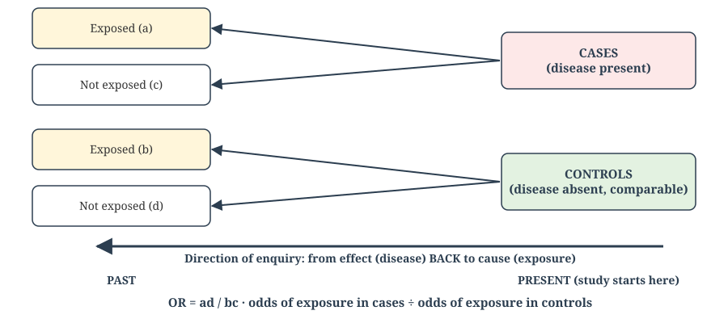
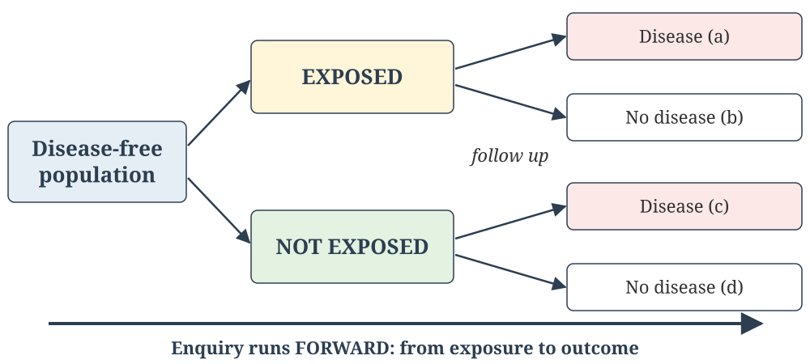
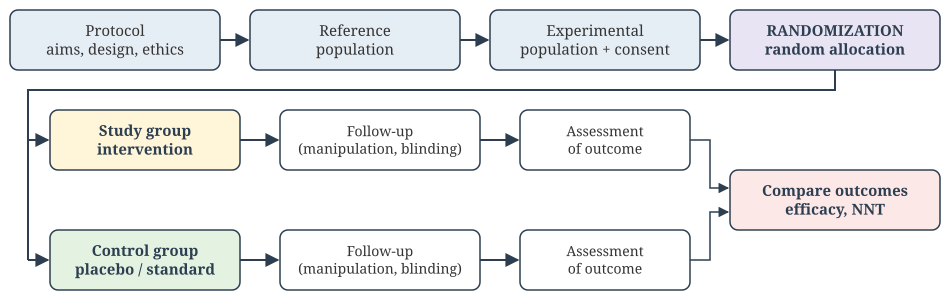
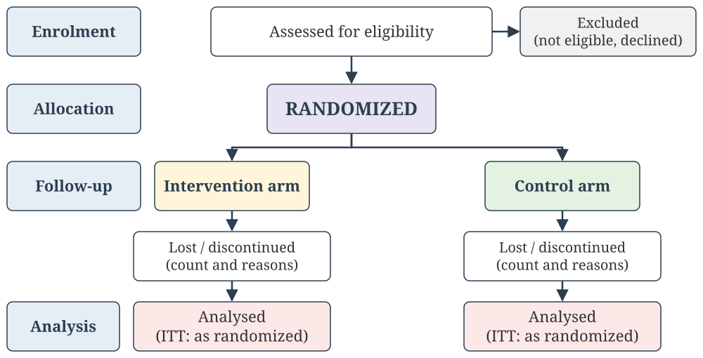
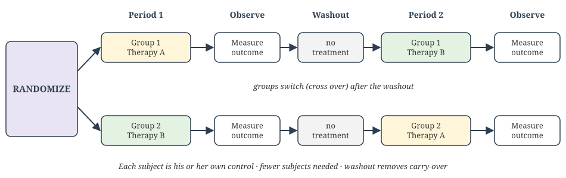
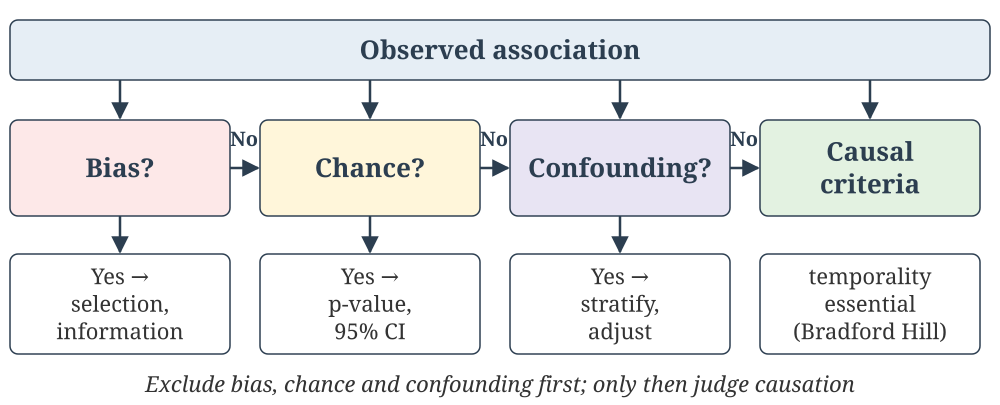
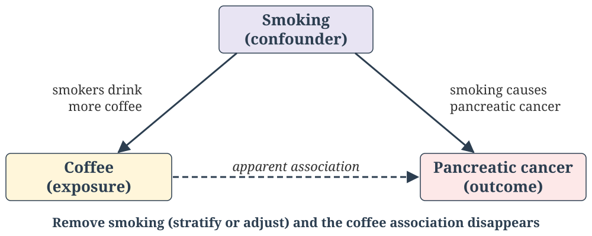
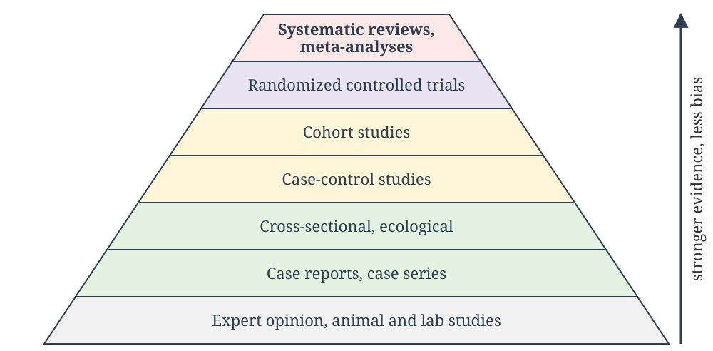

## Welcome {#home}

### Epidemiologic Methods

**Learning Objectives (CM7 Lectures 6–9):**

- Describe the design, steps, analysis (OR), biases, advantages and limitations of a case-control study
- Describe the types and elements of cohort studies; calculate RR, AR, AR% and PAR
- Outline the steps and types of randomized controlled trials; explain randomization and blinding; calculate vaccine efficacy and NNT
- Distinguish association from causation; identify bias, chance and confounding; apply causal criteria; distinguish validity from reliability

**NMC Community Medicine Code:** CM7.5, CM7.8

🟢 **MUST KNOW** · 🟡 **SHOULD KNOW** · 🟣 **MAY KNOW** · 🧡 **QUESTION**

::: {.notes}
Builds on Chapter 3's measures of frequency and the study-design
classification (Lecture 5). Mortality rates and standardization now sit in
Chapter 3 (Lectures 2 and 4).
:::

---

## Lecture 6: Case-Control Study {background-color="#E6EEF5"}

📚 **Lecture 6 of 15** · **CM7.L6**

*Case-control study*

---

## The 2×2 Table {background-color="#E3F2E1"}

🟢 **MUST KNOW**

Every analytical comparison starts from a 2×2 table of exposure against outcome:

| | Disease + (cases) | Disease − (controls) |
|---|---|---|
| **Exposed** | a | b |
| **Unexposed** | c | d |

- **Case-control**: the column totals (a+c cases, b+d controls) are fixed by the investigator
- **Cohort**: the row totals (a+b exposed, c+d unexposed) are fixed

Relative risk, odds ratio and attributable risk are all calculated from these four cells.

---

## Case-Control Study {background-color="#E3F2E1"}

🟢 **MUST KNOW**

{.slide-img .nostretch width="840px"}

`OR = ad / bc`. It proceeds from **effect to cause** (retrospective). Exposure is always measured *after* the disease has occurred. It is also called a **"trohoc" study** ("cohort" spelt backwards).

---

## Basic Steps of a Case-Control Study {background-color="#E3F2E1"}

🟢 **MUST KNOW**

1. **Selection of cases and controls**
   - *Cases*: a clear diagnostic definition. Incident cases are preferred to prevalent ones. Sources are hospitals or the general population.
   - *Controls*: free of the disease, similar to cases in everything except the disease. Sources are hospital, relatives/neighbourhood, or the general population.
2. **Matching**: on confounders such as age and sex (next slide)
3. **Measurement of exposure**: the same method for cases and controls (interview, records), with blinding where possible
4. **Analysis**: exposure rates among cases and controls, then the **odds ratio**

`OR = (a × d) ÷ (b × c)`

**Rare-disease assumption:** when the disease is uncommon, OR ≈ RR.

---

## Case Scenario: Planning a Breast Cancer Study {background-color="#FDE8E8"}

🧡 **CASE SCENARIO**

You plan a case-control study to test whether women with a **family history of breast cancer** have a higher risk of breast cancer.

1. How will you select the cases and the controls? Can controls come from the same family?
2. How will you measure family history, and what information biases may occur?
3. How will you measure association, test significance, and deal with confounders?

---

## Case Scenario: Planning a Breast Cancer Study, Discussion {background-color="#FDE8E8"}

🧡 **CASE SCENARIO: DISCUSSION**

- **Cases:** newly diagnosed, from a cancer hospital or registry. **Controls:** women from the same catchment population, matched on age, age at first pregnancy, parity and breastfeeding. **Not** relatives: that would over-match on the exposure itself.
- Measure family history by **structured interview** of cases and controls. **Recall bias** (cases remember family cancers better) and **observer bias** are possible. Blind the interviewer to case status.
- Use the **odds ratio** with a 95% CI and the **chi-square test**. Control confounders by **matching** at design, and **Mantel–Haenszel** stratified analysis or **logistic regression** at analysis.

---

## Matching in Case-Control Studies {background-color="#FFF6DA"}

🟡 **SHOULD KNOW**

**Matching** selects controls so that a potential confounder (e.g. age,
occupation) has the **same distribution** in cases and controls.

- **Group (frequency) matching**: the matched variable has a similar distribution in both groups
- **Pair (individual) matching**: each case is paired with a control sharing that characteristic, e.g. a 50-year-old mason case and a 50-year-old mason control

**Critical rule:** never match on the exposure you want to study. That forces cases and controls to look alike on it and erases its association with disease. **Over-matching** also makes controls harder to find and can bias the OR toward 1.

---

## Worked Example: Odds Ratio {background-color="#E3F2E1"}

🟢 **MUST KNOW**

A study of tobacco chewing and oral cancer (100 cases, 100 controls):

| | Oral cancer (cases) | No oral cancer (controls) |
|---|---|---|
| **Chewers** | a = 80 | b = 40 |
| **Non-chewers** | c = 20 | d = 60 |
| **Total** | 100 | 100 |

- Exposure in cases = 80% and in controls = 40%
- `OR = (80 × 60) ÷ (40 × 20) = 6.0`
- **Interpretation:** cases had **six times** the odds of having chewed tobacco compared with controls. Oral cancer is rare, so tobacco chewers have roughly six times the risk.

---

## Case Scenario: Helmets and Fatal Head Injury {background-color="#FDE8E8"}

🧡 **CASE SCENARIO**

Among two-wheeler accident victims, **87** had fatal and **113** non-fatal head injuries. Of the fatal cases, **55** had not worn a helmet; of the non-fatal, **45** had not.

1. Build the 2 × 2 table (cases = fatal injury, exposure = no helmet).
2. Calculate the odds ratio and the etiological fraction.
3. Interpret the result.

---

## Case Scenario: Helmets and Fatal Head Injury, Discussion {background-color="#FDE8E8"}

🧡 **CASE SCENARIO: DISCUSSION**

- a = 55, b = 45, c = 32, d = 68
- **OR** = (55 × 68) ÷ (45 × 32) = 3,740 ÷ 1,440 ≈ **2.6**
- **EF** = (OR − 1) ÷ OR ≈ **61%**
- Riders without helmets had about **2.6 times the odds** of a fatal head injury. About 61% of fatal head injuries among non-users could be prevented by helmet use.
- *(The textbook prints OR 1.22 and EF 18%, which is an arithmetic error.)*

---

## Bias in Case-Control Studies {background-color="#FFF6DA"}

🟡 **SHOULD KNOW**

| Bias | What happens |
|---|---|
| **Selection bias** | Cases and controls are selected in a way related to exposure |
| **Berkson's bias** | A hospital-based study is distorted by different admission rates for different combinations of disease and exposure |
| **Recall (memory) bias** | Cases search their memory harder for past exposures than controls |
| **Interviewer bias** | An interviewer who knows case status probes cases more intensively |
| **Neyman (prevalence–incidence, survivorship) bias** | Using prevalent cases misses those who died early or recovered (e.g. fatal MI) |
| **Confounding** | A third factor linked to both exposure and disease, controlled by matching or analysis |

---

## Case-Control Study: Advantages and Limitations {background-color="#E3F2E1"}

🟢 **MUST KNOW**

:::: {.columns}
::: {.column width="50%"}
**Advantages**

- Quick, cheap, needs few subjects
- Best design for **rare diseases** and those with long latency
- No risk to subjects; no attrition
- Can study **several exposures** for one disease
- Gives an estimate of RR (via the OR)
:::
::: {.column width="50%"}
**Limitations**

- Prone to **recall and selection bias**
- Incidence and true RR cannot be measured
- Temporality is sometimes unclear
- Choosing an appropriate control group is difficult
- Only **one outcome** is studied
- Not suitable for rare exposures
:::
::::

---

## Nested Case-Control Study {background-color="#FFF6DA"}

🟡 **SHOULD KNOW**

A case-control study conducted **within** an existing cohort. Once enough cases accumulate in a large prospective cohort, controls are sampled from the cohort's non-cases rather than processing exposure data for everyone.

- More **efficient** than analysing the full cohort, because exposure data (e.g. stored blood) are processed only for cases and the sampled controls
- Both groups come from the *same* defined cohort, and exposure was recorded **before** disease. This minimizes selection and recall bias.

---

## Practice Questions: Descriptive (Lecture 6) {background-color="#FFF6DA"}

**For written practice — work through these on paper; no auto-check for this slide.**

**Long Essay**

1. Define epidemiology. What is a case-control study? Describe the basic stages (framework for analysis), and mention the advantages and limitations of case-control studies.

**Short Essay / Short Answer**

2. Discuss the types of bias in case-control studies.
3. Write the advantages and disadvantages of case-control studies.
4. Explain the difference between a case-control study and a cohort study.

**Short Notes**

5. Odds ratio.

---

## Practice Questions: Descriptive (Lecture 6, contd.) {background-color="#FFF6DA"}

**Reasoning Type**

6. Explain why the odds ratio is used instead of relative risk in case-control studies.
7. Why does rarity of disease allow the odds ratio to approximate relative risk?

**Case Scenario**

8. You are planning a case-control study to test whether women with a family history of breast cancer have a higher risk of breast cancer.
   a. How will you select the cases?
   b. How will you select the controls? Can you take controls from the same family?
   c. How will you measure family history of breast cancer?
   d. What measurement (information) biases may occur in this study?
   e. How will you measure the strength of association, and which test of significance will you apply?
   f. How will you deal with confounding variables?

---

## Practice Questions: Descriptive (Lecture 6, contd.) {background-color="#FFF6DA"}

**Numerical**

9. In a case-control study of helmet use, 55 of 87 fatal and 45 of 113 non-fatal head-injury cases had not used helmets (cases = fatal injury). Calculate the odds ratio and the etiological fraction, and interpret them.

**University Examination Questions**

10. Define epidemiology. List the various epidemiological study designs. Briefly discuss the steps in a case-control study.
11. Classify epidemiological studies. Write the steps for conducting a case-control study.
12. Odds ratio.
13. Bias in case-control studies.

---

## Self-Check: Question 1 {background-color="#FDE8E8"}

🧡 **QUESTION**

::: {.quiz-question}
### Question 1

A study begins by identifying people with lung cancer and people without it, then looks backward at their smoking history. This is a:

- Cohort study
- [Case-control study]{.correct data-explanation="Starting from disease status (cases vs controls) and looking backward at exposure defines a case-control study."}
- Randomized controlled trial
- Ecological study
:::

---

## Self-Check: Question 2 {background-color="#FDE8E8"}

🧡 **QUESTION**

::: {.quiz-question}
### Question 2

A researcher wants to study the association between smoking and lung cancer using past hospital records of cases and controls. The most appropriate study design is a:

- Cohort study
- Randomized controlled trial
- Cross-sectional study
- [Case-control study]{.correct data-explanation="Cases and controls are selected and their past exposure is ascertained from records, which is the case-control design. It is quick and cheap, and well suited to rare diseases such as lung cancer."}
:::

---

## Self-Check: Question 3 {background-color="#FDE8E8"}

🧡 **QUESTION**

::: {.quiz-question}
### Question 3

In a case-control study, the association is most appropriately measured by the:

- Relative risk
- Attributable risk
- [Odds ratio]{.correct data-explanation="Incidence cannot be calculated because subjects are selected by disease status. The odds ratio (ad/bc) is the measure, and it estimates RR when the disease is rare."}
- Incidence rate ratio only
:::

---

## Self-Check: Question 4 {background-color="#FDE8E8"}

🧡 **QUESTION**

::: {.quiz-question}
### Question 4

Which of the following is known as the “cross-product ratio”?

- RR
- AR
- PAR%
- [OR]{.correct data-explanation="OR = (a × d) ÷ (b × c): the product of the diagonal cells divided by the product of the off-diagonal cells, hence the cross-product ratio."}
:::

---

## Self-Check: Question 5 {background-color="#FDE8E8"}

🧡 **QUESTION**

::: {.quiz-question}
### Question 5

A case-control study finds an odds ratio of 5.0 between exposure and disease. The best interpretation is:

- [Cases have five times higher odds of having had the exposure compared with controls]{.correct data-explanation="OR compares the odds of past exposure in cases with that in controls. It does not measure incidence directly, and a strong association alone does not prove causation."}
- The exposed have five times higher incidence, directly measured
- The exposure is definitely causal without further assessment
- The disease prevalence is 5%
:::

---

## Self-Check: Question 6 {background-color="#FDE8E8"}

🧡 **QUESTION**

::: {.quiz-question}
### Question 6

Selection bias in a case-control study most commonly occurs when:

- [Selection of cases and controls is related to exposure status]{.correct data-explanation="If the chance of being selected as a case or control depends on exposure (e.g. hospital controls admitted for smoking-related diseases), the OR is distorted. Berkson’s bias is one example."}
- Exposure is measured with high accuracy
- Outcome status is confirmed objectively
- Sample size is sufficiently large
:::

---

## Self-Check: Question 7 {background-color="#FDE8E8"}

🧡 **QUESTION**

::: {.quiz-question}
### Question 7

An epidemiologist wants to study whether blood group “O” protects against peptic ulcer disease compared with the other three blood groups. The outcome variable in this case is:

- Blood groups
- [Peptic ulcer disease]{.correct data-explanation="Blood group is the exposure (independent variable). Peptic ulcer is the outcome (dependent variable)."}
- Both of these
- None of these
:::

---

## Self-Check: Question 8 {background-color="#FDE8E8"}

🧡 **QUESTION**

::: {.quiz-question}
### Question 8

**Assertion (A):** Recall bias is commonly seen in cohort studies.

**Reason (R):** Recall bias mainly affects studies where past exposure is assessed after disease occurrence.

- Both A and R are true, and R is the correct explanation of A
- Both A and R are true, but R is NOT the correct explanation of A
- A is true, R is false
- [A is false, R is true]{.correct data-explanation="A is false: in a cohort study exposure is recorded before the outcome occurs, so recall bias is minimal. R is true: recall bias is typical of case-control studies, where cases recall past exposure differently from controls."}
:::

---

## Self-Check: Question 9 {background-color="#FDE8E8"}

🧡 **QUESTION**

::: {.quiz-question}
### Question 9

In a case-control study of oral cancer, 80 of 100 cases and 40 of 100 controls chewed tobacco. The odds ratio is:

- 2.0
- 4.0
- [6.0]{.correct data-explanation="a = 80, b = 40, c = 20, d = 60. OR = (80 × 60) ÷ (40 × 20) = 4800 ÷ 800 = 6.0."}
- 8.0
:::

---

## Self-Check: Question 10 {background-color="#FDE8E8"}

🧡 **QUESTION**

::: {.quiz-question}
### Question 10

In a standard 2 × 2 table, the odds ratio is measured as:

- (a × b)/(c × d)
- [(a × d)/(b × c)]{.correct data-explanation="OR = ad/bc, the cross-product ratio."}
- (a × c)/(b × d)
- None of these
:::

---

## Self-Check: Question 11 {background-color="#FDE8E8"}

🧡 **QUESTION**

::: {.quiz-question}
### Question 11

Which of the following is the biggest problem in the conduct of case-control studies?

- Logistic efforts
- Large number of subjects
- Loss to follow-up
- [Selection of appropriate controls]{.correct data-explanation="Controls must come from the same source population as the cases and differ only in not having the disease. Getting this right is the hardest part of a case-control study."}
:::

---

## Self-Check: Question 12 {background-color="#FDE8E8"}

🧡 **QUESTION**

::: {.quiz-question}
### Question 12

Which of the following is correct about case-control studies?

- Incidence can be calculated
- [They are good for studying risk factors of rare diseases]{.correct data-explanation="Case-control studies start from cases, so even rare diseases can be studied quickly. Incidence and true RR cannot be calculated."}
- Relative risk can be calculated
- They take a long time
:::

---

## Self-Check: Question 13 {background-color="#FDE8E8"}

🧡 **QUESTION**

::: {.quiz-question}
### Question 13

A case-control study is also known as a:

- Biased study
- Cross-sectional study
- Hill’s study
- [Trohoc study]{.correct data-explanation="“Trohoc” is “cohort” spelt backwards. A case-control study runs in the opposite direction, from effect to cause."}
:::

---

## Self-Check: Question 14 {background-color="#FDE8E8"}

🧡 **QUESTION**

::: {.quiz-question}
### Question 14

Which of the following is correct for a case-control study?

- Two groups with neither exposure nor outcome are followed for a defined period for development of outcome
- [Two comparable groups, one with the outcome and the other without, are taken and the history of exposure is obtained from both]{.correct data-explanation="Selection is by outcome status (cases vs controls), followed by a backward look at exposure."}
- A single group is studied for exposure and outcome at one point in time
- A group with exposure but not the disease is followed for a defined period
:::

---

## Self-Check: Question 15 {background-color="#FDE8E8"}

🧡 **QUESTION**

::: {.quiz-question}
### Question 15

What is the measure of effect calculated in a case-control study?

- RR
- [OR]{.correct data-explanation="Only the odds ratio can be calculated in a case-control study."}
- Prevalence
- All of these
:::

---

## Self-Check: Question 16 {background-color="#FDE8E8"}

🧡 **QUESTION**

::: {.quiz-question}
### Question 16

A case-control study:

- [Is always retrospective]{.correct data-explanation="The textbook&#x27;s answer: the direction of enquiry is always backward, from outcome to past exposure, even when cases are recruited as they occur."}
- Is always prospective
- Can be retrospective or prospective
- Gives us the prevalence of the disease
:::

---

## Self-Check: Question 17 {background-color="#FDE8E8"}

🧡 **QUESTION**

::: {.quiz-question}
### Question 17

Which of the following is NOT an advantage of case-control studies?

- They are much less expensive
- They require little time to complete
- [They have minimal recall bias]{.correct data-explanation="Recall bias is a characteristic weakness of case-control studies, because exposure is recalled after disease occurs."}
- They are good for studying risk factors of a rare disease
:::

---

## Self-Check: Question 18 {background-color="#FDE8E8"}

🧡 **QUESTION**

::: {.quiz-question}
### Question 18

A case-control study is one in which the epidemiologist starts with two comparable groups of subjects, of which:

- One has the exposure and the other does not
- [One has the outcome and the other does not]{.correct data-explanation="Cases (with the outcome) and controls (without it). Starting from exposure defines a cohort study."}
- Both groups have the outcome
- Both groups have the exposure
:::

---

## Self-Check: Question 19 {background-color="#FDE8E8"}

🧡 **QUESTION**

::: {.quiz-question}
### Question 19

For the OR to be a valid estimator of risk in a case-control study, which of the following are essential?

- The outcome (disease) should be rare in the population
- Controls should come from the same source as the cases
- [Both of these]{.correct data-explanation="Rare-disease assumption: OR ≈ RR. Same-source controls: the controls must represent the exposure distribution of the population that produced the cases."}
- None of these
:::

---

## Self-Check: Question 20 {background-color="#FDE8E8"}

🧡 **QUESTION**

::: {.quiz-question}
### Question 20

In a case-control study, survivorship (Neyman, prevalence–incidence) bias is most likely for which of the following diseases?

- Institutional normal delivery
- Coryza
- [Myocardial infarction]{.correct data-explanation="Many MI patients die before reaching hospital. Cases studied are survivors, whose exposure profile may differ from fatal cases."}
- Colles fracture sustained while playing sports
:::

---

## Self-Check: Question 21 {background-color="#FDE8E8"}

🧡 **QUESTION**

::: {.quiz-question}
### Question 21

Of 100 two-wheeler accident victims who did not use helmets, 55 had fatal and 45 non-fatal head injuries. Of 100 who used helmets, 32 had fatal and 68 non-fatal head injuries. The odds ratio for fatal head injury with non-use of helmets is about:

- 1.22
- 1.72
- [2.6]{.correct data-explanation="OR = (55 × 68)/(45 × 32) = 3740/1440 ≈ 2.6. Etiological fraction = (OR − 1)/OR ≈ 61%. The textbook&#x27;s printed answer (OR 1.22, EF 18%) is an arithmetic error."}
- 3.9
:::

---

## Lecture 7: Cohort Study {background-color="#E6EEF5"}

📚 **Lecture 7 of 15** · **CM7.L7**

*Cohort study*

---

## Cohort Study {background-color="#E3F2E1"}

🟢 **MUST KNOW**

{.slide-img .nostretch width="860px"}

**Cohort** = a group of people who share a common characteristic or experience within a defined period. The study proceeds from **cause to effect** (prospective, longitudinal or incidence study).

---

## Types of Cohort Study {background-color="#E3F2E1"}

🟢 **MUST KNOW**

| Type | Exposure | Outcome | Example |
|---|---|---|---|
| **Prospective (concurrent)** | Measured now | Occurs in the future, after follow-up | Framingham Heart Study (1948–) |
| **Retrospective (historical)** | From past records | Already occurred when the study begins | Occupational records → cancer deaths |
| **Ambispective (combination)** | From past records | Follow-up continues into the future | Historical cohort extended forward |

In every type, the logic runs from exposure to outcome. Only the investigator's position in calendar time differs.

---

## Elements of a Cohort Study {background-color="#E3F2E1"}

🟢 **MUST KNOW**

1. **Selection of study subjects**: a general population or special groups (professional groups, exposure groups), free of the disease at the start
2. **Obtaining data on exposure**: from the cohort members, records, examinations and environmental surveys
3. **Selection of comparison groups**:
   - *internal*: different exposure levels within one cohort
   - *external*: a separate unexposed cohort
   - *general population rates*
4. **Follow-up**: periodic examination, records and death certificates. **Loss to follow-up** must be minimal, because differential losses cause selection bias.
5. **Analysis**: incidence in the exposed and unexposed, then **RR** and **AR**

---

## Biases in Cohort Studies {background-color="#FFF6DA"}

🟡 **SHOULD KNOW**

1. **Loss to follow-up (attrition) bias**: subjects drop out, die or migrate. It is serious when those lost differ systematically in outcome. Prevent it by explaining the study well, recording contact details of participants *and* relatives, keeping in regular touch, and tracing drop-outs quickly.
2. **Measurement (information) bias**: exposed and unexposed cohorts are examined differently for the outcome. For example, alcoholics visit health facilities more often, so GERD is diagnosed more often in them. Prevent it with identical follow-up and assessment methods, ideally blinded.
3. **Confounding**: controlled by matching, restriction or analysis.

**Bias that does NOT occur:** **recall bias**. Exposure is measured objectively at the start, not recalled after the disease.

---

## Measures in a Cohort Study: Worked Example {background-color="#E3F2E1"}

🟢 **MUST KNOW**

Lung cancer over 10 years in 10,000 smokers and 10,000 non-smokers:

| | Lung cancer | No lung cancer | Total | Incidence |
|---|---|---|---|---|
| **Smokers** | 280 | 9,720 | 10,000 | Iₑ = 28 per 1000 |
| **Non-smokers** | 40 | 9,960 | 10,000 | I₀ = 4 per 1000 |

- **RR** = Iₑ ÷ I₀ = 28 ÷ 4 = **7**: smokers have 7 times the risk
- **AR** = Iₑ − I₀ = **24 per 1000**: the excess risk due to smoking
- **AR%** = (Iₑ − I₀) ÷ Iₑ × 100 = **86%** of smokers' lung cancer is preventable by not smoking

---

## Case Scenario: Tobacco Use in Pregnancy {background-color="#FDE8E8"}

🧡 **CASE SCENARIO**

300 antenatal women were examined: **100 tobacco users** and **200 non-users**. All were followed until delivery. Low birth weight occurred in **20 users** and **20 non-users**.

1. What type of comparison cohort is this?
2. Calculate the RR, AR and AR%.
3. Interpret the results.

---

## Case Scenario: Tobacco Use in Pregnancy, Discussion {background-color="#FDE8E8"}

🧡 **CASE SCENARIO: DISCUSSION**

- An **internal (inbuilt) comparison group**: both groups come from the same examined population
- Iₑ = 20 ÷ 100 = **20%**; I₀ = 20 ÷ 200 = **10%**
- **RR** = 2. **AR** = 10 per 100 births. **AR%** = (20 − 10) ÷ 20 = **50%**
- Tobacco users have **twice the risk** of an LBW baby. Half of the LBW among users is attributable to tobacco and preventable by quitting.

---

## Attributable Risk {background-color="#E3F2E1"}

🟢 **MUST KNOW**

**Attributable Risk (AR)** is the excess risk in the exposed group that is due to the exposure, i.e. the risk difference:

`AR = Iₑ − I₀`  ·  `AR% = (Iₑ − I₀) ÷ Iₑ × 100`

**Population Attributable Risk (PAR)** is the excess risk in the *total population* due to the exposure:

`PAR = I(total) − I₀`  ·  `PAR% = (I(total) − I₀) ÷ I(total) × 100`

- **RR** tells you the *strength* of an association, which is useful for causal inference
- **AR / AR%** tell you the impact on the *exposed*
- **PAR%** tells you the impact on the *whole community*, which is what programme planners use

---

## Cohort vs. Case-Control {background-color="#E3F2E1"}

🟢 **MUST KNOW**

| | Cohort | Case-control |
|---|---|---|
| **Starts from** | Exposure status | Disease status |
| **Direction** | Cause → effect (forward) | Effect → cause (backward) |
| **Best for** | Rare exposures, several outcomes | Rare diseases, several exposures |
| **Measure** | Incidence, RR, AR | Odds ratio only |
| **Size, cost, time** | Large, costly, long | Small, cheap, quick |
| **Main biases** | Loss to follow-up (attrition) | Recall bias, selection bias |
| **Temporality** | Clear | Sometimes unclear |

---

## Cohort Study: Advantages and Limitations {background-color="#FFF6DA"}

🟡 **SHOULD KNOW**

:::: {.columns}
::: {.column width="50%"}
**Advantages**

- **Incidence**, RR and AR can be measured directly
- **Temporality is clear**: exposure precedes outcome
- Several outcomes can be studied for one exposure
- Dose–response can be studied
- Little recall bias
:::
::: {.column width="50%"}
**Limitations**

- Large samples, long follow-up, high cost
- **Loss to follow-up**; changes in exposure or diagnostic criteria over time
- Unsuitable for rare diseases
- Ethical issues when a known risk is left unaddressed
- Administrative difficulties
:::
::::

---

## Practice Questions: Descriptive (Lecture 7) {background-color="#FFF6DA"}

**For written practice — work through these on paper; no auto-check for this slide.**

**Long Essay**

1. Define epidemiology. Classify epidemiological study designs. Describe in detail the steps involved in a cohort study, and enumerate the advantages and disadvantages of cohort studies.
2. Describe a cohort study with a suitable example.

**Short Essay / Short Answer**

3. Cohort study: steps and risk measurements.
4. Attributable risk and population attributable risk.

**Short Notes**

5. Relative risk: definition and calculation.
6. Attributable risk: calculation.

---

## Practice Questions: Descriptive (Lecture 7, contd.) {background-color="#FFF6DA"}

**Reasoning Type**

7. Give reasons why loss to follow-up threatens validity in cohort studies.

**Numerical**

8. Smokers and non-smokers free of lung cancer were followed for 15 years: 70 of 7,000 smokers and 3 of 3,000 non-smokers developed lung cancer. Calculate RR, AR, the etiological fraction (AR%) and PAR%, and explain what each means.

**University Examination Questions**

9. Mention two advantages of a cohort study.

---

## Self-Check: Question 22 {background-color="#FDE8E8"}

🧡 **QUESTION**

::: {.quiz-question}
### Question 22

Which measure of association can be directly calculated from a cohort study but NOT from a case-control study?

- Odds Ratio
- [Relative Risk]{.correct data-explanation="Cohort studies measure incidence directly in both exposed and unexposed groups, so relative risk can be calculated. Case-control studies cannot, because cases are already selected."}
- p-value
- Confidence interval
:::

---

## Self-Check: Question 23 {background-color="#FDE8E8"}

🧡 **QUESTION**

::: {.quiz-question}
### Question 23

If IE is the incidence of disease in the group exposed to a risk factor and IO the incidence in the unexposed group, then IE/IO gives the:

- Relative risk
- Risk ratio
- [Both of these]{.correct data-explanation="IE/IO is the relative risk, also called the risk ratio. IE − IO is the attributable risk (risk difference)."}
- None of these
:::

---

## Self-Check: Question 24 {background-color="#FDE8E8"}

🧡 **QUESTION**

::: {.quiz-question}
### Question 24

Attributable Risk Percent (AR%) is best described as:

- The strength of an association
- [The proportion of exposed-group risk that would be eliminated if the exposure were removed]{.correct data-explanation="AR% expresses the exposed group’s excess risk due to the exposure as a percentage of its total risk. It measures public health impact, not just the strength of association."}
- The same value as the odds ratio
- A measure usable only in RCTs
:::

---

## Self-Check: Question 25 {background-color="#FDE8E8"}

🧡 **QUESTION**

::: {.quiz-question}
### Question 25

Annual incidence of thromboembolism per lakh women aged 30–39 is 5.3 among oral-contraceptive users and 1.8 among non-users. The RR and AR are:

- [RR 2.9; AR 3.5 per lakh]{.correct data-explanation="RR = 5.3 ÷ 1.8 ≈ 2.9 and AR = 5.3 − 1.8 = 3.5 per lakh. In the 40–49 age group (29.15 vs 9.9) the RR is the same, 2.9, but the AR is about 20 per lakh. The same RR can carry very different public-health impact."}
- RR 3.5; AR 2.9 per lakh
- RR 0.34; AR 3.5 per lakh
- RR 2.9; AR 7.1 per lakh
:::

---

## Self-Check: Question 26 {background-color="#FDE8E8"}

🧡 **QUESTION**

::: {.quiz-question}
### Question 26

In a cohort study, lung cancer incidence was 28 per 1000 among smokers and 4 per 1000 among non-smokers. The attributable risk percent (AR%) among smokers is about:

- 14%
- 24%
- [86%]{.correct data-explanation="RR = 28/4 = 7. AR = 28 − 4 = 24 per 1000. AR% = 24/28 × 100 ≈ 86%: about 86% of lung cancer among smokers is due to smoking."}
- 700%
:::

---

## Self-Check: Question 27 {background-color="#FDE8E8"}

🧡 **QUESTION**

::: {.quiz-question}
### Question 27

In a cohort study, loss to follow-up is higher among exposed individuals who later develop the disease. This most likely introduces:

- Recall bias
- Information bias
- [Selection bias]{.correct data-explanation="Differential loss to follow-up is a form of selection bias: those analysed no longer represent those enrolled, and the RR is distorted (here underestimated)."}
- Confounding
:::

---

## Self-Check: Question 28 {background-color="#FDE8E8"}

🧡 **QUESTION**

::: {.quiz-question}
### Question 28

**Assertion (A):** In a cohort study, incidence can be directly measured.

**Reason (R):** Participants are followed over time from exposure status to observe the occurrence of new outcomes.

- [Both A and R are true, and R is the correct explanation of A]{.correct data-explanation="Both are true, and R explains A. Because a disease-free cohort is followed forward, new cases can be counted against a known denominator, giving incidence and RR directly."}
- Both A and R are true, but R is NOT the correct explanation of A
- A is true, R is false
- A is false, R is true
:::

---

## Self-Check: Question 29 {background-color="#FDE8E8"}

🧡 **QUESTION**

::: {.quiz-question}
### Question 29

A study uses 1990 factory employment records to classify workers by asbestos exposure, then traces their mesothelioma occurrence up to 2025. This is a:

- Prospective cohort study
- [Retrospective (historical) cohort study]{.correct data-explanation="The design runs forward from exposure to outcome, which makes it a cohort study. Because both exposure and outcome have already happened when the study begins, it is a retrospective (historical) cohort."}
- Case-control study
- Cross-sectional study
:::

---

## Self-Check: Question 30 {background-color="#FDE8E8"}

🧡 **QUESTION**

::: {.quiz-question}
### Question 30

Loss to follow-up is likely in which of the following studies?

- Case-control study
- Cross-sectional analytical study
- Ecological study
- [Cohort study]{.correct data-explanation="Only a cohort study follows subjects over time, so only a cohort study can lose them."}
:::

---

## Self-Check: Question 31 {background-color="#FDE8E8"}

🧡 **QUESTION**

::: {.quiz-question}
### Question 31

The measure of risk in a cohort study is:

- [Relative risk]{.correct data-explanation="Incidence in the exposed and unexposed is measured directly, giving RR (and AR)."}
- Prevalence odds ratio
- Exposure odds ratio
- None of these
:::

---

## Self-Check: Question 32 {background-color="#FDE8E8"}

🧡 **QUESTION**

::: {.quiz-question}
### Question 32

A cohort study can be used to study all of the following, EXCEPT:

- Risk markers
- Risk factors
- Prognostic factors
- [Preventive factors]{.correct data-explanation="The textbook&#x27;s answer: preventive factors (interventions) are best evaluated by experimental studies. Note that observational cohorts can still show protective associations, such as physical activity and IHD."}
:::

---

## Self-Check: Question 33 {background-color="#FDE8E8"}

🧡 **QUESTION**

::: {.quiz-question}
### Question 33

The direction of reasoning in a cohort study is:

- [Prospective]{.correct data-explanation="Reasoning always runs forward, from exposure (cause) to outcome (effect), even in a historical cohort."}
- Retrospective
- None of these
- Both of these
:::

---

## Self-Check: Question 34 {background-color="#FDE8E8"}

🧡 **QUESTION**

::: {.quiz-question}
### Question 34

Temporal association of a disease is best established by a:

- Case-control study
- Cross-sectional study
- [Cohort study]{.correct data-explanation="Subjects are disease-free at the start and exposure is recorded before outcome, so temporality is certain."}
- None of these
:::

---

## Self-Check: Question 35 {background-color="#FDE8E8"}

🧡 **QUESTION**

::: {.quiz-question}
### Question 35

Which type of bias is NOT likely in a cohort study?

- [Recall bias]{.correct data-explanation="Exposure is recorded objectively at the start, not recalled after disease, so recall bias does not occur. Loss to follow-up, measurement bias and confounding can occur."}
- Loss to follow-up bias
- Confounding
- None of these
:::

---

## Self-Check: Question 36 {background-color="#FDE8E8"}

🧡 **QUESTION**

::: {.quiz-question}
### Question 36

In which of the following situations should we avoid the cohort design?

- Study of a suspected risk factor of a disease
- Study of prognostic factors
- [Study of a rare disease]{.correct data-explanation="A rare disease would need an enormous cohort to yield enough cases. A case-control study suits it better."}
- A study where the likely follow-up period is short
:::

---

## Self-Check: Question 37 {background-color="#FDE8E8"}

🧡 **QUESTION**

::: {.quiz-question}
### Question 37

Which of the following is correct for a cohort study?

- Two groups with neither exposure nor outcome are followed for a defined period
- [Two groups, one exposed and one not, both free of the outcome, are followed for a defined period]{.correct data-explanation="A cohort study needs exposed and unexposed groups, both outcome-free at the start, followed forward."}
- A single group is studied for exposure and outcome at one point in time
- A single group with exposure but not the disease is followed for a defined period
:::

---

## Self-Check: Question 38 {background-color="#FDE8E8"}

🧡 **QUESTION**

::: {.quiz-question}
### Question 38

300 antenatal women (100 tobacco users, 200 non-users) were followed until delivery to compare the incidence of low birth weight. The comparison cohort in this study is a(n):

- Comparison with the general population
- [Inbuilt (internal) comparison group]{.correct data-explanation="Both exposed and unexposed women come from the same examined group, so the comparison is internal (inbuilt)."}
- Specially assembled (external) comparison cohort
- None of these
:::

---

## Self-Check: Question 39 {background-color="#FDE8E8"}

🧡 **QUESTION**

::: {.quiz-question}
### Question 39

What is the measure of effect calculated in a cohort study?

- [RR]{.correct data-explanation="Relative risk = Iₑ/I₀."}
- OR
- Prevalence
- All of these
:::

---

## Self-Check: Question 40 {background-color="#FDE8E8"}

🧡 **QUESTION**

::: {.quiz-question}
### Question 40

A cohort study:

- Is always retrospective
- Is always prospective
- [Can be retrospective or prospective]{.correct data-explanation="Prospective, retrospective (historical) and ambispective cohorts all exist. Only the calendar timing differs."}
- Is always cross-sectional
:::

---

## Self-Check: Question 41 {background-color="#FDE8E8"}

🧡 **QUESTION**

::: {.quiz-question}
### Question 41

Which of the following is NOT an advantage of cohort studies?

- [They are much less expensive and need little time]{.correct data-explanation="Cohort studies are large, long and costly. That is their main limitation."}
- Temporal association is certain
- Recall bias is minimal
- They have a strong design from the epidemiological point of view
:::

---

## Self-Check: Question 42 {background-color="#FDE8E8"}

🧡 **QUESTION**

::: {.quiz-question}
### Question 42

A cohort study is one in which the epidemiologist starts with two comparable groups, of which:

- [One has the exposure and the other does not]{.correct data-explanation="Selection is by exposure status, and all subjects are free of the outcome."}
- One has the outcome and the other does not
- Both groups have the outcome
- None of these
:::

---

## Self-Check: Question 43 {background-color="#FDE8E8"}

🧡 **QUESTION**

::: {.quiz-question}
### Question 43

A cohort study is NOT suitable for:

- Common diseases
- [Rare diseases]{.correct data-explanation="Too few cases would arise in a rare disease unless the cohort is impractically large."}
- Both of these
- None of these
:::

---

## Self-Check: Question 44 {background-color="#FDE8E8"}

🧡 **QUESTION**

::: {.quiz-question}
### Question 44

Smokers (70 lung cancers in 7,000) and non-smokers (3 in 3,000) were followed for 15 years. The relative risk and attributable risk are:

- [RR 10; AR 9 per 1000]{.correct data-explanation="Iₑ = 70/7000 = 10 per 1000 and I₀ = 3/3000 = 1 per 1000. RR = 10/1 = 10. AR = 10 − 1 = 9 per 1000 over 15 years."}
- RR 9; AR 10 per 1000
- RR 23; AR 7.3 per 1000
- RR 10; AR 90 per 1000
:::

---

## Self-Check: Question 45 {background-color="#FDE8E8"}

🧡 **QUESTION**

::: {.quiz-question}
### Question 45

In the same smoking study (Iₑ 10, I₀ 1, total population 73/10,000 = 7.3 per 1000), the etiological fraction (AR%) and PAR% are:

- [90% and 86%]{.correct data-explanation="AR% = (RR − 1)/RR = 9/10 = 90% of lung cancer among smokers is due to smoking. PAR% = (Iₜ − I₀)/Iₜ = (7.3 − 1)/7.3 ≈ 86% of lung cancer in the whole population is due to smoking."}
- 86% and 90%
- 90% and 73%
- 10% and 86%
:::

---

## Lecture 8: Experimental Studies {background-color="#E6EEF5"}

📚 **Lecture 8 of 15** · **CM7.L8**

*Experimental studies - randomised controlled trial and its types*

---

## Randomized Controlled Trial (RCT) {background-color="#E3F2E1"}

🟢 **MUST KNOW**

{.slide-img .nostretch width="920px"}

---

## Randomization and Blinding {background-color="#E3F2E1"}

🟢 **MUST KNOW**

**Randomization (random allocation)** gives every participant an equal chance of being in the study or control group.

- It removes **selection bias** and balances **known and unknown confounders**, which is the "heart" of the RCT
- Methods: random number tables, computer generation, block or stratified randomization, with allocation concealment

**Blinding** prevents bias from knowing who received what:

| Type | Who does not know the allocation |
|---|---|
| **Single-blind** | The participant |
| **Double-blind** | The participant and the investigator/observer |
| **Triple-blind** | Participant, investigator, and the person analysing the data |

A **placebo** makes blinding possible when the control group gets no active treatment.

---

## Analysing a Trial: ITT vs Per-Protocol {background-color="#E3F2E1"}

🟢 **MUST KNOW**

| | Intention-to-treat (ITT) | Per-protocol |
|---|---|---|
| **Who is analysed** | Everyone **as randomized**, whatever they actually received | Only those who completed the assigned treatment |
| **Keeps randomization?** | **Yes**: groups stay comparable | No: drop-outs differ from completers |
| **Answers** | *Effectiveness* in real use (conservative) | *Efficacy* under ideal adherence (may overestimate) |

**ITT is the primary analysis of an RCT.** **Allocation concealment** (e.g. sealed envelopes, central randomization) keeps recruiters from knowing the next assignment. It is distinct from blinding.

---

## The CONSORT Flow Diagram {background-color="#E3F2E1"}

🟢 **MUST KNOW**

{.slide-img .nostretch width="880px"}

---

## Sample Size: What Drives It {background-color="#FFF6DA"}

🟡 **SHOULD KNOW**

A trial or survey must be large enough to detect a real effect. The sample size needed **rises** when:

- the **α (type I error)** is set lower, e.g. 0.01 instead of 0.05
- the **power (1 − β)** is set higher, e.g. 90% instead of 80%
- the **effect size** to be detected is smaller
- the outcome is **rarer**, or a continuous outcome is more **variable** (larger SD)
- **drop-outs** are expected (add 10–20%)

Too small a sample gives a **type II error**: a real difference missed. It is also unethical, because subjects bear the risk without a useful answer.

---

## Types of Randomized Controlled Trials {background-color="#FFF6DA"}

🟡 **SHOULD KNOW**

| Type | Purpose / example |
|---|---|
| **Clinical (therapeutic) trials** | Evaluate a drug or procedure in patients |
| **Preventive trials** | Evaluate a vaccine or chemoprophylaxis in healthy people at risk |
| **Risk-factor trials** | Modify a risk factor (diet, BP) to see whether disease falls |
| **Cessation experiments** | Stop a suspected cause (e.g. smoking) and observe the effect |
| **Trials of etiological agents** | Confirm a suspected cause (e.g. retrolental fibroplasia and oxygen) |
| **Evaluation of health services** | Compare ways of delivering care (e.g. domiciliary vs sanatorium TB treatment) |

**By setting:** **field trials** study healthy individuals in the community (vaccine trials). **Community trials** allocate whole communities (water fluoridation).

---

## Special Trial Designs {background-color="#FFF6DA"}

🟡 **SHOULD KNOW**

- **Crossover trial**: each subject receives both treatments in sequence (next slide)
- **Factorial design**: two or more interventions are tested at once in all combinations (A, B, A+B, neither)
- **Cluster randomized trial**: villages, schools or practices are randomized, not individuals
- **Multicentre trial**: the same protocol at several sites, to reach a large sample quickly
- **Non-randomized trials**:
  - *uncontrolled trials*: no comparison group, as in early drug trials
  - *natural experiments*: Snow's water companies, Hiroshima
  - *before-and-after studies*: with or without a control group

---

## Crossover Design {background-color="#FFF6DA"}

🟡 **SHOULD KNOW**

{.slide-img .nostretch width="820px"}

- **Advantages:** each subject is their own control, so between-subject confounding is removed. The sample size is smaller. It is ethically attractive, because everyone receives both therapies.
- **Disadvantages:** a **washout** period is needed to remove carry-over, which prolongs the trial. Blinding is hard if one therapy is oral and the other parenteral. It is impossible when a therapy **cures** the disease (e.g. antibiotics).

---

## Phases of Clinical Trials {background-color="#E3F2E1"}

🟢 **MUST KNOW**

| Phase | Subjects | Purpose |
|---|---|---|
| **Pre-clinical** | Animals, laboratory | Toxicity, pharmacology |
| **Phase I** | 20–80 healthy volunteers | Safety, dose range, **maximum tolerated dose (MTD)**, pharmacokinetics |
| **Phase II** | 100–300 patients | Efficacy and side-effects at the chosen dose |
| **Phase III** | 1000s of patients, often multicentre RCTs | Confirms efficacy against the standard treatment; the basis for licensing |
| **Phase IV** | The general population after marketing | **Post-marketing surveillance**: rare and late adverse effects, long-term effectiveness |

Thalidomide (phocomelia) and rofecoxib (cardiovascular events) were withdrawn after problems surfaced in **Phase IV**.

---

## Vaccine Efficacy and Number Needed to Treat {background-color="#E3F2E1"}

🟢 **MUST KNOW**

**Vaccine efficacy** = (Iᵤᵥ − Iᵥ) ÷ Iᵤᵥ × 100

*Typhoid vaccine trial:* 80/1000 cases in the placebo group and 20/1000 in the vaccinated group, so VE = (0.08 − 0.02) ÷ 0.08 = **75%**

**Number Needed to Treat (NNT)** = 1 ÷ absolute risk difference

*Drug X vs ramipril:* hypertension was controlled in 91% vs 67%. The difference is 0.24, so NNT = 1 ÷ 0.24 ≈ **4**. Treating 4 patients with drug X gives one extra controlled patient compared with ramipril.

The lower the NNT, the more effective the intervention. The equivalent for harm is the **NNH** (number needed to harm).

---

## Case Scenario: Two Ways to Do a Bypass {background-color="#FDE8E8"}

🧡 **CASE SCENARIO**

Survival on the 10th post-operative day was **45 of 50** after CABG on cardiopulmonary bypass and **32 of 40** after off-pump (beating-heart) CABG.

1. Calculate the ratio of survival (efficacy, Iₑ ÷ I₀).
2. Calculate the NNT and explain it.
3. Can we conclude that on-pump surgery is better? What design would you want?

---

## Case Scenario: Two Ways to Do a Bypass, Discussion {background-color="#FDE8E8"}

🧡 **CASE SCENARIO: DISCUSSION**

- Iₑ = 45 ÷ 50 = 0.90; I₀ = 32 ÷ 40 = 0.80; ratio = 0.90 ÷ 0.80 = **1.13**
- **AR** = 0.10, so **NNT** = 1 ÷ 0.10 = **10**. Treat 10 patients on-pump instead of off-pump for **one extra survivor** at day 10.
- **Not yet.** If patients were not randomized, sicker patients may have gone to one technique (selection bias, confounding). A **randomized controlled trial** with blinded outcome assessment is needed.

---

## Number Needed to Treat {background-color="#E8E4F3"}

🟣 **MAY KNOW**

- NNT is always tied to a **comparator**, an **outcome** and a **time period**, e.g. "NNT 4 over 6 months vs ramipril for BP control"
- For prevention, NNTs are often large, e.g. hundreds treated for 5 years to prevent one stroke. This is still worthwhile if the treatment is cheap and safe.
- NNT can only be calculated from studies that measure risks directly (cohort studies and trials), not from case-control odds ratios alone

---

## Animal Experiments {background-color="#E8E4F3"}

🟣 **MAY KNOW**

**Advantages:** conditions can be controlled. Animals can be exposed to suspected agents that could never be given to humans (e.g. carcinogens). Short life spans allow multigeneration studies. Experiments reproduce disease and help test hypotheses, vaccines and drugs.

**Limitations:** results cannot always be **extrapolated** to humans because of species differences in susceptibility and metabolism. Some human diseases cannot be reproduced in animals. Ethical constraints and regulations (CPCSEA in India) apply, along with the "3Rs" (replace, reduce, refine).

---

## Practice Questions: Descriptive (Lecture 8) {background-color="#FFF6DA"}

**For written practice — work through these on paper; no auto-check for this slide.**

**Long Essay**

1. What is a randomized controlled trial (RCT)? Enumerate the different types of randomized controlled trials. Outline the steps involved in conducting an RCT and add a note on blinding.

**Short Essay / Short Answer**

2. Write the steps involved in a randomized controlled trial (RCT).

**Short Notes**

3. Cross-over type of study design.
4. Blinding in randomized controlled trials.
5. Advantages and limitations of animal experiments.

---

## Practice Questions: Descriptive (Lecture 8, contd.) {background-color="#FFF6DA"}

**University Examination Questions**

6. Describe an RCT with a suitable example.
7. Basic steps in conducting a randomized controlled trial.
8. Blinding in randomized controlled trials.
9. Phases of clinical trials.

---

## Practice Questions: Descriptive (Lecture 8, contd.) {background-color="#FFF6DA"}

**Short Notes (additional)**

10. Intention-to-treat analysis.
11. CONSORT flow diagram.
12. Factors determining sample size.

---

## Self-Check: Question 46 {background-color="#FDE8E8"}

🧡 **QUESTION**

::: {.quiz-question}
### Question 46

The main strength of randomization in an RCT is that it:

- Guarantees a statistically significant result
- [Balances known and unknown confounders between the intervention and control groups]{.correct data-explanation="Randomization distributes both known and unknown confounding factors evenly across groups, isolating the effect of the intervention."}
- Removes the need for a control group
- Eliminates all information bias automatically
:::

---

## Self-Check: Question 47 {background-color="#FDE8E8"}

🧡 **QUESTION**

::: {.quiz-question}
### Question 47

Another name for randomization is:

- Random sampling
- [Random allocation]{.correct data-explanation="Randomization allocates subjects already in the study to intervention or control by chance. Random sampling is how subjects are chosen from a population. The two are distinct."}
- Random error
- Random variable
:::

---

## Self-Check: Question 48 {background-color="#FDE8E8"}

🧡 **QUESTION**

::: {.quiz-question}
### Question 48

**Assertion (A):** Confounding can be reduced by randomization in experimental studies.

**Reason (R):** Randomization tends to distribute known and unknown confounders equally between groups.

- [Both A and R are true, and R is the correct explanation of A]{.correct data-explanation="Both are true, and R explains A. Randomization is the only method that also controls unknown confounders."}
- Both A and R are true, but R is NOT the correct explanation of A
- A is true, R is false
- A is false, R is true
:::

---

## Self-Check: Question 49 {background-color="#FDE8E8"}

🧡 **QUESTION**

::: {.quiz-question}
### Question 49

In a typhoid vaccine trial, 2000 children were randomized into two groups of 1000. Over one year, 20 vaccinated and 80 placebo children developed typhoid. The vaccine efficacy is:

- 25%
- 60%
- [75%]{.correct data-explanation="Iuv = 80/1000 = 0.08 and Iv = 20/1000 = 0.02. VE = (Iuv − Iv)/Iuv × 100 = 0.06/0.08 × 100 = 75%."}
- 80%
:::

---

## Self-Check: Question 50 {background-color="#FDE8E8"}

🧡 **QUESTION**

::: {.quiz-question}
### Question 50

Hypertension was controlled in 91% of patients given new drug X and in 67% of patients given ramipril. The number needed to treat (NNT) is about:

- 2
- [4]{.correct data-explanation="AR (absolute benefit increase) = 0.91 − 0.67 = 0.24. NNT = 1/0.24 ≈ 4: treating 4 patients with drug X gives one extra controlled patient compared with ramipril."}
- 24
- 58
:::

---

## Self-Check: Question 51 {background-color="#FDE8E8"}

🧡 **QUESTION**

::: {.quiz-question}
### Question 51

In a triple-blind trial, the group assignment is concealed from the:

- Participants only
- Participants and the investigator assessing outcomes
- [Participants, the investigators, and the person analysing the data]{.correct data-explanation="Single-blind: the participant does not know. Double-blind: neither the participant nor the investigator knows. Triple-blind: the analyst also does not know."}
- Ethics committee
:::

---

## Self-Check: Question 52 {background-color="#FDE8E8"}

🧡 **QUESTION**

::: {.quiz-question}
### Question 52

In a crossover trial:

- [Each participant receives both treatments in sequence, separated by a washout period]{.correct data-explanation="Each subject acts as their own control. This suits chronic, stable conditions, and a washout period prevents carry-over. Cluster randomization and factorial designs are the other two options described."}
- Whole villages are randomized rather than individuals
- Two interventions are tested simultaneously in all combinations
- Patients who fail on one drug are switched to the other at the doctor’s discretion
:::

---

## Self-Check: Question 53 {background-color="#FDE8E8"}

🧡 **QUESTION**

::: {.quiz-question}
### Question 53

A trial in which whole communities, rather than individuals, receive the intervention (e.g. water fluoridation) is a:

- Clinical trial
- Field trial
- [Community trial]{.correct data-explanation="Community trials allocate the intervention at the community level. Field trials study healthy individuals at risk in the field, as in vaccine trials."}
- Crossover trial
:::

---

## Self-Check: Question 54 {background-color="#FDE8E8"}

🧡 **QUESTION**

::: {.quiz-question}
### Question 54

In which of the following studies is randomization done?

- Case-control study
- Cohort study
- [Experimental study]{.correct data-explanation="Only in an experiment does the investigator allocate the exposure, so only there can it be randomized."}
- Cross-sectional study
:::

---

## Self-Check: Question 55 {background-color="#FDE8E8"}

🧡 **QUESTION**

::: {.quiz-question}
### Question 55

Which is the ideal (most scientific) design for an epidemiological study?

- Case-control study
- Cohort study
- [Experimental study]{.correct data-explanation="A randomized controlled trial controls known and unknown confounders and gives the strongest evidence of cause and effect."}
- Cross-sectional study
:::

---

## Self-Check: Question 56 {background-color="#FDE8E8"}

🧡 **QUESTION**

::: {.quiz-question}
### Question 56

An experimental study can be used in all of the following settings, EXCEPT:

- [Study of risk factors]{.correct data-explanation="It is unethical to deliberately expose people to a suspected risk factor, so risk factors are studied observationally. “Risk-factor trials” only test removing or reducing an existing risk factor."}
- Efficacy of preventive procedures
- Efficacy of treatment procedures
- Evaluation of health services
:::

---

## Self-Check: Question 57 {background-color="#FDE8E8"}

🧡 **QUESTION**

::: {.quiz-question}
### Question 57

An experimental study cannot be used to study:

- Risk factors for a disease
- Prognostic factors for a disease
- [Both of these]{.correct data-explanation="Neither a suspected harmful exposure nor an adverse prognostic factor can ethically be assigned to people. Both are studied with cohort or case-control designs."}
- It can be used to study both
:::

---

## Self-Check: Question 58 {background-color="#FDE8E8"}

🧡 **QUESTION**

::: {.quiz-question}
### Question 58

Phase IV of a clinical trial is:

- [Post-marketing surveillance]{.correct data-explanation="Phase IV follows licensing. It monitors safety and effectiveness in routine use and detects rare and late adverse effects."}
- Clinical trial
- Animal studies
- None of these
:::

---

## Self-Check: Question 59 {background-color="#FDE8E8"}

🧡 **QUESTION**

::: {.quiz-question}
### Question 59

Rofecoxib, a widely used NSAID for rheumatoid arthritis, was withdrawn after reports of adverse cardiovascular effects. This is an example of:

- Assessment of adverse effects at MTD
- Assessment of MTD
- A classical randomized controlled trial
- [Phase IV of a clinical trial]{.correct data-explanation="The problem surfaced after marketing, through post-marketing (Phase IV) surveillance."}
:::

---

## Self-Check: Question 60 {background-color="#FDE8E8"}

🧡 **QUESTION**

::: {.quiz-question}
### Question 60

The withdrawal of thalidomide from the market was an example of which phase of clinical trial?

- Phase I
- Phase II
- Phase III
- [Phase IV]{.correct data-explanation="Thalidomide&#x27;s teratogenicity (phocomelia) was detected after the drug was marketed, i.e. in Phase IV."}
:::

---

## Self-Check: Question 61 {background-color="#FDE8E8"}

🧡 **QUESTION**

::: {.quiz-question}
### Question 61

A cessation experiment is a type of:

- Cohort study
- [Experimental study]{.correct data-explanation="The investigator arranges for a suspected cause (e.g. smoking) to be stopped in one group and compares outcomes. This is an intervention study."}
- Case-control study
- Cross-sectional study
:::

---

## Self-Check: Question 62 {background-color="#FDE8E8"}

🧡 **QUESTION**

::: {.quiz-question}
### Question 62

In single blinding, who is unaware of the type of treatment being given?

- Analyser
- Observer
- [Subject]{.correct data-explanation="Single-blind: the subject does not know. Double-blind: the subject and observer do not know. Triple-blind: the analyser does not know either."}
- All of these
:::

---

## Self-Check: Question 63 {background-color="#FDE8E8"}

🧡 **QUESTION**

::: {.quiz-question}
### Question 63

What is the tool for control of confounding in an experimental design?

- Blinding
- Statistical analysis
- [Randomization]{.correct data-explanation="Randomization distributes known and unknown confounders equally between groups. Blinding controls information bias."}
- None of these
:::

---

## Self-Check: Question 64 {background-color="#FDE8E8"}

🧡 **QUESTION**

::: {.quiz-question}
### Question 64

In an experimental study, before randomization, the epidemiologist will remove:

- All those who already have the exposure
- All those who already have the outcome
- [Both of these]{.correct data-explanation="Subjects must be free of the outcome, and must not already have the exposure or intervention being tested, so that the allocated exposure is the only difference."}
- None of these
:::

---

## Self-Check: Question 65 {background-color="#FDE8E8"}

🧡 **QUESTION**

::: {.quiz-question}
### Question 65

In which experimental study is a group of subjects randomized instead of individual subjects?

- Clinical trial
- Preventive trial
- Cessation experiment
- [Community intervention trial]{.correct data-explanation="Community or cluster trials allocate whole communities (villages, schools) to intervention or control."}
:::

---

## Self-Check: Question 66 {background-color="#FDE8E8"}

🧡 **QUESTION**

::: {.quiz-question}
### Question 66

Imipenem results in ICU septicaemia patients were compared with earlier data from when imipenem was unavailable and cefotaxime was used. This is an example of:

- Randomized controlled trial
- Phase I clinical trial
- [Quasi-experimental design]{.correct data-explanation="There is an intervention but no randomization, and the controls are historical. That is a quasi-experimental (non-randomized) design."}
- Crossover design
:::

---

## Self-Check: Question 67 {background-color="#FDE8E8"}

🧡 **QUESTION**

::: {.quiz-question}
### Question 67

Survival on the 10th post-operative day was 45/50 (90%) after CABG on cardiopulmonary bypass and 32/40 (80%) after off-pump CABG. The efficacy (Iₑ/I₀) of CABG with CPB is:

- 1.00
- [1.13]{.correct data-explanation="Iₑ = 45/50 = 0.9 and I₀ = 32/40 = 0.8, so the ratio is 0.9/0.8 = 1.13."}
- 0.88
- 1.45
:::

---

## Self-Check: Question 68 {background-color="#FDE8E8"}

🧡 **QUESTION**

::: {.quiz-question}
### Question 68

In the same CABG comparison, the number needed to treat (NNT) is:

- 2
- 5
- [10]{.correct data-explanation="AR = 0.9 − 0.8 = 0.1 and NNT = 1/0.1 = 10. Ten patients must undergo CABG with CPB, rather than off-pump, for one additional survivor at day 10."}
- 12
:::

---

## Self-Check: Question 69 {background-color="#FDE8E8"}

🧡 **QUESTION**

::: {.quiz-question}
### Question 69

In an RCT, analysing every participant in the group to which they were randomized, regardless of the treatment actually received, is called:

- Per-protocol analysis
- [Intention-to-treat analysis]{.correct data-explanation="Intention-to-treat keeps the comparability created by randomization. It is the primary analysis of an RCT and estimates effectiveness conservatively."}
- As-treated analysis
- Subgroup analysis
:::

---

## Self-Check: Question 70 {background-color="#FDE8E8"}

🧡 **QUESTION**

::: {.quiz-question}
### Question 70

**Assertion (A):** Per-protocol analysis may overestimate the benefit of an intervention.

**Reason (R):** It excludes participants who did not adhere, who may differ systematically from those who did.

- [Both A and R are true, and R is the correct explanation of A]{.correct data-explanation="Both are true, and R explains A. Non-adherent participants are often sicker or experience more side-effects. Excluding them breaks randomization and flatters the treatment."}
- Both A and R are true, but R is NOT the correct explanation of A
- A is true, R is false
- A is false, R is true
:::

---

## Self-Check: Question 71 {background-color="#FDE8E8"}

🧡 **QUESTION**

::: {.quiz-question}
### Question 71

Keeping the person who enrols participants unaware of the next treatment assignment (e.g. by central randomization or sealed opaque envelopes) is known as:

- Blinding
- [Allocation concealment]{.correct data-explanation="Allocation concealment protects the randomization sequence before assignment. Blinding hides the assignment after it is made."}
- Matching
- Stratification
:::

---

## Self-Check: Question 72 {background-color="#FDE8E8"}

🧡 **QUESTION**

::: {.quiz-question}
### Question 72

Other things being equal, which change INCREASES the sample size needed for a trial?

- Detecting a larger effect
- Accepting 80% instead of 90% power
- [Setting α at 0.01 instead of 0.05]{.correct data-explanation="A stricter α, higher power, a smaller effect, a rarer outcome or more variability all need a larger sample."}
- Studying a more common outcome
:::

---

## Lecture 9: Association, Causation, and Bias {background-color="#E6EEF5"}

📚 **Lecture 9 of 15** · **CM7.L9**

*Association, causation and bias in epidemiological studies*

---

## From Association to Causation {background-color="#E3F2E1"}

🟢 **MUST KNOW**

{.slide-img .nostretch width="920px"}

---

## Types of Association {background-color="#E3F2E1"}

🟢 **MUST KNOW**

| Type | What it means |
|---|---|
| **Spurious** | An artefact of bias, from comparing groups that were never "like with like". It is prevented by proper design: comparable groups, randomization, standardized measurement. |
| **Indirect** | Exposure and disease are each linked to a separate third factor, with no direct link between them (e.g. altitude and endemic goitre, both tracking iodine-poor terrain) |
| **Direct (causal), one-to-one** | A change in the exposure directly produces a change in disease: the single-cause model behind Koch's postulates |
| **Direct (causal), multifactorial** | Several causes act independently or cumulatively/synergistically (coronary heart disease) |

**Rule of thumb:** correlation can suggest causation, but never proves it on its own.

---

## Chance and Statistical Significance {background-color="#FFF6DA"}

🟡 **SHOULD KNOW**

- Any observed association may arise by **chance** (random error), especially in small samples
- The **p-value** is the probability of a result at least this extreme if there were truly no association. Conventionally, p < 0.05 counts as statistically significant.
- The **95% confidence interval** is the range likely to contain the true RR or OR. If it excludes 1, the association is significant, and a narrow CI means a precise estimate.
- Random error is reduced by **increasing sample size**. Systematic error (bias) is **not**.
- Statistical significance ≠ clinical importance ≠ causation

---

## Selection Bias {background-color="#FFF6DA"}

🟡 **SHOULD KNOW**

Occurs when the people selected into (or retained in) a study are **not representative** of the population they should reflect, in a way related to exposure or outcome.

- Examples: volunteer bias, Berkson's (hospital admission) bias, the healthy worker effect, **differential loss to follow-up** in cohorts, and non-response
- It **must be prevented at the design stage**. It generally cannot be fixed by statistical adjustment afterwards.

---

## Information Bias {background-color="#FFF6DA"}

🟡 **SHOULD KNOW**

Arises from **inaccurate measurement or classification** of exposure or outcome (misclassification):

- **Recall (memory) bias**: cases remember or report past exposures differently from controls
- **Interviewer (observer) bias**: data are collected differently depending on group membership
- **Hawthorne effect**: subjects change their behaviour because they know they are being observed
- **Instrument or technique errors**: an uncalibrated sphygmomanometer, no rest before a BP reading

It is best prevented by **blinding**, standardized instruments and protocols, and objective records.

---

## Confounding {background-color="#E3F2E1"}

🟢 **MUST KNOW**

A **confounder** is a third factor that is:

1. Associated with the **exposure**
2. An independent risk factor for the **outcome**
3. **Not** an intermediate step on the causal pathway

**Example:** age confounds grey hair and heart disease. Older people have more of both, with no causal link between them. Alcohol and lung cancer are confounded by smoking.

| Stage | Methods of control |
|---|---|
| **Design** | Randomization (also controls *unknown* confounders) · restriction · matching |
| **Analysis** | Stratification (Mantel–Haenszel) · standardization · multivariable regression |

---

## Confounding: A Picture {background-color="#E3F2E1"}

🟢 **MUST KNOW**

{.slide-img .nostretch width="920px"}

---

## Case Scenario: Coffee and Pancreatic Cancer {background-color="#FDE8E8"}

🧡 **CASE SCENARIO**

A case-control study finds that patients with pancreatic cancer drank more coffee than controls (**crude OR 2.5**).

1. Which third factor could explain this association?
2. How would you check for it?
3. How could it be controlled at the design and analysis stages?

---

## Case Scenario: Coffee and Pancreatic Cancer, Discussion {background-color="#FDE8E8"}

🧡 **CASE SCENARIO: DISCUSSION**

- **Smoking:** smokers drink more coffee, and smoking independently causes pancreatic cancer. It is a **confounder**.
- **Stratify** by smoking. If the OR is close to 1 among smokers and among non-smokers, the crude association was confounding.
- **Design:** restriction (non-smokers only), matching on smoking. **Analysis:** Mantel–Haenszel stratification, logistic regression.

---

## Validity, Reliability, and Variation {background-color="#FFF6DA"}

🟡 **SHOULD KNOW**

- **Validity (accuracy)**: measures what it is meant to measure. **Internal validity** means the results are true for the study subjects (free of bias, systematic error and misclassification). **External validity** means they generalize to the reference population.
- **Reliability (precision, repeatability, reproducibility, consistency)**: gives the same result on repetition. A test can be reliable but not valid.

| Source of variation | Example |
|---|---|
| **Intra-subject (biological)** | BP varies through the day; basal temperature rises at ovulation |
| **Inter-subject** | True differences between people, which is what we want to measure |
| **Intra-observer** | The same doctor reads the same X-ray differently on two occasions |
| **Inter-observer** | Two radiologists disagree on the same CT scan |
| **Instrument / technique** | Uncalibrated scale, wrong cuff size, no rest period |

Standardizing instruments and technique reduces observer, instrument and technique variation, but not true inter-subject differences.

---

## Causal Criteria (Bradford Hill, 1965) {background-color="#E3F2E1"}

🟢 **MUST KNOW**

| Criterion | Meaning |
|---|---|
| **Temporality** | The cause precedes the effect. This is the **only essential** criterion. |
| **Strength** | A larger RR or OR is more likely to be causal |
| **Consistency** | Repeated in different studies, places and designs |
| **Specificity** | One cause, one effect (weak for multifactorial disease) |
| **Biological gradient** | Dose–response |
| **Plausibility · Coherence** | Fits current biological knowledge and the natural history |
| **Experiment** | Removing the exposure reduces the disease |
| **Analogy** | Similar causes produce similar effects |

Temporality is **necessary but not sufficient**. Detailed discussion with Koch's postulates is in Chapter 2.

---

## Hierarchy of Evidence {background-color="#E3F2E1"}

🟢 **MUST KNOW**

{.slide-img .nostretch width="880px"}

---

## Systematic Review, Meta-Analysis, Publication Bias {background-color="#FFF6DA"}

🟡 **SHOULD KNOW**

- **Systematic review**: a focused question, a comprehensive search, explicit selection criteria, critical appraisal of every eligible study, and synthesis. Cochrane reviews are the classic example.
- **Meta-analysis**: the **statistical pooling** of results from several studies into one summary estimate with a 95% CI, shown as a **forest plot**. The diamond at the bottom is the pooled estimate. Heterogeneity is checked with I².
- **Publication bias**: studies with "positive" significant results are more likely to be published, so reviews overestimate effects. It is detected with a **funnel plot**: an asymmetric funnel suggests missing small negative studies.

---

## Ecological Fallacy — A Closer Look {background-color="#E8E4F3"}

🟣 **MAY KNOW**

The ecological fallacy is the error of assuming that a correlation seen at the group or population level must also hold for individuals. A classic teaching example: countries with higher average chocolate consumption have more Nobel laureates per capita. That national-level association says nothing about whether any individual who eats more chocolate is more likely to win a Nobel Prize.

---

## Practice Questions: Descriptive (Lecture 9) {background-color="#FFF6DA"}

**For written practice — work through these on paper; no auto-check for this slide.**

**Short Essay / Short Answer**

1. Explain confounding with one epidemiological example and its control methods.
2. Discuss the concept of causal inference and the role of temporality.
3. Different types of association.
4. What is spurious association? How can it be prevented during research studies?

**Short Notes**

5. Spurious association.
6. Bradford Hill criteria of causation.

---

## Practice Questions: Descriptive (Lecture 9, contd.) {background-color="#FFF6DA"}

**Reasoning Type**

7. Justify why temporality is considered a mandatory criterion for causation.
8. Explain how confounding can distort an observed exposure–disease association.

**University Examination Questions**

9. What is bias?
10. Confounding factors in epidemiological studies (research).

---

## Practice Questions: Descriptive (Lecture 9, contd.) {background-color="#FFF6DA"}

**Short Notes (additional)**

11. Hierarchy of evidence.
12. Meta-analysis.
13. Publication bias.

---

## Self-Check: Question 73 {background-color="#FDE8E8"}

🧡 **QUESTION**

::: {.quiz-question}
### Question 73

“Confounding” is best described as:

- Error due to random variation in small samples
- [Distortion of an observed association by a third related factor]{.correct data-explanation="A confounder is associated with both the exposure and the outcome, is not on the causal pathway, and distorts the apparent association."}
- Misclassification of disease status
- Elimination of error by increasing sample size
:::

---

## Self-Check: Question 74 {background-color="#FDE8E8"}

🧡 **QUESTION**

::: {.quiz-question}
### Question 74

Which of the following is NOT an essential characteristic of a confounding variable?

- [It should lie in the direct chain of causation between exposure and outcome]{.correct data-explanation="A factor on the causal pathway is an intermediate variable, not a confounder. Adjusting for it would wrongly remove part of the true effect."}
- It should be related to the exposure variable
- It should be related to the outcome variable, independent of its relationship with the exposure
- It should be differentially distributed between the groups
:::

---

## Self-Check: Question 75 {background-color="#FDE8E8"}

🧡 **QUESTION**

::: {.quiz-question}
### Question 75

Which of the following is NOT a method of controlling confounding?

- Restriction
- Matching
- Stratified analysis
- [Ensuring use of accurate instruments]{.correct data-explanation="Accurate instruments reduce measurement (information) bias. Confounding is controlled by randomization, restriction and matching at the design stage, and by stratification or multivariable analysis at analysis."}
:::

---

## Self-Check: Question 76 {background-color="#FDE8E8"}

🧡 **QUESTION**

::: {.quiz-question}
### Question 76

Which method can be used to control confounding during the statistical analysis stage, after data collection is complete?

- Randomization
- Matching
- Restriction
- [Stratified analysis]{.correct data-explanation="Randomization, matching and restriction are design-stage methods. Stratification (Mantel–Haenszel) and multivariable regression are applied at analysis."}
:::

---

## Self-Check: Question 77 {background-color="#FDE8E8"}

🧡 **QUESTION**

::: {.quiz-question}
### Question 77

Which type of bias or distortion CAN typically still be corrected during data analysis, after the study has been conducted?

- Selection bias
- Recall bias
- [Confounding]{.correct data-explanation="Unlike selection and information bias, confounding can be addressed after data collection through stratification or statistical adjustment."}
- Interviewer bias
:::

---

## Self-Check: Question 78 {background-color="#FDE8E8"}

🧡 **QUESTION**

::: {.quiz-question}
### Question 78

Gender CANNOT be a confounding variable in a study exploring the association between:

- Tobacco smoking and lung cancer
- Viral infections and diabetes mellitus
- [Use of talcum powder and ovarian cancer]{.correct data-explanation="Ovarian cancer occurs only in women. Gender does not vary within the study population, so it cannot be associated with the exposure-outcome relationship."}
- Habitual physical exercise and IHD
:::

---

## Self-Check: Question 79 {background-color="#FDE8E8"}

🧡 **QUESTION**

::: {.quiz-question}
### Question 79

Confounding is a form of which of the following errors?

- [Lack of internal validity (bias)]{.correct data-explanation="Confounding is a systematic distortion within the study, a threat to internal validity, in the same family as selection and measurement bias."}
- Lack of external validity
- Lack of statistical precision
- Lack of repeatability
:::

---

## Self-Check: Question 80 {background-color="#FDE8E8"}

🧡 **QUESTION**

::: {.quiz-question}
### Question 80

Another name for “lack of internal validity” is:

- Bias
- Systematic error
- Misclassification
- [All of these]{.correct data-explanation="Bias, systematic error and misclassification all describe systematic deviation of results from the truth."}
:::

---

## Self-Check: Question 81 {background-color="#FDE8E8"}

🧡 **QUESTION**

::: {.quiz-question}
### Question 81

Bias can be of which of the following types?

- Selection bias
- Measurement bias
- [Both of these]{.correct data-explanation="The two broad types are selection bias (who gets into or stays in the study) and measurement (information) bias (how exposure or outcome is measured). Confounding is often listed as a third."}
- None of these
:::

---

## Self-Check: Question 82 {background-color="#FDE8E8"}

🧡 **QUESTION**

::: {.quiz-question}
### Question 82

In assessing a cause-and-effect relationship, we exclude the role of certain factors and then evaluate the relationship against causal criteria. The correct sequence is:

- [Bias, chance, confounding, criteria of causal association]{.correct data-explanation="First exclude bias, as no statistics can fix a biased study. Then exclude chance (statistical significance), then confounding. Only then apply the causal criteria."}
- Chance, confounding, bias, criteria of causal association
- Criteria of causal association, bias, confounding, chance
- Confounding, chance, bias, criteria of causal association
:::

---

## Self-Check: Question 83 {background-color="#FDE8E8"}

🧡 **QUESTION**

::: {.quiz-question}
### Question 83

In assessing whether a cause-and-effect relationship exists between an exposure and an outcome, we ascertain that:

- There is no bias
- There is a statistically significant association
- There is no confounding
- [All of these]{.correct data-explanation="A valid association needs bias, chance and confounding all excluded before causal criteria are applied."}
:::

---

## Self-Check: Question 84 {background-color="#FDE8E8"}

🧡 **QUESTION**

::: {.quiz-question}
### Question 84

A key criterion supporting causation rather than mere association is:

- Large p-value
- [Temporality (exposure precedes outcome)]{.correct data-explanation="Temporality is the only criterion that is absolutely essential: the cause must precede the effect."}
- Availability of expensive laboratory tests
- Equal prevalence in exposed and unexposed
:::

---

## Self-Check: Question 85 {background-color="#FDE8E8"}

🧡 **QUESTION**

::: {.quiz-question}
### Question 85

The essential condition that must be satisfied before considering a causal relationship is:

- Biological plausibility
- Strength of association
- [Temporality]{.correct data-explanation="The other criteria strengthen a causal inference but are not mandatory. Without temporality, causation is impossible."}
- Consistency
:::

---

## Self-Check: Question 86 {background-color="#FDE8E8"}

🧡 **QUESTION**

::: {.quiz-question}
### Question 86

The statement “the higher the relative risk, the more likely the association is causal” reflects which criterion of causal association?

- Temporality
- [Strength of association]{.correct data-explanation="Strength of association: a large RR or OR is less likely to be explained entirely by bias or confounding."}
- Consistency
- Biological plausibility
:::

---

## Self-Check: Question 87 {background-color="#FDE8E8"}

🧡 **QUESTION**

::: {.quiz-question}
### Question 87

A high odds ratio in a case-control study always indicates:

- Causation
- [Strong association]{.correct data-explanation="A high OR means a strong statistical association. It may still arise from bias or confounding, so causation needs further assessment."}
- Absence of bias
- High incidence
:::

---

## Self-Check: Question 88 {background-color="#FDE8E8"}

🧡 **QUESTION (select ALL that apply)**

::: {.quiz-question .quiz-multiple}
### Question 88

Criteria often discussed in causal inference include:

- [Temporality]{.correct data-explanation="Temporality, plausibility and consistency are Bradford Hill criteria. Absence of all bias in every study is an unrealistic ideal, not a criterion."}
- [Biological plausibility]{.correct}
- Absence of any bias in all studies
- [Consistency across studies]{.correct}
:::

---

## Self-Check: Question 89 {background-color="#FDE8E8"}

🧡 **QUESTION**

::: {.quiz-question}
### Question 89

**Assertion (A):** Temporality is an essential criterion for concluding causation.

**Reason (R):** If exposure precedes disease, the relationship must be causal.

- Both A and R are true, and R is the correct explanation of A
- Both A and R are true, but R is NOT the correct explanation of A
- [A is true, R is false]{.correct data-explanation="A is true: the cause must precede the effect. R is false: temporality is necessary but not sufficient, since bias, chance and confounding must still be excluded. The book&#x27;s original stem said temporality alone is sufficient, which would make both A and R false. It was reworded so the printed key (c) holds."}
- A is false, R is true
:::

---

## Self-Check: Question 90 {background-color="#FDE8E8"}

🧡 **QUESTION**

::: {.quiz-question}
### Question 90

Measuring a patient’s BP immediately after they have climbed 50 stairs to reach the clinic will result in:

- [Error of basic measurement]{.correct data-explanation="The reading is wrong because of faulty measurement technique (no rest). It is an error of basic measurement, not a study-level bias or confounding."}
- Bias
- Confounding
- All of these
:::

---

## Self-Check: Question 91 {background-color="#FDE8E8"}

🧡 **QUESTION**

::: {.quiz-question}
### Question 91

In a hypertension survey, young men walked 2 km from the parking lot and their BP was measured immediately on arrival, without rest. This will adversely affect the:

- [Validity]{.correct data-explanation="Readings will be consistently too high (systematic error), so the measurement does not reflect true resting BP. Validity (accuracy) is affected."}
- Reliability
- Precision
- Will not adversely affect anything
:::

---

## Self-Check: Question 92 {background-color="#FDE8E8"}

🧡 **QUESTION**

::: {.quiz-question}
### Question 92

The ability of a measurement process to give consistent results when repeated is called:

- Reliability
- Replicability
- Consistency
- [All of these]{.correct data-explanation="Reliability, reproducibility, repeatability, replicability, consistency and precision are synonyms for agreement on repeated measurement."}
:::

---

## Self-Check: Question 93 {background-color="#FDE8E8"}

🧡 **QUESTION**

::: {.quiz-question}
### Question 93

The ability of a measurement process to correctly measure what it actually intends to measure is known as:

- Reliability
- Reproducibility
- [Validity]{.correct data-explanation="Validity is accuracy, i.e. closeness to the truth. A measurement can be reliable without being valid, like a consistently mis-calibrated scale."}
- Consistency
:::

---

## Self-Check: Question 94 {background-color="#FDE8E8"}

🧡 **QUESTION**

::: {.quiz-question}
### Question 94

A CT scan of an unconscious patient’s brain was read independently by two radiologists. One reported a mild left subthalamic bleed and the other reported it as normal. This is a situation of:

- Subject-related variation
- Instrument-related variation
- [Interobserver variation]{.correct data-explanation="Different observers reading the same image differently is inter-observer variation. The same observer differing on re-reading is intra-observer variation."}
- Technique-related variation
:::

---

## Self-Check: Question 95 {background-color="#FDE8E8"}

🧡 **QUESTION**

::: {.quiz-question}
### Question 95

In women, body temperature taken immediately on waking is higher at the time of ovulation. This is an example of:

- [Intrasubject variation]{.correct data-explanation="The same individual’s value changes over time (the menstrual cycle). That is biological variation within a subject."}
- Intersubject variation
- Circadian variation
- Observer variation
:::

---

## Self-Check: Question 96 {background-color="#FDE8E8"}

🧡 **QUESTION**

::: {.quiz-question}
### Question 96

Standardization of instruments and measurement technique will ensure all of the following, EXCEPT:

- Validity
- [Intersubject variations]{.correct data-explanation="Standardization reduces measurement-related variation (observer, instrument, technique) and improves validity. Intersubject variation, the true difference between people, is what we want to measure, and standardization does not remove it."}
- Intrasubject variations
- Interobserver variations
:::

---

## Self-Check: Question 97 {background-color="#FDE8E8"}

🧡 **QUESTION**

::: {.quiz-question}
### Question 97

Which of the following provides the highest level of evidence for the effectiveness of an intervention?

- Cohort study
- Case-control study
- [Systematic review and meta-analysis of RCTs]{.correct data-explanation="The evidence hierarchy places systematic reviews and meta-analyses of well-conducted RCTs at the top, then individual RCTs, cohort studies, case-control studies, cross-sectional studies, case series and expert opinion."}
- Expert opinion
:::

---

## Self-Check: Question 98 {background-color="#FDE8E8"}

🧡 **QUESTION**

::: {.quiz-question}
### Question 98

In a meta-analysis, the diamond at the bottom of a forest plot represents:

- The largest study
- [The pooled summary estimate with its confidence interval]{.correct data-explanation="Each square is one study&#x27;s estimate (sized by weight) with its CI line. The diamond is the pooled estimate, and its width is the 95% CI."}
- Publication bias
- The study with the most weight
:::

---

## Self-Check: Question 99 {background-color="#FDE8E8"}

🧡 **QUESTION**

::: {.quiz-question}
### Question 99

An asymmetrical funnel plot in a meta-analysis most often suggests:

- Confounding
- [Publication bias]{.correct data-explanation="Small studies with negative or non-significant results are missing (unpublished), leaving one side of the funnel empty."}
- Recall bias
- Random error
:::

---

## References {background-color="#FFF6DA"}

1. Park, K. *Park's Textbook of Preventive and Social Medicine* (latest ed.): case-control, cohort and experimental studies; association and causation.
2. *Community Medicine with Recent Advances* (9th ed.), Section 3, Chapters 12–14: review exercises (measures of association, causation, confounding, bias, study designs) adapted as Self-Check MCQs.
3. Faculty question bank, Section V, Chapter 19 *Principles and Practice of Epidemiology*.
4. Rothman, K.J., Greenland, S., Lash, T.L. *Modern Epidemiology* (3rd ed.). Lippincott Williams & Wilkins.
5. Hill, A.B. (1965). The environment and disease: association or causation? *Proc R Soc Med* 58:295–300.
6. Centers for Disease Control and Prevention. *Principles of Epidemiology in Public Health Practice* (3rd ed.), Lesson 3.

**Want to practice?** The [Epidemiology Question Bank](epidemiology-question-bank.qmd) has every question from this chapter with answer keys.

---

## Thank You!

**Next Chapter:** Screening for Disease (CM7 Lectures 14–15)

[← Previous](principles-epidemiology.html) | [Top](#home) | [Contents](../intro.html) | Chapter 4/29 | [Next Chapter →](screening.html)
