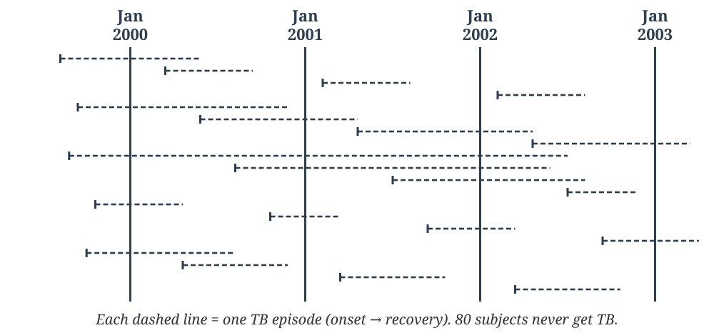

# Epidemiology (CM7): Question Bank

A written companion to the four decks that carry the 15 CM7 lectures:
[Chapter 3: Principles of Epidemiology](principles-epidemiology.qmd)
(Lectures 1–5), [Chapter 4: Epidemiologic Methods](epidemiologic-methods.qmd)
(Lectures 6–9), [Chapter 6: Communicable Diseases](../diseases/communicable-diseases.qmd)
(Lectures 10–13), and [Chapter 5: Screening](screening.qmd) (Lectures 14–15).

Questions are organized by lecture. Descriptive questions (long essay, short
essay, short notes, reasoning, case scenario) are for written practice.
MCQs (single best answer, multiple correct, assertion–reason) are followed
by a lettered answer key. Try them before checking. The same 183 MCQs
appear as interactive Self-Check slides at the end of each lecture in
the decks.

**Sources:** the faculty question bank (Section V, Chapter 19 *Principles
and Practice of Epidemiology*), review exercises from *Community Medicine
with Recent Advances* (9th ed.), Section 3, Chapters 9–14, the decks'
earlier Self-Check questions, and new questions written for the thinner
lectures (10–15).

**Assertion–reason options (all A-R items):** a. Both A and R are true,
and R is the correct explanation of A · b. Both A and R are true, but R is
NOT the correct explanation of A · c. A is true, R is false · d. A is
false, R is true.

**Notes on the source keys:**

- *Ch 19 MCQ 27* (temporality): as printed, both A and R are false and
  there is no "both false" option. The assertion has been reworded to
  "Temporality is an essential criterion for concluding causation" so
  that the printed key (c) is correct.
- *Latest NFHS*: the textbook answer was NFHS-5. NFHS-6 (2023–24) fact
  sheets were released in May 2026, so the option set and key are updated
  (retrieved 28 Oct 2026).
- *Sources of Information (Ch 11) MCQs*: the answer key was not in the
  images supplied. The answers here follow Park / RGI / MoHFW sources.

------------------------------------------------------------------------

## Lecture 1: Definition, Aims, Approach and Uses

*CM7.1 · slides and interactive versions: [Chapter 3](principles-epidemiology.qmd)*

### Descriptive Questions

**Long Essay**

1. Define epidemiology, explain measures of disease frequency, describe the major epidemiological study designs, and discuss association versus causation, including bias and confounding. Add a brief note on MCCD and verbal autopsy. *(Integrated question: draws on Lectures 1–9)*

**Short Essay / Short Answer**

2. Difference between epidemiology and clinical medicine.
3. Write the uses of epidemiology.

**Short Notes**

4. Aims of epidemiology.
5. The epidemiological approach.

### Multiple Choice Questions

**A. Single Best Answer (SBA)**

1. Epidemiology is best defined as the study of:

   a. Diagnosis and treatment of diseases in individual patients
   b. Distribution and determinants of health-related events in populations
   c. Laboratory identification of disease-causing agents
   d. Pharmacological prevention of diseases

2. Which of the following has been considered, at one time or another, a part of the definition of epidemiology?

   a. Study of frequency, distribution, and determinants of diseases
   b. Study of epidemics
   c. Study of mass phenomena of diseases
   d. All of these

3. Epidemiology differs from clinical practice in all of the following respects, EXCEPT:

   a. Epidemiology focuses on a large number of subjects and not a single person
   b. In epidemiology, we quantify the findings
   c. In epidemiology, we do not use clinical skills
   d. Epidemiology asks whether a subject has the disease of interest, while the clinician asks which disease the patient has

4. The word “epidemiology” is derived from three Greek words, “epi,” “demos,” and “logos.” Here, “epi” stands for:

   a. Upon
   b. Population
   c. Science
   d. None of these

5. Community diagnosis means:

   a. Quantifying and summarizing the important health problems and their associated sociodemographic characteristics in a community
   b. Priority-wise listing of the common diseases seen in a community
   c. Summarizing the standards of living and lifestyle factors in a community
   d. None of these

6. Which of the following does NOT fall within the purview of the uses of epidemiology?

   a. Deciding whether a community needs one PHC or four subcentres
   b. Establishing the natural history of HIV infection
   c. Training medical students in conducting a delivery
   d. Investigating an outbreak of food poisoning

7. The book “Airs, Waters and Places” was compiled by:

   a. John Graunt
   b. William Farr
   c. Hippocrates
   d. Alexander Fleming

8. Edward Jenner’s basis for vaccination was the observation that prior infection with which disease protected against subsequent smallpox?

   a. Monkeypox
   b. Cowpox
   c. Chickenpox
   d. Rickettsial pox

9. The first ever scientifically conducted clinical trial was:

   a. Trial of streptomycin for tuberculosis
   b. Trial of polio vaccine
   c. Goldberger’s observations on pellagra
   d. James Lind’s study of lemon juice in the prevention of scurvy

10. The first ever scientific investigation of an epidemic was undertaken by:

    a. John Snow
    b. John Graunt
    c. William Farr
    d. Edward Jenner

11. Which statement is correct regarding Sir Richard Doll and Sir A. Bradford Hill?

    a. Doll was a statistician and Hill was a physician
    b. Doll was a physician and Hill was a statistician
    c. Both were physicians
    d. Both were statisticians

12. Doll and Hill are famous for their studies regarding:

    a. Framingham Heart Study
    b. Treatment of tuberculosis
    c. Smoking and lung cancer
    d. Prevention of HIV

13. The discovery of penicillin by Sir Alexander Fleming was based on:

    a. Epidemiological studies
    b. Laboratory studies
    c. Clinical studies
    d. None of these

14. John Snow’s 1854 investigation is best known for:

    a. Confirming germ theory in a laboratory
    b. Tracing a cholera outbreak to a contaminated water pump using mapped case data
    c. Discovering the cholera bacterium
    d. Establishing Koch’s postulates

### Answers

**MCQs:** 1-b, 2-d, 3-c, 4-a, 5-a, 6-c, 7-c, 8-b\
9-d, 10-a, 11-b, 12-c, 13-b, 14-b

------------------------------------------------------------------------

## Lecture 2: Rates, Ratios and Proportions; Measurement of Mortality

*CM7.3, CM7.4 · slides and interactive versions: [Chapter 3](principles-epidemiology.qmd)*

### Descriptive Questions

**Short Essay / Short Answer**

1. Define rate, ratio, and proportion with appropriate examples.

**Short Notes**

2. Tools of measurement in epidemiology.
3. Tools for measurement of disease magnitude.
4. Mortality rates and ratios.
5. Crude death rate.
6. Case fatality rate.
7. Survival rate.

### Multiple Choice Questions

**A. Single Best Answer (SBA)**

1. “12 new cases of disease per 1,000 population per year” is an example of a:

   a. Ratio
   b. Proportion
   c. Rate
   d. Odds

2. The measure of frequency in which the numerator is NOT a part of the denominator is:

   a. Rate
   b. Ratio
   c. Incidence
   d. Prevalence

3. The term “odds” is the same as a:

   a. Rate
   b. Ratio
   c. Proportion
   d. Mean

4. A proportion with an added relationship with time becomes a:

   a. Rate
   b. Ratio
   c. Prevalence
   d. Mean

5. Which measure best reflects the severity of a disease among those affected?

   a. Incidence rate
   b. Prevalence
   c. Case fatality rate
   d. Proportionate mortality

**B. Multiple Correct Answer (MCMA) — select all that apply**

6. Measures of mortality commonly used in public health include:

   a. Attack rate
   b. Infant mortality rate
   c. Crude death rate
   d. Maternal mortality ratio

**C. Assertion–Reason (A-R)**

7. **Assertion (A):** Case fatality rate is a useful indicator of disease severity. **Reason (R):** It measures the total deaths in the population irrespective of disease.

   a. Both A and R are true, and R is the correct explanation of A
   b. Both A and R are true, but R is NOT the correct explanation of A
   c. A is true, R is false
   d. A is false, R is true

### Answers

**MCQs:** 1-c, 2-b, 3-b, 4-a, 5-c, 6-bcd, 7-c

------------------------------------------------------------------------

## Lecture 3: Measurement of Morbidity: Incidence and Prevalence

*CM7.4 · slides and interactive versions: [Chapter 3](principles-epidemiology.qmd)*

### Descriptive Questions

**Short Essay / Short Answer**

1. Differentiate incidence and prevalence with suitable examples.
2. How will you measure morbidity?
3. Relationship between prevalence and incidence (prevalence vs incidence).

**Short Notes**

4. Relationship between incidence and prevalence.

**Reasoning Type**

5. Why is incidence preferred over prevalence for studying disease causation?
6. Give reasons why prevalence depends on both the incidence and the duration of disease.

### Multiple Choice Questions

Use this figure for the TB-cohort questions (100 HIV-positive subjects, January 2000 – January 2003):

{width="760px"}

**A. Single Best Answer (SBA)**

1. Which measure best reflects the risk of developing disease over a specified period among initially disease-free individuals?

   a. Prevalence
   b. Incidence
   c. Case fatality rate
   d. Proportionate mortality

2. A district surveillance officer wants to compare the current burden of diabetes between two urban wards to plan clinic services. The most appropriate measure is:

   a. Incidence rate
   b. Case fatality rate
   c. Prevalence
   d. Attack rate

3. A disease has high incidence but short duration because of rapid recovery. In such a situation, prevalence is likely to be:

   a. High
   b. Equal to incidence
   c. Very low
   d. Zero

4. A disease with a long duration but low incidence will typically show:

   a. Low prevalence
   b. High prevalence
   c. Zero prevalence
   d. Prevalence equal to incidence

5. Under stable conditions, the relationship between incidence (I), prevalence (P) and duration (D) is:

   a. P = I × D
   b. I = P × D
   c. P = I + D
   d. I = P + D

6. The proportion of persons found to have the disease condition of interest out of those examined gives the:

   a. Rate
   b. Incidence
   c. Prevalence
   d. Ratio

7. Identify the correct statement:

   a. Incidence is a rate while prevalence is a proportion
   b. Prevalence is a rate while incidence is a proportion
   c. Both incidence and prevalence are rates
   d. Both incidence and prevalence are proportions

8. In which of the following frequency measures is the denominator “person-time”?

   a. Cumulative incidence
   b. Incidence density
   c. Point prevalence
   d. Period prevalence

9. In which of the following disease frequency measures can the numerator be greater than the denominator?

   a. Incidence rate (persons)
   b. Period prevalence
   c. Incidence rate (spells)
   d. Point prevalence

10. Which of the following measures is NOT recommended for scientific statistical analysis of epidemiological data?

    a. Cumulative incidence
    b. Incidence density
    c. Point prevalence
    d. Period prevalence

11. In a survey of tobacco smoking among adult males, 190 of the 950 persons surveyed were smokers. The correct frequency measure and its value are:

    a. Incidence, 20%
    b. Prevalence, 20%
    c. Prevalence, 19%
    d. Incidence rate, 190 per 1000 per year

12. BP assessment of 1000 male university students in January 2016 found 50 hypertensive. What is the prevalence of hypertension in January 2016?

    a. 2%
    b. 5%
    c. 10%
    d. 15%

13. In the same students, the remaining 950 normotensives were followed for 3 years, and 19 developed hypertension by January 2019. What is the incidence of hypertension?

    a. 2%
    b. 5%
    c. 2% over a period of 3 years
    d. 5% over a period of 3 years

14. Refer to the TB timeline figure (100 HIV-positive subjects, Jan 2000 – Jan 2003). What is the prevalence of TB in January 2000?

    a. 5/100
    b. 8/100
    c. 5/95
    d. 8/95
    e. 5/92

15. Refer to the TB timeline figure (100 HIV-positive subjects, Jan 2000 – Jan 2003). What is the prevalence of TB in January 2002?

    a. 5/100
    b. 9/100
    c. 5/95
    d. 5/80
    e. 9/80

16. Refer to the TB timeline figure (100 HIV-positive subjects, Jan 2000 – Jan 2003). What is the 3-year incidence of TB for 1 Jan 2000 to 1 Jan 2003?

    a. 20/100
    b. 15/100
    c. 20/95
    d. 15/95
    e. None of these

17. Refer to the TB timeline figure (100 HIV-positive subjects, Jan 2000 – Jan 2003). What is the incidence of TB for the year 2002?

    a. 5/100
    b. 5/85
    c. 5/95
    d. 10/85
    e. None of these

18. Refer to the TB timeline figure (100 HIV-positive subjects, Jan 2000 – Jan 2003). What is the period prevalence for January 2000 to January 2002?

    a. 5%
    b. 10%
    c. 15%
    d. 20%

**C. Assertion–Reason (A-R)**

19. **Assertion (A):** Prevalence is useful for planning health services. **Reason (R):** Prevalence reflects only new cases occurring in a population.

    a. Both A and R are true, and R is the correct explanation of A
    b. Both A and R are true, but R is NOT the correct explanation of A
    c. A is true, R is false
    d. A is false, R is true

### Answers

**MCQs:** 1-b, 2-c, 3-c, 4-b, 5-a, 6-c, 7-a, 8-b\
9-c, 10-d, 11-b, 12-b, 13-c, 14-a, 15-a, 16-d\
17-b, 18-c, 19-c

------------------------------------------------------------------------

## Lecture 4: Standardisation of Rates; Sources of Epidemiological Data

*CM7.3 · slides and interactive versions: [Chapter 3](principles-epidemiology.qmd)*

### Descriptive Questions

**Short Essay / Short Answer**

1. Enumerate the steps of completing an MCCD correctly (principle-based, not format drawing).

**Short Notes**

2. Standardized death rate.
3. Sources of epidemiological data in India.

**Reasoning Type**

4. Why is standardization of death rates necessary when comparing two populations?
5. Explain why the Medical Certification of Cause of Death (MCCD) is important for public health planning but not for individual patient care.

**Exercise**

6. A 54-year-old male with a past history of type 2 diabetes mellitus developed acute STEMI on 22 May 2016 and was admitted to the ICU. On 24 May he developed atrial fibrillation, followed by embolism of the right MCA. He was placed on ventilator and vasopressor support but died on 27 May 2016 at 4 p.m. Prepare his death certificate (MCCD).

### Multiple Choice Questions

**A. Single Best Answer (SBA)**

1. A health planner wants to compare mortality rates between two populations with different age structures. The most appropriate method is to use the:

   a. Crude death rate
   b. Case fatality rate
   c. Standardized death rate
   d. Proportionate mortality ratio

2. The most appropriate public health use of a Medical Certificate of Cause of Death (MCCD) is:

   a. Planning treatment for individual patients
   b. Generation of cause-specific mortality statistics
   c. Early detection of disease outbreaks
   d. Clinical diagnosis at the bedside

3. In verbal autopsy, the primary source of information is:

   a. Postmortem examination findings
   b. Interview with relatives about symptoms before death
   c. Laboratory investigation of body fluids
   d. Review of hospital case records

4. A national tuberculosis survey used trained investigators to collect data from randomly selected households to measure the magnitude of TB and identify high-risk groups. This is an example of:

   a. Primary data collection
   b. Secondary data analysis
   c. Aggregate data analysis
   d. None of these

5. What advantage do death certificates have, in our country, as a source of epidemiological information?

   a. There is a uniform national law for enforcing the filling of death certificates
   b. The cause of death is usually confirmed by autopsy
   c. The ICD system for cause of death has remained constant over the past 50 years
   d. The personal physician of the deceased has to complete the certificate from his/her own knowledge of past illnesses

6. The reference (referral) date for the Indian Census 2001 was:

   a. April 1, 2001
   b. February 1, 2001
   c. March 1, 2001
   d. April 1, 2000

7. The “census point” is taken as the midnight between:

   a. December 31 and January 1
   b. January 31 and February 1
   c. February 28 and March 1
   d. March 31 and April 1

8. The sex ratio in India is described as:

   a. Females per 1000 males
   b. Males per 1000 females
   c. Fraction of females divided by males
   d. Fraction of males divided by females

9. In India, the census is undertaken by which method?

   a. De facto
   b. De jure
   c. Both of these
   d. None of these

10. The authority for overall administration and conduct of the census in India is the:

    a. Registrar of Births and Deaths
    b. Census Commissioner of India
    c. Secretary, Ministry of Home Affairs
    d. Union Health Minister

11. Which of the following enumeration methods has legal backing through an Act passed by Parliament?

    a. Census
    b. Sample Registration System
    c. Model Registration Scheme
    d. Family Health Survey

12. Which of the following is NOT a part of vital statistics?

    a. Registration of births
    b. Registration of patients in hospitals
    c. Registration of deaths
    d. Registration of marriages

13. The annual publication “National Health Profile – India” is published by:

    a. Indian Council of Medical Research
    b. Central Health Education Bureau
    c. Central Bureau of Health Intelligence
    d. National Centre for Disease Control

14. Which of the following is the latest in the series of National Family Health Surveys (NFHS)?

    a. NFHS-3
    b. NFHS-4
    c. NFHS-5
    d. NFHS-6

15. The authority for overall administration and conduct of the Sample Registration System (SRS) in India is the:

    a. Registrar General of India
    b. Census Commissioner of India
    c. Secretary, Ministry of Home Affairs
    d. Union Health Minister

16. Once data have been summarized to obtain information, and then evaluated by experts from socioeconomic, demographic and health angles, they are known as:

    a. Data
    b. Information
    c. Intelligence
    d. Policy

17. Which of the following enumeration methods has separate units for enumeration in rural and urban areas?

    a. Census
    b. SRS
    c. MRS
    d. NFHS

18. The “double recording” (dual record) system of enumeration is used in which of the following?

    a. Census
    b. Facilities Survey
    c. RHS
    d. SRS

19. The “Rapid Household Survey” and “Facilities Survey” are conducted under the overall responsibility of the:

    a. Registrar of Births and Deaths
    b. Census Commissioner
    c. Reproductive and Child Health programme
    d. Ministry of Social Welfare

20. In 2016, results for 13 states and 2 union territories were released in respect of which survey?

    a. Census
    b. Facilities Survey
    c. NFHS-4
    d. NFHS-5

21. Which of the following is a good method of obtaining data on morbidity due to a number of common and important diseases in our country?

    a. Census
    b. SRS
    c. Death certificates
    d. IDSP

22. Which source of information is best for developing a sentinel surveillance system for important diseases?

    a. Census
    b. Hospital-based data
    c. NFHS
    d. Registration of births

**C. Assertion–Reason (A-R)**

23. **Assertion (A):** A properly completed MCCD improves the quality of mortality data. **Reason (R):** Incorrect sequencing and nonspecific terms in certificates reduce the usefulness of cause-specific statistics.

    a. Both A and R are true, and R is the correct explanation of A
    b. Both A and R are true, but R is NOT the correct explanation of A
    c. A is true, R is false
    d. A is false, R is true

### Answers

**MCQs:** 1-c, 2-b, 3-b, 4-a, 5-a, 6-c, 7-c, 8-a\
9-a, 10-b, 11-a, 12-b, 13-c, 14-d, 15-a, 16-c\
17-b, 18-d, 19-c, 20-c, 21-d, 22-b, 23-a

------------------------------------------------------------------------

## Lecture 5: Descriptive Epidemiology: Time, Place and Person

*CM7.5 · slides and interactive versions: [Chapter 3](principles-epidemiology.qmd)*

### Descriptive Questions

**Long Essay**

1. Classify epidemiological studies. Describe the distribution of disease by time, place, and person with respect to descriptive epidemiological studies.

**Short Essay / Short Answer**

2. What are secular trends? How are they useful to doctors?
3. What are cross-sectional studies? Mention the advantages and limitations of this study design.

**Short Notes**

4. Ecological studies.
5. Types of epidemics and the epidemic curve.
6. Propagated epidemic.
7. Migration studies.
8. Epidemic.
9. Sporadic diseases.
10. Exotic diseases, with examples.

### Multiple Choice Questions

**A. Single Best Answer (SBA)**

1. Which of the following is a “person” variable in descriptive epidemiology?

   a. Urban vs rural residence
   b. Seasonal variation
   c. Occupation
   d. Secular trend

2. “The incidence of malaria is very high among migrant labourers in Odisha, Jharkhand and Chhattisgarh.” This statement includes which component(s) of epidemiology?

   a. Frequency
   b. Place distribution
   c. Person distribution
   d. All of these

3. In the statement “55% of pregnant women in India are likely to have anaemia,” which component of epidemiology is NOT included?

   a. Frequency
   b. Person-related distribution
   c. Place-related distribution
   d. Time-related distribution

4. In the statement “Tobacco smoking increases the risk of IHD by three times,” the epidemiological aspect covered pertains to:

   a. Person-related distribution
   b. Place-related distribution
   c. Time-related distribution
   d. Determinants

5. During an outbreak investigation, the number of new cases rises rapidly over a short period and then falls sharply after removal of a common source. This epidemic curve is most consistent with a:

   a. Propagated epidemic
   b. Continuous common-source epidemic
   c. Intermittent common-source epidemic
   d. Seasonal epidemic

6. Descriptive studies perform which of the following functions?

   a. Generate hypotheses
   b. Compare people with disease with those without disease
   c. Compare people with exposure with those without exposure
   d. Test hypotheses

7. A 2 × 2 table showing the four cells E+O+, E+O−, E−O+ and E−O− is seen in a:

   a. Descriptive study
   b. Analytical study
   c. Both of these
   d. None of these

8. The 2 × 2 table of exposure (present/absent) against outcome (present/absent) will NOT be formed in a:

   a. Descriptive study
   b. Case-control study
   c. Cohort study
   d. Experimental study

9. In a standard 2 × 2 table, cell “a” represents all those who are:

   a. Having the exposure but not the outcome
   b. Having the outcome but not the exposure
   c. Having both the exposure and the outcome
   d. Having neither the exposure nor the outcome

10. Another name for an experimental study is:

    a. Interventional study
    b. Case-control study
    c. Cohort study
    d. Cross-sectional study

11. The main difference between an experimental and a cohort design is that:

    a. One is analytical while the other is not
    b. Subjects are followed up in one but not in the other
    c. One is observational while the other is not
    d. One is descriptive while the other is not

12. A study on children with acute glomerulonephritis found that 20% gave a history of acute sore throat 3–4 weeks before onset of renal symptoms. This is an example of a:

    a. Descriptive study
    b. Case-control study
    c. Cohort study
    d. Clinical trial

13. For establishing a cause-and-effect relationship, we need to undertake a:

    a. Case-control study
    b. Cohort study
    c. Experimental study
    d. Any one of these

14. Case-control and cohort studies belong to which type of epidemiological design?

    a. Experimental analytical
    b. Observational analytical
    c. Observational descriptive
    d. Experimental descriptive

15. In which study are the exposure and outcome variables studied at the same point of time?

    a. Case-control study
    b. Cross-sectional analytical study
    c. Cohort study
    d. Experimental study

16. In a retrospective study, we find the history of:

    a. Exposure among those having or not having the outcome
    b. Outcome among those having or not having the exposure
    c. Both exposure and outcome at the same time
    d. None of these

17. When the investigator creates two groups by randomization and introduces the exposure in one group while withholding it from the other, it is known as a:

    a. Descriptive study
    b. Case-control study
    c. Cohort study
    d. Experimental study

18. To study the incidence of malaria according to various age and sex groups in a village, we need to undertake a:

    a. Descriptive study
    b. Case-control study
    c. Cohort study
    d. Experimental study

19. “Comparison between two groups” is the hallmark of a(n):

    a. Descriptive study
    b. Analytical study
    c. Both of these
    d. None of these

20. A country-level comparison of average salt intake against average blood pressure across nations, without individual-level data, is an example of:

    a. A cohort study
    b. A case-control study
    c. An ecological study
    d. A randomized controlled trial

21. A study that actively assigns an intervention to participants, rather than only observing existing exposure, is classified as:

    a. Descriptive
    b. Analytical (observational)
    c. Experimental
    d. Ecological

22. A quality, characteristic or constituent of a subject that can be measured and is likely to differ from one person to another is called a:

    a. Case definition
    b. Variable
    c. Both of these
    d. None of these

23. Which of the following is a “variable” from the epidemiological and statistical points of view?

    a. Age
    b. Sex
    c. Blood pressure
    d. All of these

24. A “numerical discrete scale” belongs to which class of measurement scales?

    a. Qualitative
    b. Quantitative
    c. Both of these
    d. None of these

25. Match each method of recording data with its scale of measurement. **A** satisfaction scored −2 to +2; **B** gravida status; **C** survived/died at 5 years; **D** angiogram: no/mild/moderate/severe blockage; **E** actual coronary diameter; **F** diagnosis: lung / heart / other disease. Scales: (i) dichotomous–nominal (ii) numerical–continuous (iii) polychotomous–ordinal (iv) numerical–ordinal (v) discrete–numerical (vi) nominal–polychotomous.

    a. A-iv, B-v, C-i, D-iii, E-ii, F-vi
    b. A-iii, B-v, C-i, D-iv, E-ii, F-vi
    c. A-iv, B-ii, C-vi, D-iii, E-v, F-i
    d. A-v, B-iv, C-i, D-iii, E-ii, F-vi

26. A study set out to find what percentage of visitors of commercial sex workers in Mumbai use condoms, but interviewed only truck drivers eating at one roadside restaurant outside Mumbai. Condom use was 25%. This conclusion is likely to suffer from:

    a. Lack of ethics
    b. Lack of external validity
    c. None of the previous two
    d. The study was not required at all

27. Which of the following correctly lists the synonyms of “reference population”?

    a. Target population, source population, or universe
    b. Target population, study population, or universe
    c. Target population, source population, or external population
    d. None of these

28. The requirements of a sample are that it should be:

    a. Adequately large
    b. Representative
    c. Both of these
    d. None of these

29. An organized collection of the values of the various variables to be used for further analysis in an epidemiological study is known as a:

    a. Data set
    b. Sample
    c. Statistic
    d. Population

30. In which of the following is the sample studied the same as the total population?

    a. National Family Health Survey
    b. Sample Registration System
    c. Census
    d. Model Registration Scheme

31. If the case definition for dengue is “any person with fever for 1 day,” this definition is:

    a. Very sensitive but not specific
    b. Very specific but not sensitive
    c. Both very sensitive and very specific
    d. Neither sensitive nor specific

32. Fever rising in a step-ladder pattern, with initial constipation followed by pea-soup stools and TLC below 6000/mm³, falls into which category of case definition for enteric fever?

    a. Suspected case
    b. Probable case
    c. Confirmed case
    d. None of these

**B. Multiple Correct Answer (MCMA) — select all that apply**

33. Typical epidemiological study designs include:

    a. Cohort study
    b. Clinical case report as an analytical design
    c. Cross-sectional study
    d. Case-control study

### Answers

**MCQs:** 1-c, 2-d, 3-d, 4-d, 5-b, 6-a, 7-b, 8-a\
9-c, 10-a, 11-c, 12-a, 13-d, 14-b, 15-b, 16-a\
17-d, 18-a, 19-b, 20-c, 21-c, 22-b, 23-d, 24-b\
25-a, 26-b, 27-a, 28-c, 29-a, 30-c, 31-a, 32-b\
33-acd

------------------------------------------------------------------------

## Lecture 6: Case-Control Study

*CM7.5 · slides and interactive versions: [Chapter 4](epidemiologic-methods.qmd)*

### Descriptive Questions

**Long Essay**

1. Define epidemiology. What is a case-control study? Describe the basic stages (framework for analysis), and mention the advantages and limitations of case-control studies.

**Short Essay / Short Answer**

2. Discuss the types of bias in case-control studies.
3. Write the advantages and disadvantages of case-control studies.
4. Explain the difference between a case-control study and a cohort study.

**Short Notes**

5. Odds ratio.

**Reasoning Type**

6. Explain why the odds ratio is used instead of relative risk in case-control studies.
7. Why does rarity of disease allow the odds ratio to approximate relative risk?

### Multiple Choice Questions

**A. Single Best Answer (SBA)**

1. A study begins by identifying people with lung cancer and people without it, then looks backward at their smoking history. This is a:

   a. Cohort study
   b. Case-control study
   c. Randomized controlled trial
   d. Ecological study

2. A researcher wants to study the association between smoking and lung cancer using past hospital records of cases and controls. The most appropriate study design is a:

   a. Cohort study
   b. Randomized controlled trial
   c. Cross-sectional study
   d. Case-control study

3. In a case-control study, the association is most appropriately measured by the:

   a. Relative risk
   b. Attributable risk
   c. Odds ratio
   d. Incidence rate ratio only

4. Which of the following is known as the “cross-product ratio”?

   a. RR
   b. AR
   c. PAR%
   d. OR

5. A case-control study finds an odds ratio of 5.0 between exposure and disease. The best interpretation is:

   a. Cases have five times higher odds of having had the exposure compared with controls
   b. The exposed have five times higher incidence, directly measured
   c. The exposure is definitely causal without further assessment
   d. The disease prevalence is 5%

6. Selection bias in a case-control study most commonly occurs when:

   a. Selection of cases and controls is related to exposure status
   b. Exposure is measured with high accuracy
   c. Outcome status is confirmed objectively
   d. Sample size is sufficiently large

7. An epidemiologist wants to study whether blood group “O” protects against peptic ulcer disease compared with the other three blood groups. The outcome variable in this case is:

   a. Blood groups
   b. Peptic ulcer disease
   c. Both of these
   d. None of these

8. In a case-control study of oral cancer, 80 of 100 cases and 40 of 100 controls chewed tobacco. The odds ratio is:

   a. 2.0
   b. 4.0
   c. 6.0
   d. 8.0

**C. Assertion–Reason (A-R)**

9. **Assertion (A):** Recall bias is commonly seen in cohort studies. **Reason (R):** Recall bias mainly affects studies where past exposure is assessed after disease occurrence.

   a. Both A and R are true, and R is the correct explanation of A
   b. Both A and R are true, but R is NOT the correct explanation of A
   c. A is true, R is false
   d. A is false, R is true

### Answers

**MCQs:** 1-b, 2-d, 3-c, 4-d, 5-a, 6-a, 7-b, 8-c\
9-d

------------------------------------------------------------------------

## Lecture 7: Cohort Study

*CM7.5 · slides and interactive versions: [Chapter 4](epidemiologic-methods.qmd)*

### Descriptive Questions

**Long Essay**

1. Define epidemiology. Classify epidemiological study designs. Describe in detail the steps involved in a cohort study, and enumerate the advantages and disadvantages of cohort studies.
2. Describe a cohort study with a suitable example.

**Short Essay / Short Answer**

3. Cohort study: steps and risk measurements.
4. Attributable risk and population attributable risk.

**Short Notes**

5. Relative risk: definition and calculation.
6. Attributable risk: calculation.

**Reasoning Type**

7. Give reasons why loss to follow-up threatens validity in cohort studies.

### Multiple Choice Questions

**A. Single Best Answer (SBA)**

1. Which measure of association can be directly calculated from a cohort study but NOT from a case-control study?

   a. Odds Ratio
   b. Relative Risk
   c. p-value
   d. Confidence interval

2. If IE is the incidence of disease in the group exposed to a risk factor and IO the incidence in the unexposed group, then IE/IO gives the:

   a. Relative risk
   b. Risk ratio
   c. Both of these
   d. None of these

3. Attributable Risk Percent (AR%) is best described as:

   a. The strength of an association
   b. The proportion of exposed-group risk that would be eliminated if the exposure were removed
   c. The same value as the odds ratio
   d. A measure usable only in RCTs

4. Annual incidence of thromboembolism per lakh women aged 30–39 is 5.3 among oral-contraceptive users and 1.8 among non-users. The RR and AR are:

   a. RR 2.9; AR 3.5 per lakh
   b. RR 3.5; AR 2.9 per lakh
   c. RR 0.34; AR 3.5 per lakh
   d. RR 2.9; AR 7.1 per lakh

5. In a cohort study, lung cancer incidence was 28 per 1000 among smokers and 4 per 1000 among non-smokers. The attributable risk percent (AR%) among smokers is about:

   a. 14%
   b. 24%
   c. 86%
   d. 700%

6. In a cohort study, loss to follow-up is higher among exposed individuals who later develop the disease. This most likely introduces:

   a. Recall bias
   b. Information bias
   c. Selection bias
   d. Confounding

7. A study uses 1990 factory employment records to classify workers by asbestos exposure, then traces their mesothelioma occurrence up to 2025. This is a:

   a. Prospective cohort study
   b. Retrospective (historical) cohort study
   c. Case-control study
   d. Cross-sectional study

**C. Assertion–Reason (A-R)**

8. **Assertion (A):** In a cohort study, incidence can be directly measured. **Reason (R):** Participants are followed over time from exposure status to observe the occurrence of new outcomes.

   a. Both A and R are true, and R is the correct explanation of A
   b. Both A and R are true, but R is NOT the correct explanation of A
   c. A is true, R is false
   d. A is false, R is true

### Answers

**MCQs:** 1-b, 2-c, 3-b, 4-a, 5-c, 6-c, 7-b, 8-a

------------------------------------------------------------------------

## Lecture 8: Experimental Studies: RCT and Its Types

*CM7.5 · slides and interactive versions: [Chapter 4](epidemiologic-methods.qmd)*

### Descriptive Questions

**Long Essay**

1. What is a randomized controlled trial (RCT)? Enumerate the different types of randomized controlled trials. Outline the steps involved in conducting an RCT and add a note on blinding.

**Short Essay / Short Answer**

2. Write the steps involved in a randomized controlled trial (RCT).

**Short Notes**

3. Cross-over type of study design.
4. Blinding in randomized controlled trials.
5. Advantages and limitations of animal experiments.

### Multiple Choice Questions

**A. Single Best Answer (SBA)**

1. The main strength of randomization in an RCT is that it:

   a. Guarantees a statistically significant result
   b. Balances known and unknown confounders between the intervention and control groups
   c. Removes the need for a control group
   d. Eliminates all information bias automatically

2. Another name for randomization is:

   a. Random sampling
   b. Random allocation
   c. Random error
   d. Random variable

3. In a typhoid vaccine trial, 2000 children were randomized into two groups of 1000. Over one year, 20 vaccinated and 80 placebo children developed typhoid. The vaccine efficacy is:

   a. 25%
   b. 60%
   c. 75%
   d. 80%

4. Hypertension was controlled in 91% of patients given new drug X and in 67% of patients given ramipril. The number needed to treat (NNT) is about:

   a. 2
   b. 4
   c. 24
   d. 58

5. In a triple-blind trial, the group assignment is concealed from the:

   a. Participants only
   b. Participants and the investigator assessing outcomes
   c. Participants, the investigators, and the person analysing the data
   d. Ethics committee

6. In a crossover trial:

   a. Each participant receives both treatments in sequence, separated by a washout period
   b. Whole villages are randomized rather than individuals
   c. Two interventions are tested simultaneously in all combinations
   d. Patients who fail on one drug are switched to the other at the doctor’s discretion

7. A trial in which whole communities, rather than individuals, receive the intervention (e.g. water fluoridation) is a:

   a. Clinical trial
   b. Field trial
   c. Community trial
   d. Crossover trial

**C. Assertion–Reason (A-R)**

8. **Assertion (A):** Confounding can be reduced by randomization in experimental studies. **Reason (R):** Randomization tends to distribute known and unknown confounders equally between groups.

   a. Both A and R are true, and R is the correct explanation of A
   b. Both A and R are true, but R is NOT the correct explanation of A
   c. A is true, R is false
   d. A is false, R is true

### Answers

**MCQs:** 1-b, 2-b, 3-c, 4-b, 5-c, 6-a, 7-c, 8-a

------------------------------------------------------------------------

## Lecture 9: Association, Causation and Bias

*CM7.8 · slides and interactive versions: [Chapter 4](epidemiologic-methods.qmd)*

### Descriptive Questions

**Short Essay / Short Answer**

1. Explain confounding with one epidemiological example and its control methods.
2. Discuss the concept of causal inference and the role of temporality.
3. Different types of association.
4. What is spurious association? How can it be prevented during research studies?

**Short Notes**

5. Spurious association.
6. Bradford Hill criteria of causation.

**Reasoning Type**

7. Justify why temporality is considered a mandatory criterion for causation.
8. Explain how confounding can distort an observed exposure–disease association.

### Multiple Choice Questions

**A. Single Best Answer (SBA)**

1. “Confounding” is best described as:

   a. Error due to random variation in small samples
   b. Distortion of an observed association by a third related factor
   c. Misclassification of disease status
   d. Elimination of error by increasing sample size

2. Which of the following is NOT an essential characteristic of a confounding variable?

   a. It should lie in the direct chain of causation between exposure and outcome
   b. It should be related to the exposure variable
   c. It should be related to the outcome variable, independent of its relationship with the exposure
   d. It should be differentially distributed between the groups

3. Which of the following is NOT a method of controlling confounding?

   a. Restriction
   b. Matching
   c. Stratified analysis
   d. Ensuring use of accurate instruments

4. Which method can be used to control confounding during the statistical analysis stage, after data collection is complete?

   a. Randomization
   b. Matching
   c. Restriction
   d. Stratified analysis

5. Which type of bias or distortion CAN typically still be corrected during data analysis, after the study has been conducted?

   a. Selection bias
   b. Recall bias
   c. Confounding
   d. Interviewer bias

6. Gender CANNOT be a confounding variable in a study exploring the association between:

   a. Tobacco smoking and lung cancer
   b. Viral infections and diabetes mellitus
   c. Use of talcum powder and ovarian cancer
   d. Habitual physical exercise and IHD

7. Confounding is a form of which of the following errors?

   a. Lack of internal validity (bias)
   b. Lack of external validity
   c. Lack of statistical precision
   d. Lack of repeatability

8. Another name for “lack of internal validity” is:

   a. Bias
   b. Systematic error
   c. Misclassification
   d. All of these

9. Bias can be of which of the following types?

   a. Selection bias
   b. Measurement bias
   c. Both of these
   d. None of these

10. In assessing a cause-and-effect relationship, we exclude the role of certain factors and then evaluate the relationship against causal criteria. The correct sequence is:

    a. Bias, chance, confounding, criteria of causal association
    b. Chance, confounding, bias, criteria of causal association
    c. Criteria of causal association, bias, confounding, chance
    d. Confounding, chance, bias, criteria of causal association

11. In assessing whether a cause-and-effect relationship exists between an exposure and an outcome, we ascertain that:

    a. There is no bias
    b. There is a statistically significant association
    c. There is no confounding
    d. All of these

12. A key criterion supporting causation rather than mere association is:

    a. Large p-value
    b. Temporality (exposure precedes outcome)
    c. Availability of expensive laboratory tests
    d. Equal prevalence in exposed and unexposed

13. The essential condition that must be satisfied before considering a causal relationship is:

    a. Biological plausibility
    b. Strength of association
    c. Temporality
    d. Consistency

14. The statement “the higher the relative risk, the more likely the association is causal” reflects which criterion of causal association?

    a. Temporality
    b. Strength of association
    c. Consistency
    d. Biological plausibility

15. A high odds ratio in a case-control study always indicates:

    a. Causation
    b. Strong association
    c. Absence of bias
    d. High incidence

16. Measuring a patient’s BP immediately after they have climbed 50 stairs to reach the clinic will result in:

    a. Error of basic measurement
    b. Bias
    c. Confounding
    d. All of these

17. In a hypertension survey, young men walked 2 km from the parking lot and their BP was measured immediately on arrival, without rest. This will adversely affect the:

    a. Validity
    b. Reliability
    c. Precision
    d. Will not adversely affect anything

18. The ability of a measurement process to give consistent results when repeated is called:

    a. Reliability
    b. Replicability
    c. Consistency
    d. All of these

19. The ability of a measurement process to correctly measure what it actually intends to measure is known as:

    a. Reliability
    b. Reproducibility
    c. Validity
    d. Consistency

20. A CT scan of an unconscious patient’s brain was read independently by two radiologists. One reported a mild left subthalamic bleed and the other reported it as normal. This is a situation of:

    a. Subject-related variation
    b. Instrument-related variation
    c. Interobserver variation
    d. Technique-related variation

21. In women, body temperature taken immediately on waking is higher at the time of ovulation. This is an example of:

    a. Intrasubject variation
    b. Intersubject variation
    c. Circadian variation
    d. Observer variation

22. Standardization of instruments and measurement technique will ensure all of the following, EXCEPT:

    a. Validity
    b. Intersubject variations
    c. Intrasubject variations
    d. Interobserver variations

**B. Multiple Correct Answer (MCMA) — select all that apply**

23. Criteria often discussed in causal inference include:

    a. Temporality
    b. Biological plausibility
    c. Absence of any bias in all studies
    d. Consistency across studies

**C. Assertion–Reason (A-R)**

24. **Assertion (A):** Temporality is an essential criterion for concluding causation. **Reason (R):** If exposure precedes disease, the relationship must be causal.

    a. Both A and R are true, and R is the correct explanation of A
    b. Both A and R are true, but R is NOT the correct explanation of A
    c. A is true, R is false
    d. A is false, R is true

### Answers

**MCQs:** 1-b, 2-a, 3-d, 4-d, 5-c, 6-c, 7-a, 8-d\
9-c, 10-a, 11-d, 12-b, 13-c, 14-b, 15-b, 16-a\
17-a, 18-d, 19-c, 20-c, 21-a, 22-b, 23-abd, 24-c

------------------------------------------------------------------------

## Lecture 10: Infectious Disease Epidemiology: Dynamics and Modes of Transmission

*CM7.2 · slides and interactive versions: [Chapter 6](../diseases/communicable-diseases.qmd)*

### Descriptive Questions

**Short Essay / Short Answer**

1. Write the various modes of disease transmission with examples and control measures for each.
2. Describe the chain of infection (dynamics of disease transmission).

**Short Notes**

3. Secondary attack rate and its calculation.
4. Carriers.
5. Incubation period and its uses.
6. Basic reproduction number (R₀).

### Multiple Choice Questions

**A. Single Best Answer (SBA)**

1. Which of the following is NOT one of the six links in the chain of infection?

   a. Reservoir
   b. Portal of exit
   c. Herd immunity
   d. Susceptible host

2. Malaria, transmitted from an infected person to a new host via a mosquito, is an example of which mode of transmission?

   a. Direct contact
   b. Droplet spread
   c. Vector-borne transmission
   d. Fomite transmission

3. A typhoid patient continues to excrete S. Typhi in stools for several weeks after clinical recovery. This person is a:

   a. Incubatory carrier
   b. Convalescent carrier
   c. Healthy carrier
   d. Contact

4. In a household of 6, one person develops measles (the primary case). One other member is already immune. Within one incubation period, 2 more members develop measles. The secondary attack rate is:

   a. 33%
   b. 40%
   c. 50%
   d. 60%

5. The time interval between receipt of infection by a host and maximal infectivity of that host is called the:

   a. Incubation period
   b. Serial interval
   c. Generation time
   d. Communicable period

6. If a disease has a basic reproduction number (R₀) of less than 1 in a population, the disease will:

   a. Spread as an epidemic
   b. Remain endemic at a stable level
   c. Gradually die out
   d. Become pandemic

### Answers

**MCQs:** 1-c, 2-c, 3-b, 4-c, 5-c, 6-c

------------------------------------------------------------------------

## Lecture 11: Immunity and Immunising Agents

*CM7.2 · slides and interactive versions: [Chapter 6](../diseases/communicable-diseases.qmd)*

### Descriptive Questions

**Short Essay / Short Answer**

1. Classify immunity with examples. Differentiate active and passive immunity.
2. Describe the immunizing agents: vaccines, immunoglobulins and antisera.

**Short Notes**

3. Herd immunity.
4. Cold chain.
5. Adverse events following immunization (AEFI).
6. Live vs killed vaccines.

### Multiple Choice Questions

**A. Single Best Answer (SBA)**

1. A disease has R₀ = 4. What proportion of the population must be immune to reach the herd immunity threshold?

   a. 25%
   b. 50%
   c. 75%
   d. 100%

2. Immunity acquired by a newborn from maternal antibodies transferred across the placenta is:

   a. Natural active immunity
   b. Natural passive immunity
   c. Artificial active immunity
   d. Artificial passive immunity

3. Administration of tetanus immunoglobulin to an unimmunized patient with a contaminated wound provides:

   a. Natural active immunity
   b. Natural passive immunity
   c. Artificial active immunity
   d. Artificial passive immunity

4. Which of the following is a live attenuated vaccine?

   a. Tetanus toxoid
   b. Hepatitis B vaccine
   c. BCG
   d. Inactivated polio vaccine (IPV)

5. Which of the following vaccines is the MOST heat-sensitive?

   a. BCG
   b. Oral polio vaccine (OPV)
   c. Tetanus toxoid
   d. Hepatitis B

6. The Vaccine Vial Monitor (VVM) on a vial indicates:

   a. Whether the vaccine has been frozen
   b. Cumulative heat exposure of the vial
   c. The expiry date of the vaccine
   d. Whether the vial has been opened

**B. Multiple Correct Answer (MCMA) — select all that apply**

7. Which of the following are recognized causes in the WHO classification of adverse events following immunization (AEFI)?

   a. Vaccine product-related reaction
   b. Immunization error-related reaction
   c. Immunization anxiety-related reaction
   d. Coincidental event

### Answers

**MCQs:** 1-c, 2-b, 3-d, 4-c, 5-b, 6-b, 7-abcd

------------------------------------------------------------------------

## Lecture 12: Disease Prevention and Control; Disinfection

*CM7.2 · slides and interactive versions: [Chapter 6](../diseases/communicable-diseases.qmd)*

### Descriptive Questions

**Short Essay / Short Answer**

1. Describe the methods for the control of communicable diseases: controlling the reservoir, interrupting transmission, and protecting the susceptible host.
2. Define disinfection. Describe its types and the agents used, with their applications.

**Short Notes**

3. Isolation vs quarantine.
4. Concurrent and terminal disinfection.
5. Chemoprophylaxis.

### Multiple Choice Questions

**A. Single Best Answer (SBA)**

1. A person who was exposed to a confirmed case, but has no symptoms and unknown infection status, is placed in separate accommodation for the incubation period of the disease. This is:

   a. Isolation
   b. Quarantine
   c. Ring vaccination
   d. Contact tracing

2. Disinfection of the sickroom, its contents and bedding after the patient has been removed by recovery, death or transfer is called:

   a. Concurrent disinfection
   b. Terminal disinfection
   c. Precurrent disinfection
   d. Sterilization

3. Chlorination of a community water supply is an example of:

   a. Concurrent disinfection
   b. Terminal disinfection
   c. Precurrent (prophylactic) disinfection
   d. Sterilization

4. Giving rifampicin to the household contacts of a case of meningococcal meningitis is an example of:

   a. Controlling the reservoir
   b. Interrupting transmission
   c. Chemoprophylaxis to protect the susceptible host
   d. Active immunization

5. Which measure acts on the RESERVOIR link of the chain of infection?

   a. Early diagnosis and treatment of cases
   b. Vector control
   c. Water chlorination
   d. Immunization of contacts

### Answers

**MCQs:** 1-b, 2-b, 3-c, 4-c, 5-a

------------------------------------------------------------------------

## Lecture 13: Investigation of an Epidemic; Surveillance (IDSR/IHIP)

*CM7.7 · slides and interactive versions: [Chapter 6](../diseases/communicable-diseases.qmd)*

### Descriptive Questions

**Short Essay / Short Answer**

1. Describe the steps in the investigation of an epidemic.
2. Define surveillance. Describe its types and the Integrated Disease Surveillance Programme (IDSP/IHIP).

**Short Notes**

3. Epidemiological case sheet for investigation of an epidemic.
4. Sentinel surveillance.

**Case Scenario**

5. A health officer observes that the number of reported cases of typhoid fever in a town has doubled over the past month compared to the same period last year. Most cases are clustered around a specific locality.

   a. What epidemiological phenomenon is suggested by this observation?
   b. Which measure of disease frequency is being used for comparison?
   c. What is the first step the health officer should take to investigate this situation?
   d. Mention two possible sources of infection in this locality.
   e. How does epidemiology help in planning control measures in such situations?

### Multiple Choice Questions

**A. Single Best Answer (SBA)**

1. In the standard outbreak-investigation sequence, “develop hypotheses” comes immediately after which step?

   a. Verify the diagnosis
   b. Describe data by time, place, and person
   c. Implement control measures
   d. Communicate findings

2. When investigating a suspected outbreak, the first step after preparation for field work is to:

   a. Implement control measures
   b. Confirm the existence of an epidemic and verify the diagnosis
   c. Formulate a hypothesis
   d. Write the report

3. On the IHIP platform under IDSP, the “P” form is used to report:

   a. Patients admitted to hospital
   b. Presumptive cases diagnosed by clinicians
   c. Polio cases only
   d. Private-sector laboratory results

4. Surveillance in which health workers make house-to-house visits to search for fever cases and collect blood smears is:

   a. Passive surveillance
   b. Active surveillance
   c. Sentinel surveillance
   d. Syndromic surveillance

5. Selected reporting sites that systematically report a specific disease, used to detect trends that routine reporting misses, constitute:

   a. Passive surveillance
   b. Active surveillance
   c. Sentinel surveillance
   d. Census

### Answers

**MCQs:** 1-b, 2-b, 3-b, 4-b, 5-c

------------------------------------------------------------------------

## Lecture 14: Screening I: Concept, Uses and Criteria

*CM7.6 · slides and interactive versions: [Chapter 5](screening.qmd)*

### Descriptive Questions

**Short Essay / Short Answer**

1. Define screening. Describe its uses and the types of screening.
2. Differentiate a screening test from a diagnostic test.
3. Enumerate the criteria for screening (disease and test).

**Short Notes**

4. Wilson and Jungner criteria.
5. Multiphasic screening.
6. Lead time.

### Multiple Choice Questions

**A. Single Best Answer (SBA)**

1. A screening test is applied to an asymptomatic population. A person who tests positive should next:

   a. Be told they definitely have the disease
   b. Undergo a diagnostic test to confirm or rule out disease
   c. Be treated immediately without further testing
   d. Be excluded from future screening

2. Which Wilson–Jungner criterion is violated if there is no accepted treatment for a condition, even if a perfect test for it exists?

   a. Suitable test
   b. Accepted treatment for recognized disease
   c. Acceptability to the population
   d. Continuing process

3. A health camp offering blood pressure, blood glucose and vision testing together in one visit is an example of:

   a. Mass screening
   b. Selective screening
   c. Multiphasic screening
   d. Opportunistic screening

4. Screening a pregnant woman for anaemia and syphilis at her first antenatal visit, to protect her and her baby, primarily serves which use of screening?

   a. Case detection (prescriptive screening)
   b. Control of disease (prospective screening)
   c. Research purposes
   d. Educational opportunity

5. Screening of blood donors for HIV and hepatitis B is mainly done for:

   a. Case detection for the donor’s benefit
   b. Control of disease: protecting others (prospective screening)
   c. Research
   d. Health education

6. Which feature distinguishes a screening test from a diagnostic test?

   a. Screening is applied to symptomatic patients
   b. Screening results are the basis for treatment
   c. Screening is applied to apparently healthy groups and is less accurate and cheaper
   d. Screening is initiated by the patient

7. Screening offered only to smokers aged over 50 for lung disease is an example of:

   a. Mass screening
   b. High-risk (selective) screening
   c. Multiphasic screening
   d. Opportunistic screening

### Answers

**MCQs:** 1-b, 2-b, 3-c, 4-a, 5-b, 6-c, 7-b

------------------------------------------------------------------------

## Lecture 15: Screening II: Sensitivity, Specificity and Predictive Values

*CM7.6 · slides and interactive versions: [Chapter 5](screening.qmd)*

### Descriptive Questions

**Short Essay / Short Answer**

1. Define sensitivity, specificity and predictive values. Explain with a 2 × 2 table.
2. Explain how disease prevalence affects the predictive value of a screening test.

**Short Notes**

3. Series and parallel testing.
4. Lead time bias and length time bias.

**Reasoning Type**

5. Why can screening programmes with poor specificity overload health services?

**Numerical**

6. A new test was applied to 500 persons, 100 of whom had the disease (confirmed by a gold standard). The test was positive in 90 diseased and 40 non-diseased persons. Calculate sensitivity, specificity, PPV, NPV, and the false-positive and false-negative rates.

### Multiple Choice Questions

**A. Single Best Answer (SBA)**

1. Which measure of test validity does NOT change with disease prevalence in the population tested?

   a. Positive predictive value
   b. Negative predictive value
   c. Sensitivity
   d. Both PPV and NPV

2. In a screening programme for cervical cancer, many women test positive but are later found disease-free on confirmatory testing. This problem is best explained by low:

   a. Sensitivity
   b. Specificity
   c. Incidence
   d. Reliability

3. A screening test for a fatal disease has very high sensitivity but poor specificity. In a low-prevalence population, the most likely consequence is:

   a. High positive predictive value
   b. Many false positives leading to unnecessary confirmatory testing
   c. No impact on workload
   d. Elimination of overdiagnosis

4. A test is applied to 1000 people. Of 100 who truly have the disease, 80 test positive. Of 900 without the disease, 90 test positive. The sensitivity and specificity are:

   a. 80% and 90%
   b. 90% and 80%
   c. 80% and 10%
   d. 47% and 98%

5. In the same example (TP 80, FP 90, FN 20, TN 810), the positive predictive value is about:

   a. 47%
   b. 80%
   c. 90%
   d. 98%

6. Two tests are applied in series, and a person is called positive only if positive on both. Compared with either test alone, series testing:

   a. Increases sensitivity
   b. Increases specificity
   c. Increases both
   d. Decreases both

7. Screened patients appear to survive longer after diagnosis simply because their disease was detected earlier in its course, even though they die at the same time as without screening. This is:

   a. Length time bias
   b. Lead time bias
   c. Overdiagnosis
   d. Selection bias

8. Detection, through screening, of a genuine abnormality that would never have caused symptoms or harm in a person’s lifetime is called:

   a. Lead time bias
   b. Length time bias
   c. Overdiagnosis
   d. False positive

### Answers

**MCQs:** 1-c, 2-b, 3-b, 4-a, 5-a, 6-b, 7-b, 8-c
