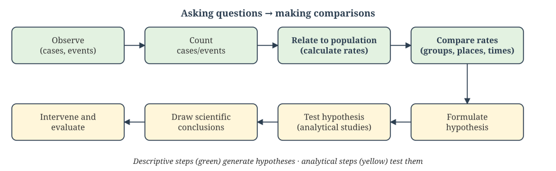
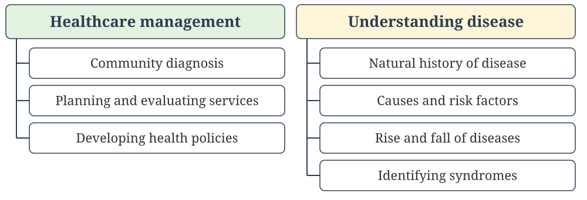
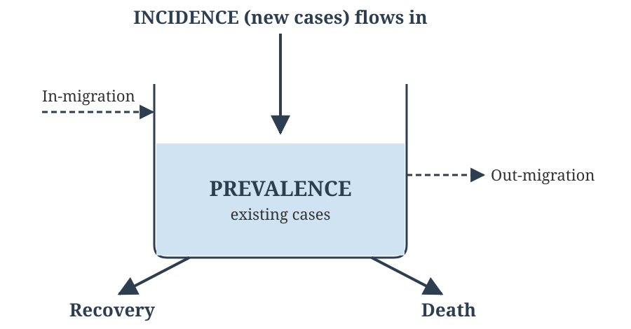
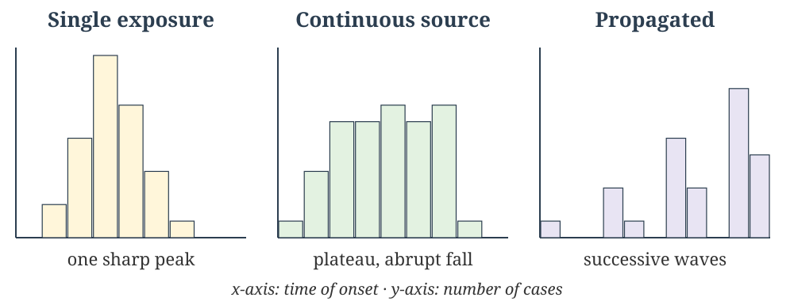
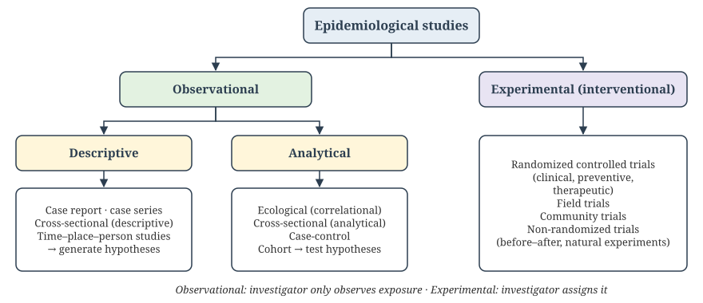

## Welcome {#home}

### Principles of Epidemiology

**Learning Objectives (CM7 Lectures 1–5):**

- Define epidemiology; state its aims, components, approach and uses
- Distinguish ratio, proportion and rate; calculate and interpret the main mortality measures
- Measure morbidity: incidence (cumulative, density), prevalence, and P = I × D
- Standardize rates (direct, indirect/SMR); list India's sources of epidemiological data, including MCCD
- Describe disease by time, place and person; classify epidemiological study designs

**NMC Community Medicine Code:** CM7.1, CM7.3, CM7.4, CM7.5

🟢 **MUST KNOW** · 🟡 **SHOULD KNOW** · 🟣 **MAY KNOW** · 🧡 **QUESTION**

::: {.notes}
Each lecture ends with descriptive practice questions and a block of
interactive Self-Check MCQs drawn from the faculty question bank. The
written version with answer keys is in the Epidemiology Question Bank.
:::

---

## Lecture 1: Definition, Aims, and Uses {background-color="#E6EEF5"}

📚 **Lecture 1 of 15** · **CM7.L1**

*Epidemiology - definition, aims, epidemiological approach and uses*

---

## What Is Epidemiology? {background-color="#E3F2E1"}

🟢 **MUST KNOW**

*Epi* (upon) + *demos* (people) + *logos* (study): the study of what
befalls a population.

**John Last's definition (1988), the standard reference definition:**

> "The study of the distribution and determinants of health-related
> states or events in specified populations, and the application of this
> study to the control of health problems."

- **Distribution**: frequency and pattern by time, place and person (descriptive)
- **Determinants**: the causes and risk factors behind that pattern (analytical)
- **Application**: using that knowledge to prevent and control disease

---

## Aims of Epidemiology {background-color="#E3F2E1"}

🟢 **MUST KNOW**

The International Epidemiological Association lists three aims:

1. **Describe** the distribution and magnitude of health and disease problems in human populations
2. **Identify** etiological factors (causes and risk factors) in the pathogenesis of disease
3. **Provide data** essential to the planning, implementation and evaluation of services for the prevention, control and treatment of disease, and to setting priorities among them

**Ultimate aim:** to eliminate or reduce the health problem, and to promote the health and well-being of society as a whole.

**Basic components:** disease **frequency** · **distribution** · **determinants**

---

## The Epidemiological Approach {background-color="#E3F2E1"}

🟢 **MUST KNOW**

Two core activities: **asking questions** (*what is the event? how much? where? when? who? why?*) and **making comparisons** (between groups, places and times).

{.slide-img .nostretch width="860px"}

---

## Epidemiology vs Clinical Medicine {background-color="#E3F2E1"}

🟢 **MUST KNOW**

| | Clinical medicine | Epidemiology |
|---|---|---|
| **Unit of study** | The individual patient | Defined population (community) |
| **Starting point** | A sick person seeks care | Sick *and* healthy people, including those who never reach a clinic |
| **Core question** | *Which* disease does this patient have? | *Does* this subject have the disease of interest? How many, where, when, why? |
| **Method** | History, examination, investigations | Counting, rates, comparison of groups |
| **Outcome** | Diagnosis and treatment of the patient | Community diagnosis, prevention and control |

Both rely on clinical skills: an epidemiologist still needs them to apply a case definition.

---

## Uses of Epidemiology {background-color="#FFF6DA"}

🟡 **SHOULD KNOW**

{.slide-img .nostretch width="800px"}

**Morris's seven uses (Park):** historical study · community diagnosis · planning and evaluation · individual risks and chances · completing the clinical picture · identification of syndromes · searching for causes.

---

## Milestones in the History of Epidemiology {background-color="#FFF6DA"}

🟡 **SHOULD KNOW**

| Year | Person | Contribution |
|---|---|---|
| c. 400 BC | **Hippocrates** | *Airs, Waters and Places*: related disease to the environment |
| 1662 | **John Graunt** | *Bills of Mortality*: first quantification of birth and death data |
| 1747 | **James Lind** | Citrus fruit for scurvy: the first controlled clinical trial |
| 1796 | **Edward Jenner** | Cowpox inoculation against smallpox: vaccination |
| 1839 | **William Farr** | Systematic vital statistics; classification of causes of death |
| 1854 | **John Snow** | Cholera and the Broad Street pump: the first scientific epidemic investigation |
| 1948–51 | **Framingham; Doll & Hill** | CVD cohort; smoking and lung cancer (Doll a physician, Hill a statistician) |
| 1948 | **MRC streptomycin trial** | The first randomized controlled trial |

---

## John Snow and the Broad Street Pump {background-color="#E8E4F3"}

🟣 **MAY KNOW**

In 1854, a severe cholera outbreak in London's Soho district killed over
600 people in about ten days. **John Snow** rejected the then-dominant
miasma ("bad air") theory. He mapped cholera deaths by address and traced
them to a single water pump on Broad Street. Local authorities removed the
pump handle, and the outbreak subsided.

Snow also compared death rates among households supplied by two water
companies (the "Grand Experiment"): the Southwark & Vauxhall company drew
sewage-polluted Thames water and the Lambeth company drew cleaner water.

**Why it matters:** this is the founding case study of modern
epidemiology. It used descriptive and comparative data to identify a cause
and act, *before* germ theory existed.

---

## Practice Questions: Descriptive (Lecture 1) {background-color="#FFF6DA"}

**For written practice — work through these on paper; no auto-check for this slide.**

**Long Essay**

1. Define epidemiology, explain measures of disease frequency, describe the major epidemiological study designs, and discuss association versus causation, including bias and confounding. Add a brief note on MCCD and verbal autopsy. *(Integrated question: draws on Lectures 1–9)*

**Short Essay / Short Answer**

2. Difference between epidemiology and clinical medicine.
3. Write the uses of epidemiology.

**Short Notes**

4. Aims of epidemiology.
5. The epidemiological approach.

---

## Self-Check: Question 1 {background-color="#FDE8E8"}

🧡 **QUESTION**

::: {.quiz-question}
### Question 1

Epidemiology is best defined as the study of:

- Diagnosis and treatment of diseases in individual patients
- [Distribution and determinants of health-related events in populations]{.correct data-explanation="Last&#x27;s definition: the study of the distribution and determinants of health-related states or events in specified populations, and the application of this study to the control of health problems. The unit of concern is the population, not the individual patient."}
- Laboratory identification of disease-causing agents
- Pharmacological prevention of diseases
:::

---

## Self-Check: Question 2 {background-color="#FDE8E8"}

🧡 **QUESTION**

::: {.quiz-question}
### Question 2

Which of the following has been considered, at one time or another, a part of the definition of epidemiology?

- Study of frequency, distribution, and determinants of diseases
- Study of epidemics
- Study of mass phenomena of diseases
- [All of these]{.correct data-explanation="The definition has evolved: early definitions spoke of the study of epidemics, later of mass phenomena of disease, and modern ones of frequency, distribution and determinants. All three have been part of the definition at some point."}
:::

---

## Self-Check: Question 3 {background-color="#FDE8E8"}

🧡 **QUESTION**

::: {.quiz-question}
### Question 3

Epidemiology differs from clinical practice in all of the following respects, EXCEPT:

- Epidemiology focuses on a large number of subjects and not a single person
- In epidemiology, we quantify the findings
- [In epidemiology, we do not use clinical skills]{.correct data-explanation="Epidemiologists still rely on clinical skills: case definitions, examination and diagnosis all need them. The real differences are the unit of study (population vs individual), quantification, and the question being asked."}
- Epidemiology asks whether a subject has the disease of interest, while the clinician asks which disease the patient has
:::

---

## Self-Check: Question 4 {background-color="#FDE8E8"}

🧡 **QUESTION**

::: {.quiz-question}
### Question 4

The word “epidemiology” is derived from three Greek words, “epi,” “demos,” and “logos.” Here, “epi” stands for:

- [Upon]{.correct data-explanation="Epi = upon, demos = people (population), logos = study or science. Literally, the study of what falls upon the people."}
- Population
- Science
- None of these
:::

---

## Self-Check: Question 5 {background-color="#FDE8E8"}

🧡 **QUESTION**

::: {.quiz-question}
### Question 5

Community diagnosis means:

- [Quantifying and summarizing the important health problems and their associated sociodemographic characteristics in a community]{.correct data-explanation="Community diagnosis is the epidemiological counterpart of a clinical diagnosis. It quantifies the community&#x27;s main health problems together with the sociodemographic characteristics linked to them. A bare disease list or a lifestyle summary is incomplete."}
- Priority-wise listing of the common diseases seen in a community
- Summarizing the standards of living and lifestyle factors in a community
- None of these
:::

---

## Self-Check: Question 6 {background-color="#FDE8E8"}

🧡 **QUESTION**

::: {.quiz-question}
### Question 6

Which of the following does NOT fall within the purview of the uses of epidemiology?

- Deciding whether a community needs one PHC or four subcentres
- Establishing the natural history of HIV infection
- [Training medical students in conducting a delivery]{.correct data-explanation="Planning health services (healthcare management), natural history (understanding the disease process) and outbreak investigation (public health practice) are all uses of epidemiology. Teaching a clinical procedural skill is not."}
- Investigating an outbreak of food poisoning
:::

---

## Self-Check: Question 7 {background-color="#FDE8E8"}

🧡 **QUESTION**

::: {.quiz-question}
### Question 7

The book “Airs, Waters and Places” was compiled by:

- John Graunt
- William Farr
- [Hippocrates]{.correct data-explanation="Hippocrates (c. 400 BC) related disease to environmental factors such as climate, water and place of residence. This is the earliest attempt at an epidemiological, non-supernatural explanation of disease."}
- Alexander Fleming
:::

---

## Self-Check: Question 8 {background-color="#FDE8E8"}

🧡 **QUESTION**

::: {.quiz-question}
### Question 8

Edward Jenner’s basis for vaccination was the observation that prior infection with which disease protected against subsequent smallpox?

- Monkeypox
- [Cowpox]{.correct data-explanation="Jenner (1796) noticed that milkmaids who had caught cowpox did not get smallpox. He inoculated cowpox material, and the word vaccine comes from vacca (cow)."}
- Chickenpox
- Rickettsial pox
:::

---

## Self-Check: Question 9 {background-color="#FDE8E8"}

🧡 **QUESTION**

::: {.quiz-question}
### Question 9

The first ever scientifically conducted clinical trial was:

- Trial of streptomycin for tuberculosis
- Trial of polio vaccine
- Goldberger’s observations on pellagra
- [James Lind’s study of lemon juice in the prevention of scurvy]{.correct data-explanation="James Lind (1747) allotted 12 scorbutic sailors to six dietary treatments. The two given citrus fruit recovered. It is regarded as the first controlled clinical trial. The MRC streptomycin trial (1948) was the first properly randomized one."}
:::

---

## Self-Check: Question 10 {background-color="#FDE8E8"}

🧡 **QUESTION**

::: {.quiz-question}
### Question 10

The first ever scientific investigation of an epidemic was undertaken by:

- [John Snow]{.correct data-explanation="John Snow’s investigation of the London cholera outbreaks (1849–1854) used spot maps and a natural experiment comparing water companies. This was the first systematic epidemic investigation."}
- John Graunt
- William Farr
- Edward Jenner
:::

---

## Self-Check: Question 11 {background-color="#FDE8E8"}

🧡 **QUESTION**

::: {.quiz-question}
### Question 11

Which statement is correct regarding Sir Richard Doll and Sir A. Bradford Hill?

- Doll was a statistician and Hill was a physician
- [Doll was a physician and Hill was a statistician]{.correct data-explanation="Richard Doll was a physician-epidemiologist. Austin Bradford Hill was a medical statistician, also known for the Bradford Hill criteria of causation."}
- Both were physicians
- Both were statisticians
:::

---

## Self-Check: Question 12 {background-color="#FDE8E8"}

🧡 **QUESTION**

::: {.quiz-question}
### Question 12

Doll and Hill are famous for their studies regarding:

- Framingham Heart Study
- Treatment of tuberculosis
- [Smoking and lung cancer]{.correct data-explanation="Their 1950 case-control study and the British Doctors cohort study (from 1951) established smoking as a cause of lung cancer."}
- Prevention of HIV
:::

---

## Self-Check: Question 13 {background-color="#FDE8E8"}

🧡 **QUESTION**

::: {.quiz-question}
### Question 13

The discovery of penicillin by Sir Alexander Fleming was based on:

- Epidemiological studies
- [Laboratory studies]{.correct data-explanation="Fleming (1928) noticed that Penicillium mould inhibited staphylococcal growth on a culture plate. This was a laboratory observation, not a population study."}
- Clinical studies
- None of these
:::

---

## Self-Check: Question 14 {background-color="#FDE8E8"}

🧡 **QUESTION**

::: {.quiz-question}
### Question 14

John Snow’s 1854 investigation is best known for:

- Confirming germ theory in a laboratory
- [Tracing a cholera outbreak to a contaminated water pump using mapped case data]{.correct data-explanation="Snow used descriptive, spatial data to trace the outbreak to the Broad Street pump, without germ theory or laboratory confirmation."}
- Discovering the cholera bacterium
- Establishing Koch’s postulates
:::

---

## Lecture 2: Rates, Ratios, and Mortality {background-color="#E6EEF5"}

📚 **Lecture 2 of 15** · **CM7.L2**

*Rates, ratios and proportions; measurement of mortality*

---

## Ratio, Proportion, and Rate {background-color="#E3F2E1"}

🟢 **MUST KNOW**

These three terms are often confused, but they are mathematically distinct:

| Term | Definition | Numerator in denominator? |
|---|---|---|
| **Ratio** | Relation of one quantity to another, *x : y* | No: separate groups |
| **Proportion** | A ratio whose numerator is a subset of the denominator, *x / (x + y)* | Yes |
| **Rate** | A proportion with a **time dimension** built in | Yes, plus time |

**Examples:** sex ratio (females per 1000 males) and odds are *ratios*. "60% of the class is
male" is a *proportion*. "12 new cases per 1,000 population per year" is
a *rate*.

**Tools of measurement in epidemiology:** rates, ratios and proportions.

---

## How a Rate Is Built {background-color="#E3F2E1"}

🟢 **MUST KNOW**

`Rate = (Number of events in a specified period / Average population at risk during that period) × 10ⁿ`

- **Numerator**: events (deaths, new cases) occurring in the defined place and period
- **Denominator**: the population at risk, usually the **mid-year (1 July) population** for annual rates
- **Time**: the period, usually one calendar year
- **Multiplier (10ⁿ)**: per 1000, per 100,000, etc., chosen so the result is a convenient whole number

| Type of rate | Example |
|---|---|
| **Crude** | Crude birth and death rates: the whole population, unadjusted |
| **Specific** | Age-, sex- or cause-specific rates, for a defined subgroup |
| **Standardized** | Age-adjusted rates for fair comparison (Lecture 4) |

---

## Mortality Rates: Crude, Specific, and Case Fatality {background-color="#E3F2E1"}

🟢 **MUST KNOW**

| Rate | Formula | Use |
|---|---|---|
| **Crude Death Rate (CDR)** | Deaths in the year ÷ mid-year population × 1000 | Simplest mortality measure; not comparable across different age structures |
| **Specific Death Rate** | Deaths in a subgroup (age/sex/cause) ÷ subgroup mid-year population × 1000 | Identifies high-risk groups |
| **Case Fatality Rate (CFR)** | Deaths from a disease ÷ cases of that disease × 100 | "Killing power" (severity); suits acute infections |
| **Proportional Mortality Rate (PMR)** | Deaths from a cause ÷ all deaths × 100 | Share of deaths; used when no population denominator exists |

**Exam trap:** PMR is *not* a risk measure. A rising PMR may only mean deaths from other causes fell.

---

## More Mortality Measures {background-color="#FFF6DA"}

🟡 **SHOULD KNOW**

- **Survival rate** = (patients alive after a fixed period, usually 5 years ÷ patients diagnosed or treated) × 100. Used for cancer and other chronic disease and for evaluating treatment.
- **Years of Life Lost (YLL)**: the sum, over all deaths, of (standard life expectancy − age at death). It gives weight to premature deaths and is the mortality part of the DALY.
- **Infant mortality rate**: infant deaths ÷ live births × 1000.
- **Maternal mortality ratio**: maternal deaths ÷ live births × 100,000. Formally a *ratio*, because the denominator is live births, not women at risk.

Detailed fertility and MCH indicators are taught under CM10.

---

## Worked Example: Mortality Measures {background-color="#E3F2E1"}

🟢 **MUST KNOW**

A town has a mid-year population of **50,000**. In one year:

- 400 deaths in all, 200 of them among the 5,000 persons aged ≥ 60
- 120 cholera cases, with 6 cholera deaths
- 40 deaths due to tuberculosis

| Measure | Calculation | Result |
|---|---|---|
| CDR | 400 ÷ 50,000 × 1000 | **8 per 1000** |
| Age-specific DR (≥ 60) | 200 ÷ 5,000 × 1000 | **40 per 1000** |
| CFR (cholera) | 6 ÷ 120 × 100 | **5%** |
| PMR (TB) | 40 ÷ 400 × 100 | **10% of deaths** |

---

## India's Mortality Snapshot {background-color="#FFF6DA"}

🟡 **SHOULD KNOW**

**Sample Registration System, Statistical Report 2023** (Office of the RGI, released Sept 2025):

| Indicator | India, 2023 | Trend |
|---|---|---|
| Crude birth rate | **18.4** per 1000 | 19.1 in 2022 |
| Crude death rate | **6.4** per 1000 | 6.8 in 2022 |
| Infant mortality rate | **25** per 1000 live births | 40 in 2013 |

*Retrieved 28 Oct 2026 from SRS 2023 summaries. Secondary sources differ slightly: some give CDR 6.3 and CBR 19.7. Check the official RGI report before an exam, and use the latest SRS bulletin.*

---

## Practice Questions: Descriptive (Lecture 2) {background-color="#FFF6DA"}

**For written practice — work through these on paper; no auto-check for this slide.**

**Short Essay / Short Answer**

1. Define rate, ratio, and proportion with appropriate examples.

---

## Practice Questions: Descriptive (Lecture 2, contd.) {background-color="#FFF6DA"}

**Short Notes**

2. Tools of measurement in epidemiology.
3. Tools for measurement of disease magnitude.
4. Mortality rates and ratios.
5. Crude death rate.
6. Case fatality rate.
7. Survival rate.

---

## Self-Check: Question 15 {background-color="#FDE8E8"}

🧡 **QUESTION**

::: {.quiz-question}
### Question 15

“12 new cases of disease per 1,000 population per year” is an example of a:

- Ratio
- Proportion
- [Rate]{.correct data-explanation="A rate is a proportion with a time dimension built in. Here, “per year” makes it a rate rather than a plain proportion."}
- Odds
:::

---

## Self-Check: Question 16 {background-color="#FDE8E8"}

🧡 **QUESTION**

::: {.quiz-question}
### Question 16

The measure of frequency in which the numerator is NOT a part of the denominator is:

- Rate
- [Ratio]{.correct data-explanation="In a ratio the numerator and denominator are separate quantities (e.g. males : females). In a proportion or rate, the numerator is part of the denominator."}
- Incidence
- Prevalence
:::

---

## Self-Check: Question 17 {background-color="#FDE8E8"}

🧡 **QUESTION**

::: {.quiz-question}
### Question 17

The term “odds” is the same as a:

- Rate
- [Ratio]{.correct data-explanation="Odds = probability that an event occurs ÷ probability that it does not, i.e. p / (1 − p). The numerator is not included in the denominator, so odds are a ratio."}
- Proportion
- Mean
:::

---

## Self-Check: Question 18 {background-color="#FDE8E8"}

🧡 **QUESTION**

::: {.quiz-question}
### Question 18

A proportion with an added relationship with time becomes a:

- [Rate]{.correct data-explanation="Rate = proportion + time. For example, deaths in a year ÷ mid-year population × 1000."}
- Ratio
- Prevalence
- Mean
:::

---

## Self-Check: Question 19 {background-color="#FDE8E8"}

🧡 **QUESTION**

::: {.quiz-question}
### Question 19

Which measure best reflects the severity of a disease among those affected?

- Incidence rate
- Prevalence
- [Case fatality rate]{.correct data-explanation="CFR = deaths from a disease ÷ cases of that disease × 100. It measures the killing power of the disease among those who have it."}
- Proportionate mortality
:::

---

## Self-Check: Question 20 {background-color="#FDE8E8"}

🧡 **QUESTION (select ALL that apply)**

::: {.quiz-question .quiz-multiple}
### Question 20

Measures of mortality commonly used in public health include:

- Attack rate
- [Infant mortality rate]{.correct data-explanation="IMR, CDR and MMR are mortality indicators. Attack rate is a morbidity (incidence) measure used in outbreaks."}
- [Crude death rate]{.correct}
- [Maternal mortality ratio]{.correct}
:::

---

## Self-Check: Question 21 {background-color="#FDE8E8"}

🧡 **QUESTION**

::: {.quiz-question}
### Question 21

**Assertion (A):** Case fatality rate is a useful indicator of disease severity.

**Reason (R):** It measures the total deaths in the population irrespective of disease.

- Both A and R are true, and R is the correct explanation of A
- Both A and R are true, but R is NOT the correct explanation of A
- [A is true, R is false]{.correct data-explanation="A is true: CFR reflects the killing power of a disease. R is false: CFR is deaths among cases of a specific disease. Total deaths in the population irrespective of cause is the crude death rate."}
- A is false, R is true
:::

---

## Lecture 3: Measurement of Morbidity {background-color="#E6EEF5"}

📚 **Lecture 3 of 15** · **CM7.L3**

*Measurement of morbidity - incidence and prevalence*

---

## Incidence {background-color="#E3F2E1"}

🟢 **MUST KNOW**

**Incidence** counts **new** cases occurring in a population at risk during a defined period.

| | Cumulative incidence (risk) | Incidence density (incidence rate) |
|---|---|---|
| **Denominator** | Persons at risk at the **start** of the period | Total **person-time** at risk |
| **Formula** | New cases ÷ population at risk | New cases ÷ person-years at risk |
| **Unit** | Proportion over a stated period (e.g. 2% in 3 years) | Per person-year (a true rate) |

- Incidence measures **risk** and is the best measure for **causation** studies
- Spell (episode) incidence counts episodes, so it can exceed the number of persons
- Special forms: **attack rate**, **secondary attack rate**

---

## Prevalence {background-color="#E3F2E1"}

🟢 **MUST KNOW**

**Prevalence** counts all **existing** cases (old + new) at a given time:

`Prevalence = (All current cases at a point or period / Estimated population at that time) × 100`

- **Point prevalence**: cases at one point in time (e.g. a survey day)
- **Period prevalence**: cases existing at any time during an interval = point prevalence at the start + new cases in the interval. It mixes the two concepts and is not used for analysis.

Prevalence is a **proportion**, not a rate. It measures the **burden** of disease.

---

## Prevalence, Incidence, and Duration {background-color="#E3F2E1"}

🟢 **MUST KNOW**

:::: {.columns}
::: {.column width="55%"}
{.slide-img .nostretch width="460px"}
:::
::: {.column width="45%"}
`P = I × D` (steady state)

- Long duration with low incidence gives **high** prevalence (diabetes, leprosy before MDT)
- High incidence with short duration gives **low** prevalence (common cold)
- Better treatment that cures fast **lowers** prevalence
- Treatment that prolongs life without cure **raises** it
:::
::::

---

## Uses of Incidence vs Prevalence {background-color="#E3F2E1"}

🟢 **MUST KNOW**

| Incidence | Prevalence |
|---|---|
| New cases only | All existing cases |
| Measures **risk** | Measures **burden** |
| Needs follow-up (cohort) | One-time survey (cross-sectional) |
| Best for **etiology/causation**: exposure must precede onset | Best for **planning** services, beds, drugs, manpower |
| Evaluates **primary prevention** | Estimates chronic disease load; affected by duration and survival |
| Suited to acute disease | Suited to chronic disease |

---

## Attack Rate {background-color="#E3F2E1"}

🟢 **MUST KNOW**

A special form of incidence used when a population is exposed to risk for a **limited period**, typically during an outbreak:

`Attack Rate = (New cases during the outbreak / Population at risk) × 100`

It is expressed as a percentage over the whole exposure episode, not per year.

**Secondary attack rate (SAR):** new cases among susceptible *contacts* of a primary case, within one incubation period. It measures infectiousness and is covered with infectious disease dynamics in Lecture 10.

---

## Other Morbidity Measures {background-color="#FFF6DA"}

🟡 **SHOULD KNOW**

- **Duration of illness**: mean days of illness per case
- **Disability rates**: days of restricted activity, bed-disability days, work-loss days per person per year
- **Notification data**: legally notifiable diseases (IDSP/IHIP)
- **Hospital and registry data**: admissions, discharges, cancer and TB registries
- **Composite measures**: DALY and HALE combine morbidity with mortality (Chapter 2)

**Population at risk:** the denominator must include only people *capable* of developing the disease. Exclude the already immune or already affected, and use women only for cervical cancer. A wrong denominator is a common source of error.

---

## Problem Set: TB in an HIV Cohort {background-color="#FFF6DA"}

🟡 **SHOULD KNOW**

Use this figure for the TB questions in the Self-Check below.

{.slide-img .nostretch width="740px"}

---

## Practice Questions: Descriptive (Lecture 3) {background-color="#FFF6DA"}

**For written practice — work through these on paper; no auto-check for this slide.**

**Short Essay / Short Answer**

1. Differentiate incidence and prevalence with suitable examples.
2. How will you measure morbidity?
3. Relationship between prevalence and incidence (prevalence vs incidence).

**Short Notes**

4. Relationship between incidence and prevalence.

**Reasoning Type**

5. Why is incidence preferred over prevalence for studying disease causation?
6. Give reasons why prevalence depends on both the incidence and the duration of disease.

---

## Self-Check: Question 22 {background-color="#FDE8E8"}

🧡 **QUESTION**

::: {.quiz-question}
### Question 22

Which measure best reflects the risk of developing disease over a specified period among initially disease-free individuals?

- Prevalence
- [Incidence]{.correct data-explanation="Incidence (cumulative incidence) = new cases ÷ population at risk over the period. It is a direct estimate of risk. Prevalence counts existing cases."}
- Case fatality rate
- Proportionate mortality
:::

---

## Self-Check: Question 23 {background-color="#FDE8E8"}

🧡 **QUESTION**

::: {.quiz-question}
### Question 23

A district surveillance officer wants to compare the current burden of diabetes between two urban wards to plan clinic services. The most appropriate measure is:

- Incidence rate
- Case fatality rate
- [Prevalence]{.correct data-explanation="Prevalence measures the existing burden (old + new cases) and is the measure used to plan services, staff and drugs. Incidence is preferred for studying causation."}
- Attack rate
:::

---

## Self-Check: Question 24 {background-color="#FDE8E8"}

🧡 **QUESTION**

::: {.quiz-question}
### Question 24

A disease has high incidence but short duration because of rapid recovery. In such a situation, prevalence is likely to be:

- High
- Equal to incidence
- [Very low]{.correct data-explanation="P ≈ I × D. When duration is very short, cases leave the prevalence pool quickly (recovery or death), so prevalence stays low despite high incidence. The common cold and acute diarrhoea are examples."}
- Zero
:::

---

## Self-Check: Question 25 {background-color="#FDE8E8"}

🧡 **QUESTION**

::: {.quiz-question}
### Question 25

A disease with a long duration but low incidence will typically show:

- Low prevalence
- [High prevalence]{.correct data-explanation="P ≈ I × D. A long duration can produce high prevalence even with low incidence (e.g. diabetes, leprosy before MDT)."}
- Zero prevalence
- Prevalence equal to incidence
:::

---

## Self-Check: Question 26 {background-color="#FDE8E8"}

🧡 **QUESTION**

::: {.quiz-question}
### Question 26

Under stable conditions, the relationship between incidence (I), prevalence (P) and duration (D) is:

- [P = I × D]{.correct data-explanation="Under steady-state conditions, prevalence = incidence × mean duration of disease."}
- I = P × D
- P = I + D
- I = P + D
:::

---

## Self-Check: Question 27 {background-color="#FDE8E8"}

🧡 **QUESTION**

::: {.quiz-question}
### Question 27

The proportion of persons found to have the disease condition of interest out of those examined gives the:

- Rate
- Incidence
- [Prevalence]{.correct data-explanation="Cases found among those examined at a point or period in time, with no follow-up of new occurrence, is prevalence."}
- Ratio
:::

---

## Self-Check: Question 28 {background-color="#FDE8E8"}

🧡 **QUESTION**

::: {.quiz-question}
### Question 28

Identify the correct statement:

- [Incidence is a rate while prevalence is a proportion]{.correct data-explanation="Incidence carries a time element (new cases per unit time), so it is a rate. Prevalence is a proportion at a point or period."}
- Prevalence is a rate while incidence is a proportion
- Both incidence and prevalence are rates
- Both incidence and prevalence are proportions
:::

---

## Self-Check: Question 29 {background-color="#FDE8E8"}

🧡 **QUESTION**

::: {.quiz-question}
### Question 29

In which of the following frequency measures is the denominator “person-time”?

- Cumulative incidence
- [Incidence density]{.correct data-explanation="Incidence density (incidence rate) = new cases ÷ total person-time at risk. Cumulative incidence uses the number of persons at risk at the start."}
- Point prevalence
- Period prevalence
:::

---

## Self-Check: Question 30 {background-color="#FDE8E8"}

🧡 **QUESTION**

::: {.quiz-question}
### Question 30

In which of the following disease frequency measures can the numerator be greater than the denominator?

- Incidence rate (persons)
- Period prevalence
- [Incidence rate (spells)]{.correct data-explanation="Spell incidence counts episodes. One person can have several spells (e.g. diarrhoea), so the number of spells can exceed the number of persons."}
- Point prevalence
:::

---

## Self-Check: Question 31 {background-color="#FDE8E8"}

🧡 **QUESTION**

::: {.quiz-question}
### Question 31

Which of the following measures is NOT recommended for scientific statistical analysis of epidemiological data?

- Cumulative incidence
- Incidence density
- Point prevalence
- [Period prevalence]{.correct data-explanation="Period prevalence mixes prevalent cases at the start with new cases during the period. It is neither a pure incidence nor a pure prevalence measure, so it is unsuitable for analysis."}
:::

---

## Self-Check: Question 32 {background-color="#FDE8E8"}

🧡 **QUESTION**

::: {.quiz-question}
### Question 32

In a survey of tobacco smoking among adult males, 190 of the 950 persons surveyed were smokers. The correct frequency measure and its value are:

- Incidence, 20%
- [Prevalence, 20%]{.correct data-explanation="There is no follow-up and no defined time period, so it is prevalence: 190/950 = 0.20 = 20%."}
- Prevalence, 19%
- Incidence rate, 190 per 1000 per year
:::

---

## Self-Check: Question 33 {background-color="#FDE8E8"}

🧡 **QUESTION**

::: {.quiz-question}
### Question 33

BP assessment of 1000 male university students in January 2016 found 50 hypertensive. What is the prevalence of hypertension in January 2016?

- 2%
- [5%]{.correct data-explanation="Point prevalence = 50/1000 = 5%."}
- 10%
- 15%
:::

---

## Self-Check: Question 34 {background-color="#FDE8E8"}

🧡 **QUESTION**

::: {.quiz-question}
### Question 34

In the same students, the remaining 950 normotensives were followed for 3 years, and 19 developed hypertension by January 2019. What is the incidence of hypertension?

- 2%
- 5%
- [2% over a period of 3 years]{.correct data-explanation="Cumulative incidence = 19/950 = 2%. It must always be stated with its time period (here, 3 years), otherwise it is meaningless."}
- 5% over a period of 3 years
:::

---

## Self-Check: Question 35 {background-color="#FDE8E8"}

🧡 **QUESTION**

::: {.quiz-question}
### Question 35

Refer to the TB timeline figure (100 HIV-positive subjects, Jan 2000 – Jan 2003). What is the prevalence of TB in January 2000?

- [5/100]{.correct data-explanation="Five episodes cross the January 2000 line. Prevalence uses the whole population as denominator: 5/100."}
- 8/100
- 5/95
- 8/95
- 5/92
:::

---

## Self-Check: Question 36 {background-color="#FDE8E8"}

🧡 **QUESTION**

::: {.quiz-question}
### Question 36

Refer to the TB timeline figure (100 HIV-positive subjects, Jan 2000 – Jan 2003). What is the prevalence of TB in January 2002?

- [5/100]{.correct data-explanation="Five episodes are ongoing on the January 2002 line. Prevalence = 5/100."}
- 9/100
- 5/95
- 5/80
- 9/80
:::

---

## Self-Check: Question 37 {background-color="#FDE8E8"}

🧡 **QUESTION**

::: {.quiz-question}
### Question 37

Refer to the TB timeline figure (100 HIV-positive subjects, Jan 2000 – Jan 2003). What is the 3-year incidence of TB for 1 Jan 2000 to 1 Jan 2003?

- 20/100
- 15/100
- 20/95
- [15/95]{.correct data-explanation="15 new episodes began during the 3 years. The population at risk on 1 Jan 2000 excludes the 5 already ill: 100 − 5 = 95. Cumulative incidence = 15/95."}
- None of these
:::

---

## Self-Check: Question 38 {background-color="#FDE8E8"}

🧡 **QUESTION**

::: {.quiz-question}
### Question 38

Refer to the TB timeline figure (100 HIV-positive subjects, Jan 2000 – Jan 2003). What is the incidence of TB for the year 2002?

- 5/100
- [5/85]{.correct data-explanation="5 new cases began in 2002. Those at risk on 1 Jan 2002 = 100 − 15 who had already had TB (5 baseline + 5 in 2000 + 5 in 2001) = 85."}
- 5/95
- 10/85
- None of these
:::

---

## Self-Check: Question 39 {background-color="#FDE8E8"}

🧡 **QUESTION**

::: {.quiz-question}
### Question 39

Refer to the TB timeline figure (100 HIV-positive subjects, Jan 2000 – Jan 2003). What is the period prevalence for January 2000 to January 2002?

- 5%
- 10%
- [15%]{.correct data-explanation="Period prevalence = (prevalent at start + new cases during the period) ÷ population = (5 + 5 + 5)/100 = 15%."}
- 20%
:::

---

## Self-Check: Question 40 {background-color="#FDE8E8"}

🧡 **QUESTION**

::: {.quiz-question}
### Question 40

**Assertion (A):** Prevalence is useful for planning health services.

**Reason (R):** Prevalence reflects only new cases occurring in a population.

- Both A and R are true, and R is the correct explanation of A
- Both A and R are true, but R is NOT the correct explanation of A
- [A is true, R is false]{.correct data-explanation="A is true: prevalence gives the total load of existing cases that services must handle. R is false: prevalence counts all existing cases, old and new. Counting only new cases is incidence."}
- A is false, R is true
:::

---

## Lecture 4: Standardisation and Data Sources {background-color="#E6EEF5"}

📚 **Lecture 4 of 15** · **CM7.L4**

*Standardisation of rates; sources of epidemiological data*

---

## Standardization: Direct and Indirect Methods {background-color="#E3F2E1"}

🟢 **MUST KNOW**

Crude rates aren't comparable between populations with different age (or
sex) structures. **Standardization** removes that distortion (confounding by age) by applying
a common "standard population".

| | Direct method | Indirect method |
|---|---|---|
| **Needs** | Age-specific rates of each study population | Only total deaths and the age structure of the study population |
| **Applies** | Each population's own rates → one **standard population** | **Standard rates** → the study population |
| **Result** | Age-adjusted (standardized) rate | **SMR** = observed deaths ÷ expected deaths |
| **Use when** | Populations are large with reliable rates | Groups are small, or age-specific rates are unavailable (occupational studies) |

An SMR > 1 (or > 100%) means more deaths than expected from the standard population's experience.

---

## Worked Example: Direct Standardization {background-color="#E3F2E1"}

🟢 **MUST KNOW**

| Age (y) | Town A pop. | Deaths | Town B pop. | Deaths | Rate (both) per 1000 | Standard pop. (A+B) | Expected deaths |
|---|---|---|---|---|---|---|---|
| 0–29 | 6,000 | 6 | 2,000 | 2 | 1 | 8,000 | 8 |
| 30–59 | 3,000 | 9 | 4,000 | 12 | 3 | 7,000 | 21 |
| ≥ 60 | 1,000 | 40 | 4,000 | 160 | 40 | 5,000 | 200 |
| **Total** | 10,000 | **55** | 10,000 | **174** | | 20,000 | **229** |

- **Crude DR:** A = 5.5, B = 17.4 per 1000, which looks like a threefold difference
- **Standardized DR:** 229 ÷ 20,000 × 1000 = **11.45 per 1000 for both**
- The difference was entirely due to B's older population

---

## Worked Example: Indirect Standardization (SMR) {background-color="#FFF6DA"}

🟡 **SHOULD KNOW**

Mine workers: 27 deaths observed in one year. Age-specific death rates of the national (standard) population are applied to the workers' age structure:

| Age (y) | Workers | Standard rate per 1000 | Expected deaths |
|---|---|---|---|
| 20–39 | 4,000 | 2 | 8 |
| 40–59 | 1,000 | 10 | 10 |
| **Total** | 5,000 | | **18** |

`SMR = Observed ÷ Expected = 27 ÷ 18 = 1.5 (150%)`

The workers die at **1.5 times** the rate expected for their age structure, which points to an occupational hazard.

---

## Sources of Epidemiological Data (1) {background-color="#E3F2E1"}

🟢 **MUST KNOW**

| Source | Key facts |
|---|---|
| **Census** | Every 10 years. First 1872 (non-synchronous), synchronous since 1881. **Census Act 1948**, conducted by the **Registrar General & Census Commissioner** (MHA). **De facto** method, reference date **00:00 hrs, 1 March**. Complete enumeration. Last completed: 2011. **Census 2027** reference date 1 March 2027 (1 Oct 2026 in snow-bound areas) |
| **Civil registration (CRS)** | **RBD Act 1969**: compulsory registration of births and deaths (21 days), uniform across India. Vital statistics = births, deaths, marriages, divorces, foetal deaths |
| **SRS** | RGI, from 1964–65 (pilot), full scale 1969–70. **Dual record system**: continuous enumeration plus an independent half-yearly survey, then matching. Separate rural and urban sample units. Source of CBR, CDR, IMR, MMR, TFR |
| **MCCD and verbal autopsy** | Cause-of-death data (next slide). Verbal autopsy is used in SRS sample units |

---

## Sources of Epidemiological Data (2) {background-color="#FFF6DA"}

🟡 **SHOULD KNOW**

- **Notification and surveillance**: notifiable diseases. **IDSP** (2004) collects weekly S/P/L data, now on the **IHIP** digital platform (nationwide 2021). This is the best routine source of morbidity data on epidemic-prone diseases.
- **Hospital records**: admissions, OPD, laboratory and radiology registers. These are the basis of **sentinel surveillance** (e.g. AFP).
- **Disease registers**: population-based cancer registries (NCRP, 1981), Ni-kshay (TB).
- **Sample surveys**:
  - **NFHS 1–6**: IIPS, MoHFW. NFHS-6 (2023–24) fact sheets released in May 2026.
  - **DLHS / RCH Rapid Household and Facility Surveys**
  - NSS health rounds, LASI, CNNS
- **Publications**: CBHI *National Health Profile* (annual), WHO *World Health Statistics*, UNICEF *SOWC*, CDC *MMWR*.

**Data → information → intelligence:** raw data, summarized into information, and evaluated by experts into intelligence, which is the basis for action.

---

## MCCD and Verbal Autopsy {background-color="#E3F2E1"}

🟢 **MUST KNOW**

**Medical Certification of Cause of Death (MCCD)** under the RBD Act. Form 4 is for institutional deaths and Form 4A for non-institutional deaths. It follows the WHO international format.

- **Part I**: the causal sequence. (a) immediate cause → (b) antecedent → (c) **underlying cause** on the *lowest* line. Give the interval between onset and death for each line.
- **Part II**: other significant conditions that contributed but are not in the chain (e.g. diabetes)
- **Underlying cause** = the disease that initiated the train of events leading to death. It is the cause coded with ICD for statistics.

**Common errors:** writing the mode of death ("cardiac arrest", "respiratory failure") as a cause, wrong sequence, more than one cause per line, abbreviations, missing intervals, vague terms ("old age").

**Verbal autopsy:** a structured interview of relatives or caregivers about signs and symptoms before death, coded by physicians or software. It is used where deaths occur without medical attention, as in the SRS Million Death Study.

---

## Practice Questions: Descriptive (Lecture 4) {background-color="#FFF6DA"}

**For written practice — work through these on paper; no auto-check for this slide.**

**Short Essay / Short Answer**

1. Enumerate the steps of completing an MCCD correctly (principle-based, not format drawing).

**Short Notes**

2. Standardized death rate.
3. Sources of epidemiological data in India.

**Reasoning Type**

4. Why is standardization of death rates necessary when comparing two populations?
5. Explain why the Medical Certification of Cause of Death (MCCD) is important for public health planning but not for individual patient care.

---

## Practice Questions: Descriptive (Lecture 4, contd.) {background-color="#FFF6DA"}

**Exercise**

6. A 54-year-old male with a past history of type 2 diabetes mellitus developed acute STEMI on 22 May 2016 and was admitted to the ICU. On 24 May he developed atrial fibrillation, followed by embolism of the right MCA. He was placed on ventilator and vasopressor support but died on 27 May 2016 at 4 p.m. Prepare his death certificate (MCCD).

---

## Self-Check: Question 41 {background-color="#FDE8E8"}

🧡 **QUESTION**

::: {.quiz-question}
### Question 41

A health planner wants to compare mortality rates between two populations with different age structures. The most appropriate method is to use the:

- Crude death rate
- Case fatality rate
- [Standardized death rate]{.correct data-explanation="Crude rates are distorted by age composition. Age-standardized (adjusted) rates remove this distortion and allow a fair comparison."}
- Proportionate mortality ratio
:::

---

## Self-Check: Question 42 {background-color="#FDE8E8"}

🧡 **QUESTION**

::: {.quiz-question}
### Question 42

The most appropriate public health use of a Medical Certificate of Cause of Death (MCCD) is:

- Planning treatment for individual patients
- [Generation of cause-specific mortality statistics]{.correct data-explanation="MCCD data, coded by ICD, produce reliable cause-specific mortality statistics for planning and priority-setting. The patient is already dead, so it has no role in their individual care."}
- Early detection of disease outbreaks
- Clinical diagnosis at the bedside
:::

---

## Self-Check: Question 43 {background-color="#FDE8E8"}

🧡 **QUESTION**

::: {.quiz-question}
### Question 43

In verbal autopsy, the primary source of information is:

- Postmortem examination findings
- [Interview with relatives about symptoms before death]{.correct data-explanation="Verbal autopsy assigns a probable cause of death from a structured interview with family or caregivers about the signs and symptoms before death. It is used where deaths occur without medical attention."}
- Laboratory investigation of body fluids
- Review of hospital case records
:::

---

## Self-Check: Question 44 {background-color="#FDE8E8"}

🧡 **QUESTION**

::: {.quiz-question}
### Question 44

**Assertion (A):** A properly completed MCCD improves the quality of mortality data.

**Reason (R):** Incorrect sequencing and nonspecific terms in certificates reduce the usefulness of cause-specific statistics.

- [Both A and R are true, and R is the correct explanation of A]{.correct data-explanation="Both are true, and R explains A. The underlying cause is coded from the sequence in Part I. Wrong sequencing or vague terms such as cardiac arrest or old age make the coded cause meaningless."}
- Both A and R are true, but R is NOT the correct explanation of A
- A is true, R is false
- A is false, R is true
:::

---

## Self-Check: Question 45 {background-color="#FDE8E8"}

🧡 **QUESTION**

::: {.quiz-question}
### Question 45

A national tuberculosis survey used trained investigators to collect data from randomly selected households to measure the magnitude of TB and identify high-risk groups. This is an example of:

- [Primary data collection]{.correct data-explanation="The investigators collected fresh data themselves for the study purpose, which makes it primary data. Secondary data are data collected earlier by someone else (e.g. hospital records, census)."}
- Secondary data analysis
- Aggregate data analysis
- None of these
:::

---

## Self-Check: Question 46 {background-color="#FDE8E8"}

🧡 **QUESTION**

::: {.quiz-question}
### Question 46

What advantage do death certificates have, in our country, as a source of epidemiological information?

- [There is a uniform national law for enforcing the filling of death certificates]{.correct data-explanation="The Registration of Births and Deaths Act, 1969 applies uniformly across India and makes registration and medical certification compulsory. Autopsy is uncommon, ICD has been revised repeatedly (ICD-11 is now in force), and most deaths have no personal physician."}
- The cause of death is usually confirmed by autopsy
- The ICD system for cause of death has remained constant over the past 50 years
- The personal physician of the deceased has to complete the certificate from his/her own knowledge of past illnesses
:::

---

## Self-Check: Question 47 {background-color="#FDE8E8"}

🧡 **QUESTION**

::: {.quiz-question}
### Question 47

The reference (referral) date for the Indian Census 2001 was:

- April 1, 2001
- February 1, 2001
- [March 1, 2001]{.correct data-explanation="Indian censuses take 00:00 hours on 1 March of the census year as the reference date (1 October of the previous year for snow-bound areas). Census 2027 also uses 1 March 2027."}
- April 1, 2000
:::

---

## Self-Check: Question 48 {background-color="#FDE8E8"}

🧡 **QUESTION**

::: {.quiz-question}
### Question 48

The “census point” is taken as the midnight between:

- December 31 and January 1
- January 31 and February 1
- [February 28 and March 1]{.correct data-explanation="The census reference moment is 00:00 hours of 1 March, i.e. the midnight between 28 (29) February and 1 March."}
- March 31 and April 1
:::

---

## Self-Check: Question 49 {background-color="#FDE8E8"}

🧡 **QUESTION**

::: {.quiz-question}
### Question 49

The sex ratio in India is described as:

- [Females per 1000 males]{.correct data-explanation="In India the sex ratio is expressed as the number of females per 1000 males. Internationally it is often expressed as males per 100 females."}
- Males per 1000 females
- Fraction of females divided by males
- Fraction of males divided by females
:::

---

## Self-Check: Question 50 {background-color="#FDE8E8"}

🧡 **QUESTION**

::: {.quiz-question}
### Question 50

In India, the census is undertaken by which method?

- [De facto]{.correct data-explanation="India follows the de facto method (people counted where they are found during the enumeration period), with a revision round. It is often described as a modified de facto method. De jure counts people at their usual residence."}
- De jure
- Both of these
- None of these
:::

---

## Self-Check: Question 51 {background-color="#FDE8E8"}

🧡 **QUESTION**

::: {.quiz-question}
### Question 51

The authority for overall administration and conduct of the census in India is the:

- Registrar of Births and Deaths
- [Census Commissioner of India]{.correct data-explanation="The census is conducted under the Census Act, 1948 by the Office of the Registrar General and Census Commissioner, India, under the Ministry of Home Affairs."}
- Secretary, Ministry of Home Affairs
- Union Health Minister
:::

---

## Self-Check: Question 52 {background-color="#FDE8E8"}

🧡 **QUESTION**

::: {.quiz-question}
### Question 52

Which of the following enumeration methods has legal backing through an Act passed by Parliament?

- [Census]{.correct data-explanation="The Census Act, 1948 provides the legal basis for the census. SRS, MRS and NFHS are administrative or sample surveys without a dedicated Act."}
- Sample Registration System
- Model Registration Scheme
- Family Health Survey
:::

---

## Self-Check: Question 53 {background-color="#FDE8E8"}

🧡 **QUESTION**

::: {.quiz-question}
### Question 53

Which of the following is NOT a part of vital statistics?

- Registration of births
- [Registration of patients in hospitals]{.correct data-explanation="Vital events are births, deaths, marriages, divorces, foetal deaths and adoptions. Hospital patient registers are health-service records."}
- Registration of deaths
- Registration of marriages
:::

---

## Self-Check: Question 54 {background-color="#FDE8E8"}

🧡 **QUESTION**

::: {.quiz-question}
### Question 54

The annual publication “National Health Profile – India” is published by:

- Indian Council of Medical Research
- Central Health Education Bureau
- [Central Bureau of Health Intelligence]{.correct data-explanation="CBHI, under DGHS, MoHFW, publishes the National Health Profile every year."}
- National Centre for Disease Control
:::

---

## Self-Check: Question 55 {background-color="#FDE8E8"}

🧡 **QUESTION**

::: {.quiz-question}
### Question 55

Which of the following is the latest in the series of National Family Health Surveys (NFHS)?

- NFHS-3
- NFHS-4
- NFHS-5
- [NFHS-6]{.correct data-explanation="NFHS-6 (fieldwork 2023–24) fact sheets were released by MoHFW in May 2026. The textbook’s answer, NFHS-5 (2019–21), was correct when it was printed. Retrieved 28 Oct 2026."}
:::

---

## Self-Check: Question 56 {background-color="#FDE8E8"}

🧡 **QUESTION**

::: {.quiz-question}
### Question 56

The authority for overall administration and conduct of the Sample Registration System (SRS) in India is the:

- [Registrar General of India]{.correct data-explanation="SRS is run by the Office of the Registrar General of India (since 1964–65 pilot, full scale from 1969–70)."}
- Census Commissioner of India
- Secretary, Ministry of Home Affairs
- Union Health Minister
:::

---

## Self-Check: Question 57 {background-color="#FDE8E8"}

🧡 **QUESTION**

::: {.quiz-question}
### Question 57

Once data have been summarized to obtain information, and then evaluated by experts from socioeconomic, demographic and health angles, they are known as:

- Data
- Information
- [Intelligence]{.correct data-explanation="Hierarchy: data (raw facts) → information (processed, summarized data) → intelligence (information evaluated and interpreted for decision-making). Hence the name Central Bureau of Health Intelligence."}
- Policy
:::

---

## Self-Check: Question 58 {background-color="#FDE8E8"}

🧡 **QUESTION**

::: {.quiz-question}
### Question 58

Which of the following enumeration methods has separate units for enumeration in rural and urban areas?

- Census
- [SRS]{.correct data-explanation="The SRS sampling frame uses villages (or segments) as rural units and census enumeration blocks as urban units, with separate estimates for each."}
- MRS
- NFHS
:::

---

## Self-Check: Question 59 {background-color="#FDE8E8"}

🧡 **QUESTION**

::: {.quiz-question}
### Question 59

The “double recording” (dual record) system of enumeration is used in which of the following?

- Census
- Facilities Survey
- RHS
- [SRS]{.correct data-explanation="SRS combines continuous enumeration by a part-time local enumerator with an independent half-yearly retrospective survey by a supervisor. Unmatched events are re-verified."}
:::

---

## Self-Check: Question 60 {background-color="#FDE8E8"}

🧡 **QUESTION**

::: {.quiz-question}
### Question 60

The “Rapid Household Survey” and “Facilities Survey” are conducted under the overall responsibility of the:

- Registrar of Births and Deaths
- Census Commissioner
- [Reproductive and Child Health programme]{.correct data-explanation="The RCH Rapid Household Survey and Facility Survey (later DLHS) were run to monitor the RCH programme at district level."}
- Ministry of Social Welfare
:::

---

## Self-Check: Question 61 {background-color="#FDE8E8"}

🧡 **QUESTION**

::: {.quiz-question}
### Question 61

In 2016, results for 13 states and 2 union territories were released in respect of which survey?

- Census
- Facilities Survey
- [NFHS-4]{.correct data-explanation="NFHS-4 (2015–16) fact sheets were released in phases. The first phase, in early 2016, covered 13 states and 2 UTs."}
- NFHS-5
:::

---

## Self-Check: Question 62 {background-color="#FDE8E8"}

🧡 **QUESTION**

::: {.quiz-question}
### Question 62

Which of the following is a good method of obtaining data on morbidity due to a number of common and important diseases in our country?

- Census
- SRS
- Death certificates
- [IDSP]{.correct data-explanation="IDSP (now on the IHIP digital platform) collects weekly syndromic, presumptive and laboratory-confirmed data on epidemic-prone diseases. Census, SRS and death certificates give demographic or mortality data."}
:::

---

## Self-Check: Question 63 {background-color="#FDE8E8"}

🧡 **QUESTION**

::: {.quiz-question}
### Question 63

Which source of information is best for developing a sentinel surveillance system for important diseases?

- Census
- [Hospital-based data]{.correct data-explanation="Sentinel surveillance uses selected reporting sites, usually hospitals and laboratories, to pick up cases (e.g. AFP surveillance for polio, sentinel sites for HIV)."}
- NFHS
- Registration of births
:::

---

## Lecture 5: Descriptive Epidemiology {background-color="#E6EEF5"}

📚 **Lecture 5 of 15** · **CM7.L5**

*Descriptive epidemiology - time, place and person*

---

## Descriptive Epidemiology: Person, Place, Time {background-color="#E3F2E1"}

🟢 **MUST KNOW**

Descriptive epidemiology describes **who, where and when**: the first step before asking *why* (analytical epidemiology). Its output is a **hypothesis**.

**Steps in a descriptive study:**

1. Define the population to be studied
2. Define the disease under study (an operational case definition)
3. Describe the disease by **time, place and person**
4. Measure the disease (rates and ratios)
5. Compare with known indices (other populations, past years)
6. Formulate an etiological hypothesis

---

## Time Patterns of Disease {background-color="#E3F2E1"}

🟢 **MUST KNOW**

- **Short-term fluctuations (epidemics)**: common-source (single exposure, or continuous/repeated) and propagated
- **Periodic fluctuations**:
  - **Seasonal**: a regular variation with season, such as diarrhoea in summer/monsoon or measles in early spring
  - **Cyclic**: a recurrence over a few years, such as measles every 2–3 years before mass immunization
- **Long-term (secular) trend**: a gradual change over decades, such as declining TB mortality or a rising CHD, diabetes and lung cancer burden

Secular trends help doctors and planners judge whether a problem is growing, and evaluate the long-term impact of programmes.

---

## Epidemics and the Epidemic Curve {background-color="#E3F2E1"}

🟢 **MUST KNOW**

{.slide-img .nostretch width="900px"}

- **Epidemic**: cases clearly in excess of normal expectancy
- **Endemic**: constant presence of a disease at its usual level in an area
- **Sporadic**: scattered, irregular cases with no apparent link (e.g. tetanus)
- **Exotic**: a disease imported into a country where it does not otherwise occur (e.g. yellow fever if introduced into India)

---

## Place Distribution {background-color="#FFF6DA"}

🟡 **SHOULD KNOW**

- **International variation**: e.g. oral cancer common in India and stomach cancer in Japan. Climate, diet, culture and health systems all differ.
- **National variation**: e.g. kala-azar in Bihar and Jharkhand, endemic goitre in the iodine-deficient sub-Himalayan belt, and malaria in the forest and tribal belt.
- **Rural–urban differences**: in population density, sanitation, lifestyle and access to care.
- **Local distributions**: spot maps, as in Snow's cholera map.
- **Migration studies**: compare migrants with their home and host populations. Japanese migrants to the USA: stomach cancer **fell** and colon cancer **rose** toward host levels within a generation, so environmental factors outweigh genes.

---

## Person Distribution {background-color="#FFF6DA"}

🟡 **SHOULD KNOW**

| Variable | Example of what it reveals |
|---|---|
| **Age** | Bimodal age curve in Hodgkin lymphoma; childhood infections; NCDs rise with age |
| **Sex** | More IHD in men, more gallstones and thyroid disease in women |
| **Ethnicity/race** | Sickle-cell disease, thalassaemia |
| **Occupation** | Silicosis, byssinosis, needle-stick infections |
| **Socioeconomic status** | Social gradient in TB, malnutrition, infant mortality |
| **Marital status, behaviour** | Cervical cancer and sexual behaviour; smoking, alcohol, diet |
| **Stress, migration** | Hypertension, mental illness |

---

## Operational Case Definitions {background-color="#FFF6DA"}

🟡 **SHOULD KNOW**

A clinician can revise a diagnosis later. An epidemiologist cannot: the study needs a definition **fixed in advance** that any field worker can apply the same way.

- **Example**: tonsillitis defined as "enlarged, red tonsils with white exudate, throat swab culture positive for *S. pyogenes*"
- **Requirements**: it must be **precise** (unambiguous), **valid** and **applicable** across large populations and different observers
- **Tiers** (WHO/IDSP style):
  - **suspected**: clinical picture only
  - **probable**: clinical picture plus supportive non-specific tests
  - **confirmed**: laboratory confirmation
- **Sensitivity vs specificity**: a broad definition such as "fever for 1 day" for dengue is very sensitive but not specific

Changing the definition mid-study breaks comparability between phases.

---

## Variables, Scales, and Populations {background-color="#FFF6DA"}

🟡 **SHOULD KNOW**

A **variable** is a characteristic that differs between subjects (age, sex, BP). Its values form a **data set**.

| Scale | Type | Example |
|---|---|---|
| Nominal: dichotomous / polychotomous | Qualitative | Survived/died; lung, heart or other disease |
| Ordinal | Qualitative (ordered) | No, mild, moderate or severe blockage |
| Numerical discrete | Quantitative | Gravida, number of children |
| Numerical continuous | Quantitative | Coronary diameter, Hb |

- **Reference population** (= target, source or universe): the population the results are meant to apply to
- **Study (actual) population**: the subset from which the **sample** is actually drawn. The sample must be **adequately large** and **representative**.
- **External validity**: the ability to generalize from the study population to the reference population

---

## Types of Epidemiological Studies (Overview) {background-color="#E3F2E1"}

🟢 **MUST KNOW**

{.slide-img .nostretch width="780px"}

A **2 × 2 table** (exposure × outcome) can only be built when groups are **compared**, so it belongs to analytical and experimental studies, never purely descriptive ones.

---

## Cross-Sectional and Ecological Studies {background-color="#FFF6DA"}

🟡 **SHOULD KNOW**

**Cross-sectional study:** measures exposure and outcome **at the same time** in a defined population.

- Gives **prevalence**; quick and cheap; useful for planning and for chronic disease
- **Limitation**: it cannot show which came first (no temporality), and it over-represents long-duration cases

**Ecological (correlational) study:** the unit of analysis is a **group or population**, not individuals. An example is national smoking rates against national lung-cancer rates.

- Fast, uses routine data, and generates hypotheses
- **Ecological fallacy**: a group-level association need not hold for individuals (Lecture 9)

---

## Practice Questions: Descriptive (Lecture 5) {background-color="#FFF6DA"}

**For written practice — work through these on paper; no auto-check for this slide.**

**Long Essay**

1. Classify epidemiological studies. Describe the distribution of disease by time, place, and person with respect to descriptive epidemiological studies.

**Short Essay / Short Answer**

2. What are secular trends? How are they useful to doctors?
3. What are cross-sectional studies? Mention the advantages and limitations of this study design.

---

## Practice Questions: Descriptive (Lecture 5, contd.) {background-color="#FFF6DA"}

**Short Notes**

4. Ecological studies.
5. Types of epidemics and the epidemic curve.
6. Propagated epidemic.
7. Migration studies.
8. Epidemic.
9. Sporadic diseases.
10. Exotic diseases, with examples.

---

## Self-Check: Question 64 {background-color="#FDE8E8"}

🧡 **QUESTION**

::: {.quiz-question}
### Question 64

Which of the following is a “person” variable in descriptive epidemiology?

- Urban vs rural residence
- Seasonal variation
- [Occupation]{.correct data-explanation="Occupation is a person characteristic. Urban/rural residence is a place variable, and seasonal variation and secular trend are time variables."}
- Secular trend
:::

---

## Self-Check: Question 65 {background-color="#FDE8E8"}

🧡 **QUESTION**

::: {.quiz-question}
### Question 65

“The incidence of malaria is very high among migrant labourers in Odisha, Jharkhand and Chhattisgarh.” This statement includes which component(s) of epidemiology?

- Frequency
- Place distribution
- Person distribution
- [All of these]{.correct data-explanation="“Very high incidence” is frequency, “migrant labourers” is person, and the three states are place. All three components are present."}
:::

---

## Self-Check: Question 66 {background-color="#FDE8E8"}

🧡 **QUESTION**

::: {.quiz-question}
### Question 66

In the statement “55% of pregnant women in India are likely to have anaemia,” which component of epidemiology is NOT included?

- Frequency
- Person-related distribution
- Place-related distribution
- [Time-related distribution]{.correct data-explanation="55% is frequency, pregnant women is person, and India is place. No time period is stated."}
:::

---

## Self-Check: Question 67 {background-color="#FDE8E8"}

🧡 **QUESTION**

::: {.quiz-question}
### Question 67

In the statement “Tobacco smoking increases the risk of IHD by three times,” the epidemiological aspect covered pertains to:

- Person-related distribution
- Place-related distribution
- Time-related distribution
- [Determinants]{.correct data-explanation="A risk factor and its strength of association (RR = 3) concern determinants, the “why” of disease, not its distribution."}
:::

---

## Self-Check: Question 68 {background-color="#FDE8E8"}

🧡 **QUESTION**

::: {.quiz-question}
### Question 68

During an outbreak investigation, the number of new cases rises rapidly over a short period and then falls sharply after removal of a common source. This epidemic curve is most consistent with a:

- Propagated epidemic
- [Continuous common-source epidemic]{.correct data-explanation="In a continuous (or repeated) common-source epidemic, cases keep occurring while the source is active and drop abruptly once it is removed (e.g. Broad Street pump handle). A propagated epidemic shows successive generations with a gradual rise and tail."}
- Intermittent common-source epidemic
- Seasonal epidemic
:::

---

## Self-Check: Question 69 {background-color="#FDE8E8"}

🧡 **QUESTION**

::: {.quiz-question}
### Question 69

Descriptive studies perform which of the following functions?

- [Generate hypotheses]{.correct data-explanation="Descriptive studies (time, place, person) generate hypotheses. Analytical studies test them by comparing groups."}
- Compare people with disease with those without disease
- Compare people with exposure with those without exposure
- Test hypotheses
:::

---

## Self-Check: Question 70 {background-color="#FDE8E8"}

🧡 **QUESTION**

::: {.quiz-question}
### Question 70

A 2 × 2 table showing the four cells E+O+, E+O−, E−O+ and E−O− is seen in a:

- Descriptive study
- [Analytical study]{.correct data-explanation="A 2 × 2 table needs a comparison of exposure against outcome between groups. That comparison is the hallmark of analytical (and experimental) studies."}
- Both of these
- None of these
:::

---

## Self-Check: Question 71 {background-color="#FDE8E8"}

🧡 **QUESTION**

::: {.quiz-question}
### Question 71

The 2 × 2 table of exposure (present/absent) against outcome (present/absent) will NOT be formed in a:

- [Descriptive study]{.correct data-explanation="A descriptive study has no comparison group, so no exposure × outcome matrix can be built."}
- Case-control study
- Cohort study
- Experimental study
:::

---

## Self-Check: Question 72 {background-color="#FDE8E8"}

🧡 **QUESTION**

::: {.quiz-question}
### Question 72

In a standard 2 × 2 table, cell “a” represents all those who are:

- Having the exposure but not the outcome
- Having the outcome but not the exposure
- [Having both the exposure and the outcome]{.correct data-explanation="Convention: rows = exposure (+/−), columns = outcome (+/−). a = E+O+, b = E+O−, c = E−O+, d = E−O−."}
- Having neither the exposure nor the outcome
:::

---

## Self-Check: Question 73 {background-color="#FDE8E8"}

🧡 **QUESTION**

::: {.quiz-question}
### Question 73

Another name for an experimental study is:

- [Interventional study]{.correct data-explanation="In experimental (interventional) studies the investigator deliberately assigns the exposure or intervention."}
- Case-control study
- Cohort study
- Cross-sectional study
:::

---

## Self-Check: Question 74 {background-color="#FDE8E8"}

🧡 **QUESTION**

::: {.quiz-question}
### Question 74

The main difference between an experimental and a cohort design is that:

- One is analytical while the other is not
- Subjects are followed up in one but not in the other
- [One is observational while the other is not]{.correct data-explanation="Both are analytical and both follow subjects forward. In a cohort study the investigator only observes naturally occurring exposure. In an experiment the investigator assigns it."}
- One is descriptive while the other is not
:::

---

## Self-Check: Question 75 {background-color="#FDE8E8"}

🧡 **QUESTION**

::: {.quiz-question}
### Question 75

A study on children with acute glomerulonephritis found that 20% gave a history of acute sore throat 3–4 weeks before onset of renal symptoms. This is an example of a:

- [Descriptive study]{.correct data-explanation="Only cases were studied and their characteristics described. Without a control group there is no comparison, so it is descriptive (a case series)."}
- Case-control study
- Cohort study
- Clinical trial
:::

---

## Self-Check: Question 76 {background-color="#FDE8E8"}

🧡 **QUESTION**

::: {.quiz-question}
### Question 76

For establishing a cause-and-effect relationship, we need to undertake a:

- Case-control study
- Cohort study
- Experimental study
- [Any one of these]{.correct data-explanation="Any analytical or experimental design that compares groups can test a causal hypothesis. The strength of the evidence rises from case-control to cohort to experiment."}
:::

---

## Self-Check: Question 77 {background-color="#FDE8E8"}

🧡 **QUESTION**

::: {.quiz-question}
### Question 77

Case-control and cohort studies belong to which type of epidemiological design?

- Experimental analytical
- [Observational analytical]{.correct data-explanation="Both compare groups (analytical) without the investigator assigning exposure (observational)."}
- Observational descriptive
- Experimental descriptive
:::

---

## Self-Check: Question 78 {background-color="#FDE8E8"}

🧡 **QUESTION**

::: {.quiz-question}
### Question 78

In which study are the exposure and outcome variables studied at the same point of time?

- Case-control study
- [Cross-sectional analytical study]{.correct data-explanation="A cross-sectional study takes a snapshot, measuring exposure and outcome together. This is why it cannot establish temporality."}
- Cohort study
- Experimental study
:::

---

## Self-Check: Question 79 {background-color="#FDE8E8"}

🧡 **QUESTION**

::: {.quiz-question}
### Question 79

In a retrospective study, we find the history of:

- [Exposure among those having or not having the outcome]{.correct data-explanation="A retrospective (case-control) study starts from outcome status and looks back for past exposure."}
- Outcome among those having or not having the exposure
- Both exposure and outcome at the same time
- None of these
:::

---

## Self-Check: Question 80 {background-color="#FDE8E8"}

🧡 **QUESTION**

::: {.quiz-question}
### Question 80

When the investigator creates two groups by randomization and introduces the exposure in one group while withholding it from the other, it is known as a:

- Descriptive study
- Case-control study
- Cohort study
- [Experimental study]{.correct data-explanation="Random allocation plus deliberate manipulation of exposure defines an experimental study, i.e. a randomized controlled trial."}
:::

---

## Self-Check: Question 81 {background-color="#FDE8E8"}

🧡 **QUESTION**

::: {.quiz-question}
### Question 81

To study the incidence of malaria according to various age and sex groups in a village, we need to undertake a:

- [Descriptive study]{.correct data-explanation="Describing frequency by person characteristics (age, sex) in one place is descriptive epidemiology."}
- Case-control study
- Cohort study
- Experimental study
:::

---

## Self-Check: Question 82 {background-color="#FDE8E8"}

🧡 **QUESTION**

::: {.quiz-question}
### Question 82

“Comparison between two groups” is the hallmark of a(n):

- Descriptive study
- [Analytical study]{.correct data-explanation="Analytical studies compare exposed vs unexposed, or cases vs controls. Descriptive studies only describe."}
- Both of these
- None of these
:::

---

## Self-Check: Question 83 {background-color="#FDE8E8"}

🧡 **QUESTION (select ALL that apply)**

::: {.quiz-question .quiz-multiple}
### Question 83

Typical epidemiological study designs include:

- [Cohort study]{.correct data-explanation="Cohort, cross-sectional and case-control are standard designs. A case report is descriptive, not analytical, and has no comparison group."}
- Clinical case report as an analytical design
- [Cross-sectional study]{.correct}
- [Case-control study]{.correct}
:::

---

## Self-Check: Question 84 {background-color="#FDE8E8"}

🧡 **QUESTION**

::: {.quiz-question}
### Question 84

A country-level comparison of average salt intake against average blood pressure across nations, without individual-level data, is an example of:

- A cohort study
- A case-control study
- [An ecological study]{.correct data-explanation="Comparing exposure and outcome across groups or populations rather than individuals defines an ecological study. It is vulnerable to the ecological fallacy."}
- A randomized controlled trial
:::

---

## Self-Check: Question 85 {background-color="#FDE8E8"}

🧡 **QUESTION**

::: {.quiz-question}
### Question 85

A study that actively assigns an intervention to participants, rather than only observing existing exposure, is classified as:

- Descriptive
- Analytical (observational)
- [Experimental]{.correct data-explanation="Experimental studies are defined by the investigator actively assigning the exposure or intervention."}
- Ecological
:::

---

## Self-Check: Question 86 {background-color="#FDE8E8"}

🧡 **QUESTION**

::: {.quiz-question}
### Question 86

A quality, characteristic or constituent of a subject that can be measured and is likely to differ from one person to another is called a:

- Case definition
- [Variable]{.correct data-explanation="A variable is any characteristic that varies between subjects, such as age, sex or blood pressure."}
- Both of these
- None of these
:::

---

## Self-Check: Question 87 {background-color="#FDE8E8"}

🧡 **QUESTION**

::: {.quiz-question}
### Question 87

Which of the following is a “variable” from the epidemiological and statistical points of view?

- Age
- Sex
- Blood pressure
- [All of these]{.correct data-explanation="All three vary between persons. Age and BP are quantitative variables, and sex is a qualitative (nominal) variable."}
:::

---

## Self-Check: Question 88 {background-color="#FDE8E8"}

🧡 **QUESTION**

::: {.quiz-question}
### Question 88

A “numerical discrete scale” belongs to which class of measurement scales?

- Qualitative
- [Quantitative]{.correct data-explanation="Numerical scales, whether discrete (counts, e.g. parity) or continuous (e.g. Hb), are quantitative."}
- Both of these
- None of these
:::

---

## Self-Check: Question 89 {background-color="#FDE8E8"}

🧡 **QUESTION**

::: {.quiz-question}
### Question 89

Match each method of recording data with its scale of measurement. **A** satisfaction scored −2 to +2; **B** gravida status; **C** survived/died at 5 years; **D** angiogram: no/mild/moderate/severe blockage; **E** actual coronary diameter; **F** diagnosis: lung / heart / other disease. Scales: (i) dichotomous–nominal (ii) numerical–continuous (iii) polychotomous–ordinal (iv) numerical–ordinal (v) discrete–numerical (vi) nominal–polychotomous.

- [A-iv, B-v, C-i, D-iii, E-ii, F-vi]{.correct data-explanation="Scored satisfaction −2 to +2 is numerical–ordinal. Gravida is a discrete count. Survived/died is dichotomous. Graded blockage is ordered categories (polychotomous–ordinal). Diameter is continuous. Lung/heart/other are unordered categories (nominal–polychotomous)."}
- A-iii, B-v, C-i, D-iv, E-ii, F-vi
- A-iv, B-ii, C-vi, D-iii, E-v, F-i
- A-v, B-iv, C-i, D-iii, E-ii, F-vi
:::

---

## Self-Check: Question 90 {background-color="#FDE8E8"}

🧡 **QUESTION**

::: {.quiz-question}
### Question 90

A study set out to find what percentage of visitors of commercial sex workers in Mumbai use condoms, but interviewed only truck drivers eating at one roadside restaurant outside Mumbai. Condom use was 25%. This conclusion is likely to suffer from:

- Lack of ethics
- [Lack of external validity]{.correct data-explanation="The reference population was all CSW visitors in Mumbai, but the study population was truck drivers at one restaurant. The findings cannot be generalized, so external validity is lacking."}
- None of the previous two
- The study was not required at all
:::

---

## Self-Check: Question 91 {background-color="#FDE8E8"}

🧡 **QUESTION**

::: {.quiz-question}
### Question 91

Which of the following correctly lists the synonyms of “reference population”?

- [Target population, source population, or universe]{.correct data-explanation="Reference population = target population = source population = universe. The study (actual) population is the subset from which the sample is actually drawn."}
- Target population, study population, or universe
- Target population, source population, or external population
- None of these
:::

---

## Self-Check: Question 92 {background-color="#FDE8E8"}

🧡 **QUESTION**

::: {.quiz-question}
### Question 92

The requirements of a sample are that it should be:

- Adequately large
- Representative
- [Both of these]{.correct data-explanation="A sample must be large enough for precision and representative of the study population for validity."}
- None of these
:::

---

## Self-Check: Question 93 {background-color="#FDE8E8"}

🧡 **QUESTION**

::: {.quiz-question}
### Question 93

An organized collection of the values of the various variables to be used for further analysis in an epidemiological study is known as a:

- [Data set]{.correct data-explanation="A data set is the organized collection of recorded variable values (e.g. a spreadsheet of subjects × variables)."}
- Sample
- Statistic
- Population
:::

---

## Self-Check: Question 94 {background-color="#FDE8E8"}

🧡 **QUESTION**

::: {.quiz-question}
### Question 94

In which of the following is the sample studied the same as the total population?

- National Family Health Survey
- Sample Registration System
- [Census]{.correct data-explanation="A census is a complete enumeration of the whole population. NFHS, SRS and MRS are sample-based."}
- Model Registration Scheme
:::

---

## Self-Check: Question 95 {background-color="#FDE8E8"}

🧡 **QUESTION**

::: {.quiz-question}
### Question 95

If the case definition for dengue is “any person with fever for 1 day,” this definition is:

- [Very sensitive but not specific]{.correct data-explanation="Such a broad definition will capture almost every dengue case (high sensitivity) but also many non-dengue fevers (poor specificity)."}
- Very specific but not sensitive
- Both very sensitive and very specific
- Neither sensitive nor specific
:::

---

## Self-Check: Question 96 {background-color="#FDE8E8"}

🧡 **QUESTION**

::: {.quiz-question}
### Question 96

Fever rising in a step-ladder pattern, with initial constipation followed by pea-soup stools and TLC below 6000/mm³, falls into which category of case definition for enteric fever?

- Suspected case
- [Probable case]{.correct data-explanation="A compatible clinical picture plus supportive non-specific laboratory findings (leucopenia) makes a probable case. Confirmation needs isolation of S. Typhi or Paratyphi (blood culture)."}
- Confirmed case
- None of these
:::

---

## References {background-color="#FFF6DA"}

1. Last, J.M. (Ed.) (1988). *A Dictionary of Epidemiology*. Oxford University Press; Porta, M. (Ed.) (2014), 6th ed.
2. Park, K. *Park's Textbook of Preventive and Social Medicine* (latest ed.): epidemiology, mortality and morbidity measures, standardization, sources of health information.
3. *Community Medicine with Recent Advances* (9th ed.), Section 3 "Epidemiology", Chapters 9–14: review exercises adapted as Self-Check MCQs.
4. Faculty question bank, Section V "Epidemiology", Chapter 19 *Principles and Practice of Epidemiology*: descriptive questions and MCQs.
5. Office of the Registrar General, India. *SRS Statistical Report 2023* (released Sept 2025); MoHFW/IIPS, *NFHS-6 (2023–24) Fact Sheets* (May 2026). Retrieved 28 Oct 2026.
6. Centers for Disease Control and Prevention. *Principles of Epidemiology in Public Health Practice* (3rd ed.); Snow, J. (1855). *On the Mode of Communication of Cholera*.

**Want to practice?** The [Epidemiology Question Bank](epidemiology-question-bank.qmd) has every question from this chapter with answer keys.

---

## Thank You!

**Next Chapter:** Epidemiologic Methods (CM7 Lectures 6–9)

[← Previous](concept-health-disease.html) | [Top](#home) | [Contents](../intro.html) | Chapter 3/29 | [Next Chapter →](epidemiologic-methods.html)
