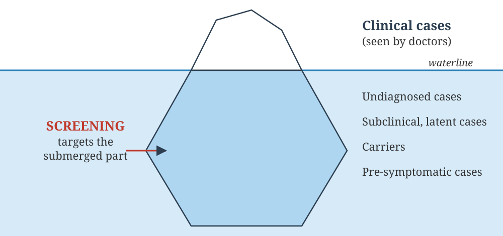
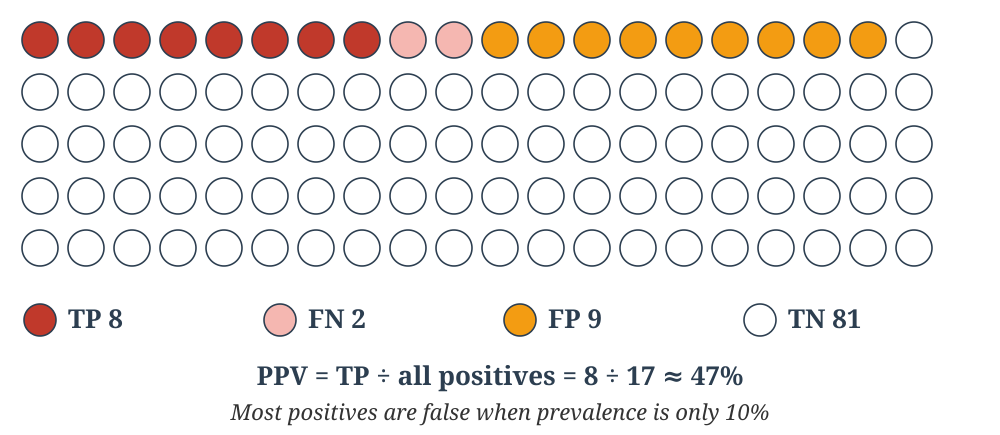
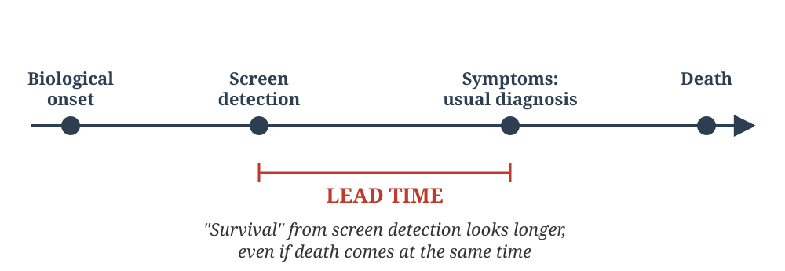

## Welcome {#home}

### Screening for Disease

**Learning Objectives (CM7 Lectures 14–15):**

- Define screening, distinguish it from diagnosis, and state its uses and types
- State the criteria for screening: the disease (Wilson and Jungner) and the test
- Calculate and interpret sensitivity, specificity, PPV, NPV and the false-positive and false-negative rates
- Explain how prevalence affects predictive values, and the effect of series vs parallel testing
- Explain lead time bias, length time bias and overdiagnosis

**NMC Community Medicine Code:** CM7.6

🟢 **MUST KNOW** · 🟡 **SHOULD KNOW** · 🟣 **MAY KNOW** · 🧡 **QUESTION**

::: {.notes}
Applies the incidence/prevalence and 2×2-table thinking from Chapters
3–4 to evaluating a screening test and a screening programme.
:::

---

## Lecture 14: Screening Concept, Uses, and Criteria {background-color="#E6EEF5"}

📚 **Lecture 14 of 15** · **CM7.L14**

*Screening I - concept, uses and criteria*

---

## What Is Screening? {background-color="#E3F2E1"}

🟢 **MUST KNOW**

**Screening** is the search for unrecognized disease or defect in apparently healthy, asymptomatic people, using rapidly applied tests, examinations or other procedures. It sorts out those who *probably* have the disease from those who probably do not.

- It targets the submerged part of the **iceberg of disease**: latent, subclinical and undiagnosed cases (Chapter 2)
- Screening is **not** diagnosis. Everyone who screens positive needs a proper **diagnostic test** to confirm or rule out the condition.
- **Concept of lead time:** screening detects disease between the first possible point of detection and the usual time of clinical diagnosis. It is useful only if earlier treatment improves the outcome.

---

## Screening and the Iceberg of Disease {background-color="#E3F2E1"}

🟢 **MUST KNOW**

{.slide-img .nostretch width="920px"}

---

## Screening vs Diagnostic Test {background-color="#E3F2E1"}

🟢 **MUST KNOW**

| | Screening test | Diagnostic test |
|---|---|---|
| **Applied to** | Groups of apparently healthy people | Single patients with symptoms or a positive screen |
| **Initiated by** | Investigator, agency or programme | The patient seeking care |
| **Test** | Quick, cheap, simple, acceptable | Accurate, often costly or invasive |
| **Accuracy** | Lower; favours sensitivity | Higher; favours specificity |
| **Cut-off** | Based on one criterion | Evaluation of all symptoms, signs and lab findings |
| **Result** | Not a basis for treatment | Basis for treatment |

---

## Uses of Screening {background-color="#E3F2E1"}

🟢 **MUST KNOW**

1. **Case detection (prescriptive screening)**: early detection and treatment for the person's own benefit, e.g. neonatal hypothyroidism, cervical and breast cancer, hypertension
2. **Control of disease (prospective screening)**: protecting others, e.g. screening blood donors, food handlers, immigrants, and contacts of TB
3. **Research purposes**: finding the prevalence and natural history of chronic diseases
4. **Educational opportunity**: creating public awareness and educating health professionals

---

## Types of Screening {background-color="#E3F2E1"}

🟢 **MUST KNOW**

- **Mass screening**: offered to the whole population regardless of individual risk. It is worthwhile only with a common disease and a good follow-up system.
- **High-risk (selective/targeted) screening**: limited to high-risk groups, such as diabetes screening in obese adults or cervical screening in women over 30. It raises yield and PPV.
- **Multiphasic screening**: several tests in one session, as in a health camp checking BP, blood sugar and vision
- **Opportunistic (case-finding) screening**: offered to people already seeking care for another reason, such as BP measurement for every OPD adult over 30

India's population-based screening (NPCDCS/NP-NCD) offers BP, diabetes and oral, breast and cervical cancer screening for people aged 30+.

---

## Wilson and Jungner Criteria (1968) {background-color="#E3F2E1"}

🟢 **MUST KNOW**

WHO's classic principles for deciding whether a condition suits a screening programme:

1. The condition is an **important health problem**
2. There is an **accepted treatment** for recognized disease
3. **Facilities** for diagnosis and treatment are available
4. There is a recognizable **latent or early symptomatic stage**
5. There is a **suitable test** for that stage
6. The test is **acceptable** to the population
7. The **natural history** of the condition is adequately understood
8. There is an agreed **policy on whom to treat**
9. The cost of case-finding is **economically balanced** against overall medical care spending
10. Case-finding is a **continuing process**, not a one-time project

---

## Criteria for the Screening Test {background-color="#FFF6DA"}

🟡 **SHOULD KNOW**

| Criterion | Meaning |
|---|---|
| **Acceptability** | Painless, quick and not embarrassing, so people take it up |
| **Repeatability (reliability)** | Gives consistent results on repetition, by the same or different observers |
| **Validity (accuracy)** | Distinguishes the diseased from the non-diseased: **sensitivity and specificity** |
| **Yield** | The amount of previously unrecognized disease detected and brought to treatment. It rises with prevalence and with high-risk screening. |
| **Simplicity, safety, rapidity, cost** | Suitable for large numbers, by paramedical workers |

---

## Case Scenario: An Oral Cancer Screening Camp {background-color="#FDE8E8"}

🧡 **CASE SCENARIO**

A district plans a camp to screen adults in a **tobacco-chewing community** for oral cancer by **oral visual examination** by trained health workers.

1. Does oral cancer meet the Wilson–Jungner criteria?
2. Is the test suitable?
3. What type of screening is this, and what must be arranged before starting?

---

## Case Scenario: An Oral Cancer Screening Camp, Discussion {background-color="#FDE8E8"}

🧡 **CASE SCENARIO: DISCUSSION**

- **Yes, largely.** It is an **important problem** in India, with a recognizable **early stage** (leukoplakia, erythroplakia, early ulcers), **accepted treatment** and a known **natural history**
- **Oral visual examination** is simple, cheap, painless and **acceptable**. Its validity is moderate, so positives need **biopsy**.
- **High-risk (selective) screening**, which raises yield and PPV. It also fits India's population-based NCD screening for people aged 30 and over.
- Arrange **referral, biopsy and treatment facilities**, an agreed **policy on whom to treat**, and a **continuing** programme rather than a one-off camp

---

## Choosing Between Screening Designs {background-color="#E8E4F3"}

🟣 **MAY KNOW**

Mass screening is efficient for a common, serious and well-understood condition such as raised blood pressure. It is wasteful and potentially harmful for rare conditions, through overdiagnosis, false positives and anxiety. This is why the Wilson–Jungner criteria (importance, natural history, economic balance) must be met before a programme starts, not just the existence of a test.

---

## Practice Questions: Descriptive (Lecture 14) {background-color="#FFF6DA"}

**For written practice — work through these on paper; no auto-check for this slide.**

**Short Essay / Short Answer**

1. Define screening. Describe its uses and the types of screening.
2. Differentiate a screening test from a diagnostic test.
3. Enumerate the criteria for screening (disease and test).

**Short Notes**

4. Wilson and Jungner criteria.
5. Multiphasic screening.
6. Lead time.

---

## Practice Questions: Descriptive (Lecture 14, contd.) {background-color="#FFF6DA"}

**University Examination Questions**

7. Definition of screening.
8. Criteria for a screening test.
9. Types of screening.

---

## Self-Check: Question 1 {background-color="#FDE8E8"}

🧡 **QUESTION**

::: {.quiz-question}
### Question 1

A screening test is applied to an asymptomatic population. A person who tests positive should next:

- Be told they definitely have the disease
- [Undergo a diagnostic test to confirm or rule out disease]{.correct data-explanation="Screening only sorts likely from unlikely disease. A positive screen must always be followed by a diagnostic test before disease is confirmed."}
- Be treated immediately without further testing
- Be excluded from future screening
:::

---

## Self-Check: Question 2 {background-color="#FDE8E8"}

🧡 **QUESTION**

::: {.quiz-question}
### Question 2

Which Wilson–Jungner criterion is violated if there is no accepted treatment for a condition, even if a perfect test for it exists?

- Suitable test
- [Accepted treatment for recognized disease]{.correct data-explanation="An accepted treatment must exist for the disease once detected. Screening without a treatment pathway has little value and can cause harm."}
- Acceptability to the population
- Continuing process
:::

---

## Self-Check: Question 3 {background-color="#FDE8E8"}

🧡 **QUESTION**

::: {.quiz-question}
### Question 3

A health camp offering blood pressure, blood glucose and vision testing together in one visit is an example of:

- Mass screening
- Selective screening
- [Multiphasic screening]{.correct data-explanation="Multiphasic screening applies several different screening tests in one session."}
- Opportunistic screening
:::

---

## Self-Check: Question 4 {background-color="#FDE8E8"}

🧡 **QUESTION**

::: {.quiz-question}
### Question 4

Screening a pregnant woman for anaemia and syphilis at her first antenatal visit, to protect her and her baby, primarily serves which use of screening?

- [Case detection (prescriptive screening)]{.correct data-explanation="Case detection (prescriptive screening) aims at early diagnosis and treatment for the benefit of the individual. Prospective screening protects others, as when screening food handlers or blood donors."}
- Control of disease (prospective screening)
- Research purposes
- Educational opportunity
:::

---

## Self-Check: Question 5 {background-color="#FDE8E8"}

🧡 **QUESTION**

::: {.quiz-question}
### Question 5

Screening of blood donors for HIV and hepatitis B is mainly done for:

- Case detection for the donor’s benefit
- [Control of disease: protecting others (prospective screening)]{.correct data-explanation="The main aim is to protect recipients and the community from infection, which is disease control."}
- Research
- Health education
:::

---

## Self-Check: Question 6 {background-color="#FDE8E8"}

🧡 **QUESTION**

::: {.quiz-question}
### Question 6

Which feature distinguishes a screening test from a diagnostic test?

- Screening is applied to symptomatic patients
- Screening results are the basis for treatment
- [Screening is applied to apparently healthy groups and is less accurate and cheaper]{.correct data-explanation="Screening is applied to apparently healthy groups, is initiated by the investigator or agency, and is quick, cheap and less accurate. It is not a basis for treatment. Diagnostic tests are applied to sick individuals."}
- Screening is initiated by the patient
:::

---

## Self-Check: Question 7 {background-color="#FDE8E8"}

🧡 **QUESTION**

::: {.quiz-question}
### Question 7

Screening offered only to smokers aged over 50 for lung disease is an example of:

- Mass screening
- [High-risk (selective) screening]{.correct data-explanation="Selective or targeted screening limits the test to high-risk groups, which raises the yield and the PPV."}
- Multiphasic screening
- Opportunistic screening
:::

---

## Self-Check: Question 8 {background-color="#FDE8E8"}

🧡 **QUESTION**

::: {.quiz-question}
### Question 8

Which of the following considerations is NOT required when undertaking a screening programme?

- The disease should be a public health problem
- [The disease should be vaccine-preventable]{.correct data-explanation="Vaccine preventability is irrelevant to screening. The Wilson–Jungner criteria require an important problem, an accepted treatment, and diagnostic and treatment facilities."}
- There should be an acceptable and effective treatment
- Facilities for confirming the diagnosis and for treatment should be available
:::

---

## Lecture 15: Sensitivity, Specificity, and Predictive Values {background-color="#E6EEF5"}

📚 **Lecture 15 of 15** · **CM7.L15**

*Screening II - sensitivity, specificity and predictive values*

---

## The Screening 2×2 Table {background-color="#E3F2E1"}

🟢 **MUST KNOW**

Every screening test is judged against a reference ("gold standard") diagnosis:

| | Disease + | Disease − | Total |
|---|---|---|---|
| **Test +** | a: True Positive (TP) | b: False Positive (FP) | a + b |
| **Test −** | c: False Negative (FN) | d: True Negative (TN) | c + d |
| **Total** | a + c | b + d | N |

All the validity measures on the next slides come from this table.

---

## Sensitivity and Specificity {background-color="#E3F2E1"}

🟢 **MUST KNOW**

**Sensitivity** is the ability to correctly identify those who **have** the disease (the true-positive rate):

`Sensitivity = a / (a + c) × 100`  ·  `False-negative rate = c / (a + c) = 1 − sensitivity`

**Specificity** is the ability to correctly identify those who **do not have** the disease (the true-negative rate):

`Specificity = d / (b + d) × 100`  ·  `False-positive rate = b / (b + d) = 1 − specificity`

Both are properties of the **test itself** and do **not** depend on prevalence. A highly sensitive test, when negative, rules disease out (**SnNout**). A highly specific test, when positive, rules disease in (**SpPin**).

---

## Predictive Values {background-color="#E3F2E1"}

🟢 **MUST KNOW**

**Positive Predictive Value (PPV)**: given a positive test, the probability that the person really has the disease:

`PPV = a / (a + b) × 100`

**Negative Predictive Value (NPV)**: given a negative test, the probability that the person is really disease-free:

`NPV = d / (c + d) × 100`

Unlike sensitivity and specificity, predictive values **depend on prevalence**. The same test gives a lower PPV and a higher NPV in a low-prevalence population.

---

## Worked Example: Evaluating a Test {background-color="#E3F2E1"}

🟢 **MUST KNOW**

A test is applied to 1000 people, 100 of whom have the disease (prevalence 10%):

| | Disease + | Disease − | Total |
|---|---|---|---|
| **Test +** | 80 (TP) | 90 (FP) | 170 |
| **Test −** | 20 (FN) | 810 (TN) | 830 |
| **Total** | 100 | 900 | 1000 |

| Measure | Calculation | Result |
|---|---|---|
| Sensitivity | 80/100 | **80%** |
| Specificity | 810/900 | **90%** |
| PPV | 80/170 | **47%** |
| NPV | 810/830 | **97.6%** |
| False-positive rate | 90/900 | 10% |
| False-negative rate | 20/100 | 20% |

---

## Seeing PPV: 100 People Screened {background-color="#E3F2E1"}

🟢 **MUST KNOW**

{.slide-img .nostretch width="920px"}

---

## How Prevalence Changes PPV {background-color="#E3F2E1"}

🟢 **MUST KNOW**

The same test (sensitivity 80%, specificity 90%) is applied to 10,000 people:

| Prevalence | Diseased | TP | FP | **PPV** | NPV |
|---|---|---|---|---|---|
| **1%** | 100 | 80 | 990 | **7.5%** | 99.8% |
| **10%** | 1,000 | 800 | 900 | **47%** | 97.6% |
| **30%** | 3,000 | 2,400 | 700 | **77%** | 91.3% |

- In a low-prevalence population, most positives are **false positives**. Poor specificity then floods services with unnecessary confirmatory tests.
- This is why **high-risk (selective) screening** gives a higher PPV and yield than mass screening

---

## Case Scenario: One HIV Test, Two Populations {background-color="#FDE8E8"}

🧡 **CASE SCENARIO**

A single HIV ELISA has **sensitivity 99.5%** and **specificity 99.8%**. It is used in voluntary blood donors (illustrative prevalence **0.1%**) and in female sex workers (illustrative prevalence **2%**). Take 1,00,000 people in each group.

1. Calculate the PPV in each group.
2. Why do they differ?
3. What should follow a positive result?

---

## Case Scenario: One HIV Test, Two Populations, Discussion {background-color="#FDE8E8"}

🧡 **CASE SCENARIO: DISCUSSION**

- **Blood donors:** 100 infected → TP 99.5. FP = 0.2% of 99,900 ≈ 200. **PPV ≈ 99.5 ÷ 299.5 ≈ 33%**
- **Female sex workers:** 2,000 infected → TP 1,990. FP = 0.2% of 98,000 = 196. **PPV ≈ 1,990 ÷ 2,186 ≈ 91%**
- Same test, but a different **prevalence**. When the disease is rare, false positives outnumber true positives.
- A positive screen needs **confirmatory testing** (series testing: three tests or strategies) before diagnosis or disclosure

---

## Series and Parallel Testing {background-color="#FFF6DA"}

🟡 **SHOULD KNOW**

| | Series (sequential) testing | Parallel (simultaneous) testing |
|---|---|---|
| **Rule** | Positive only if positive on **all** tests | Positive if positive on **any** test |
| **Effect** | ↑ Specificity, ↑ PPV, ↓ sensitivity | ↑ Sensitivity, ↑ NPV, ↓ specificity |
| **Use when** | False positives are costly or harmful (HIV: positive on three tests) | Missing a case is dangerous (emergencies, a serious treatable disease) |

---

## Cut-offs and Likelihood Ratios {background-color="#FFF6DA"}

🟡 **SHOULD KNOW**

**Sensitivity–specificity trade-off:** for a test with a continuous result, the cut-off decides the balance.

- *Example:* IFG cut-off of 100 mg/dl (ADA) vs 110 mg/dl (WHO). The **lower** cut-off catches more true cases, so sensitivity rises. It also adds false positives, so specificity and PPV fall.
- The **ROC curve** plots sensitivity against (1 − specificity) for every cut-off. A larger area under the curve means a better test.

**Likelihood ratios** do not depend on prevalence:

`LR+ = Sensitivity ÷ (1 − Specificity)`  ·  `LR− = (1 − Sensitivity) ÷ Specificity`

An LR+ above 10 strongly rules disease in, and an LR− below 0.1 strongly rules it out. **Youden index** = sensitivity + specificity − 1.

**Use the test to fit the setting:** a COVID rapid antigen test (high specificity, moderate sensitivity) suits diagnosis in *symptomatic* people, where prevalence and PPV are high.

---

## Lead Time {background-color="#FFF6DA"}

🟡 **SHOULD KNOW**

{.slide-img .nostretch width="920px"}

---

## Lead Time Bias {background-color="#FFF6DA"}

🟡 **SHOULD KNOW**

**Lead time** is the interval between detection by screening and the point when the disease would normally have been diagnosed from symptoms.

**Lead time bias** occurs when screening appears to prolong survival only because the survival clock starts earlier. The person actually dies at the same time as they would have without screening.

**Why it matters:** raw comparisons of survival time between screened and unscreened groups are misleading unless lead time is accounted for. Mortality in a randomized trial is the proper end-point.

---

## Length Time Bias and Overdiagnosis {background-color="#FFF6DA"}

🟡 **SHOULD KNOW**

**Length time bias**: screening preferentially detects **slow-growing, less aggressive** disease, because it stays detectable for longer. Fast-growing disease is more likely to cause symptoms and be diagnosed clinically between screening rounds. Screen-detected cases therefore look as though they have better outcomes, whether or not screening helped.

**Overdiagnosis** is the extreme case. Screening detects a genuine abnormality that would **never have caused symptoms or harm** in the person's lifetime, leading to unnecessary labelling and treatment. Examples include some prostate and thyroid cancers.

---

## Practice Questions: Descriptive (Lecture 15) {background-color="#FFF6DA"}

**For written practice — work through these on paper; no auto-check for this slide.**

**Short Essay / Short Answer**

1. Define sensitivity, specificity and predictive values. Explain with a 2 × 2 table.
2. Explain how disease prevalence affects the predictive value of a screening test.

**Short Notes**

3. Series and parallel testing.
4. Lead time bias and length time bias.

**Reasoning Type**

5. Why can screening programmes with poor specificity overload health services?

---

## Practice Questions: Descriptive (Lecture 15, contd.) {background-color="#FFF6DA"}

**Numerical**

6. A new test was applied to 500 persons, 100 of whom had the disease (confirmed by a gold standard). The test was positive in 90 diseased and 40 non-diseased persons. Calculate sensitivity, specificity, PPV, NPV, and the false-positive and false-negative rates.

**University Examination Questions**

7. Sensitivity and specificity.
8. Define the positive predictive value of a screening test.
9. Lead time.

---

## Self-Check: Question 9 {background-color="#FDE8E8"}

🧡 **QUESTION**

::: {.quiz-question}
### Question 9

Which measure of test validity does NOT change with disease prevalence in the population tested?

- Positive predictive value
- Negative predictive value
- [Sensitivity]{.correct data-explanation="Sensitivity and specificity are intrinsic properties of the test and do not depend on prevalence. PPV and NPV do."}
- Both PPV and NPV
:::

---

## Self-Check: Question 10 {background-color="#FDE8E8"}

🧡 **QUESTION**

::: {.quiz-question}
### Question 10

In a screening programme for cervical cancer, many women test positive but are later found disease-free on confirmatory testing. This problem is best explained by low:

- Sensitivity
- [Specificity]{.correct data-explanation="Many false positives mean the test mislabels healthy women as positive, which is low specificity. Specificity = TN/(TN + FP)."}
- Incidence
- Reliability
:::

---

## Self-Check: Question 11 {background-color="#FDE8E8"}

🧡 **QUESTION**

::: {.quiz-question}
### Question 11

A screening test for a fatal disease has very high sensitivity but poor specificity. In a low-prevalence population, the most likely consequence is:

- High positive predictive value
- [Many false positives leading to unnecessary confirmatory testing]{.correct data-explanation="With low prevalence and poor specificity, false positives far outnumber true positives. PPV falls and services are overloaded with confirmatory work-ups."}
- No impact on workload
- Elimination of overdiagnosis
:::

---

## Self-Check: Question 12 {background-color="#FDE8E8"}

🧡 **QUESTION**

::: {.quiz-question}
### Question 12

A test is applied to 1000 people. Of 100 who truly have the disease, 80 test positive. Of 900 without the disease, 90 test positive. The sensitivity and specificity are:

- [80% and 90%]{.correct data-explanation="TP = 80, FN = 20, FP = 90, TN = 810. Sensitivity = 80/100 = 80%. Specificity = 810/900 = 90%."}
- 90% and 80%
- 80% and 10%
- 47% and 98%
:::

---

## Self-Check: Question 13 {background-color="#FDE8E8"}

🧡 **QUESTION**

::: {.quiz-question}
### Question 13

In the same example (TP 80, FP 90, FN 20, TN 810), the positive predictive value is about:

- [47%]{.correct data-explanation="PPV = TP/(TP + FP) = 80/170 ≈ 47%. Less than half of the positives truly have the disease, because prevalence is only 10%. NPV = 810/830 ≈ 98%."}
- 80%
- 90%
- 98%
:::

---

## Self-Check: Question 14 {background-color="#FDE8E8"}

🧡 **QUESTION**

::: {.quiz-question}
### Question 14

Two tests are applied in series, and a person is called positive only if positive on both. Compared with either test alone, series testing:

- Increases sensitivity
- [Increases specificity]{.correct data-explanation="Series (sequential) testing raises specificity and PPV but lowers sensitivity. Parallel testing (positive on either) raises sensitivity but lowers specificity."}
- Increases both
- Decreases both
:::

---

## Self-Check: Question 15 {background-color="#FDE8E8"}

🧡 **QUESTION**

::: {.quiz-question}
### Question 15

Screened patients appear to survive longer after diagnosis simply because their disease was detected earlier in its course, even though they die at the same time as without screening. This is:

- Length time bias
- [Lead time bias]{.correct data-explanation="Lead time bias occurs when the interval between screen detection and clinical diagnosis is counted as extra survival time, with no true survival benefit."}
- Overdiagnosis
- Selection bias
:::

---

## Self-Check: Question 16 {background-color="#FDE8E8"}

🧡 **QUESTION**

::: {.quiz-question}
### Question 16

Detection, through screening, of a genuine abnormality that would never have caused symptoms or harm in a person’s lifetime is called:

- Lead time bias
- Length time bias
- [Overdiagnosis]{.correct data-explanation="Overdiagnosis is the detection of disease that would never have progressed to cause harm. It is an extreme consequence of length-biased detection."}
- False positive
:::

---

## Self-Check: Question 17 {background-color="#FDE8E8"}

🧡 **QUESTION**

::: {.quiz-question}
### Question 17

What is the numerator in calculating the sensitivity of a test?

- [True positives]{.correct data-explanation="Sensitivity = TP/(TP + FN)."}
- True negatives
- False positives
- False negatives
:::

---

## Self-Check: Question 18 {background-color="#FDE8E8"}

🧡 **QUESTION**

::: {.quiz-question}
### Question 18

What is the denominator for calculating the specificity of a test?

- True positives and true negatives
- [True negatives and false positives]{.correct data-explanation="Specificity = TN/(TN + FP). The denominator is all people without the disease."}
- False positives and false negatives
- False negatives and true positives
:::

---

## Self-Check: Question 19 {background-color="#FDE8E8"}

🧡 **QUESTION**

::: {.quiz-question}
### Question 19

Which test is preferred for ruling IN a disease?

- Highly sensitive test
- Low-specificity test
- [Highly specific test]{.correct data-explanation="SpPin: a positive result on a highly Specific test rules the disease in, because false positives are rare. SnNout: a negative result on a highly Sensitive test rules it out."}
- None of these
:::

---

## Self-Check: Question 20 {background-color="#FDE8E8"}

🧡 **QUESTION**

::: {.quiz-question}
### Question 20

Which of the following is a fixed parameter of a screening test?

- [Sensitivity]{.correct data-explanation="Sensitivity and specificity are intrinsic to the test at a given cut-off. Predictive values change with prevalence."}
- Negative predictive value
- Positive predictive value
- None of these
:::

---

## Self-Check: Question 21 {background-color="#FDE8E8"}

🧡 **QUESTION**

::: {.quiz-question}
### Question 21

The predictive value of a screening test depends on:

- [Prevalence]{.correct data-explanation="The textbook&#x27;s answer is prevalence, the factor that changes predictive values for the same test. Strictly, PPV and NPV also depend on sensitivity and specificity."}
- Sensitivity
- Health worker
- None of these
:::

---

## Self-Check: Question 22 {background-color="#FDE8E8"}

🧡 **QUESTION**

::: {.quiz-question}
### Question 22

The WHO cut-off for impaired fasting glucose is 110 mg/dl, while the American Diabetes Association uses 100 mg/dl. Using the lower (ADA) cut-off instead of the WHO one will:

- [Increase sensitivity]{.correct data-explanation="A lower cut-off labels more people positive. Fewer true cases are missed, so sensitivity rises, while more false positives lower specificity and PPV. (The textbook prints “International Diabetes Association” for ADA.)"}
- Increase specificity
- Increase the positive predictive value
- Cause no change
:::

---

## Self-Check: Question 23 {background-color="#FDE8E8"}

🧡 **QUESTION**

::: {.quiz-question}
### Question 23

A COVID-19 Rapid Antigen Test has very high specificity but only moderate sensitivity. It is therefore most appropriate for:

- [Diagnosis of COVID-19 in persons with influenza-like symptoms]{.correct data-explanation="With high specificity, a positive result is reliable (SpPin). Among symptomatic people the prevalence is high, so PPV is high too. With only moderate sensitivity, it would miss many infections in low-prevalence asymptomatic groups. (The textbook&#x27;s stem prints “specificity” twice. The second should read “sensitivity”.)"}
- Diagnosis of COVID-19 in asymptomatic persons
- Screening asymptomatic contacts of confirmed patients
- Surveillance of COVID-19 in the general population
:::

---

## Self-Check: Question 24 {background-color="#FDE8E8"}

🧡 **QUESTION**

::: {.quiz-question}
### Question 24

A single ELISA test for HIV will have the highest positive predictive value in which group?

- Voluntary blood donors
- Antenatal women
- [Female sex workers]{.correct data-explanation="PPV rises with prevalence. Of these groups, HIV prevalence is highest among female sex workers."}
- Patients with herpes zoster
:::

---

## Self-Check: Question 25 {background-color="#FDE8E8"}

🧡 **QUESTION**

::: {.quiz-question}
### Question 25

The “positive likelihood ratio” of a screening test is calculated as:

- Specificity ÷ (1 − sensitivity)
- [Sensitivity ÷ (1 − specificity)]{.correct data-explanation="LR+ = sensitivity/(1 − specificity), the true-positive rate divided by the false-positive rate. LR− = (1 − sensitivity)/specificity."}
- (1 − specificity) ÷ specificity
- (1 − sensitivity) ÷ specificity
:::

---

## References {background-color="#FFF6DA"}

1. Wilson, J.M.G., Jungner, G. (1968). *Principles and Practice of Screening for Disease*. WHO Public Health Papers No. 34.
2. Park, K. *Park's Textbook of Preventive and Social Medicine* (latest ed.): screening for disease (uses, types, criteria, sensitivity, specificity, predictive values, series and parallel testing).
3. Faculty question bank, Section V, Chapter 19 *Principles and Practice of Epidemiology*: screening MCQs and reasoning questions.
4. StatPearls. *Diagnostic Testing Accuracy: Sensitivity, Specificity, Predictive Values and Likelihood Ratios*.
5. Catalog of Bias. "Lead time bias"; NCI / NCBI Bookshelf. *Assessment of cancer screening: a primer*.

**Want to practice?** The [Epidemiology Question Bank](epidemiology-question-bank.qmd) has every question from this chapter with answer keys.

---

## Thank You!

**Next Chapter:** Epidemiology of Communicable Diseases (CM7 Lectures 10–13)

[← Previous](epidemiologic-methods.html) | [Top](#home) | [Contents](../intro.html) | Chapter 5/29 | [Next Chapter →](../diseases/communicable-diseases.html)
